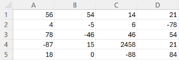

# 10. Matrius
## 10.1 Definició

Les matrius són **llistes de llistes**. Podem pensar en les matrius de 2 dimensions com les cel·les d'un full de càlcul (files i columnes).



```python
llista1 = [54, -9, 64, 44]
llista2 = [-6, 0, 14, 24]
matriu1 = [llista1 , llista2]

matriu2 =[
    ['a', 'b', 'c'],   # fila 0
    ['x', 'y', 'z']    # fila 1
]
print(matriu2)
print(matriu2[1])
print(matriu2[0][2])
```

### Matrius de 3 dimensions

Es pot treballar també amb matrius 3D. La seua gestió comença a complicar-se a l'haver de treballar amb 3 coordinades.

```python
# Crear una matriu 3D (2x3x4) utilitzant llistes niades
matriu3d = [
    [[1, 2, 3, 4], [5, 6, 7, 8], [9, 10, 11, 12]],         # matriu 0
    [[13, 14, 15, 16], [17, 18, 19, 20], [21, 22, 23, 24]] # matriu 1
]

# Accés als diferents elements
print(matriu3d[0][1][2]) # columna 2 de la fila 1 de la matriu 0
print(matriu3d[0][1])    # fila 1 de la matriu 0
print(matriu3d[0])       # matriu 0
print(matriu3d)          # matriu 3D
```

### Matrius de més dimensions

Podem crear matrius amb totes les dimensión que vulguem, però rarament necessitarem matrius de 4D, 5D, ... i la seua manipulació serà un veritable mal de cap.

```python
matriu4d = [
    [[[1, 2, 3, 4], [5, 6, 7, 8], [9, 10, 11, 12]],
     [[13, 14, 15, 16], [17, 18, 19, 20], [21, 22, 23, 24]]
    ],
    [[[1, 2, 3, 4], [5, 6, 7, 8], [9, 10, 11, 12]],
     [[13, 14, 15, 16], [17, 18, 19, 20], [21, 22, 23, 24]]
    ]
]
```

Si realment necessitem matrius amb tantes dimensions, potser la solució passa per replantejar-se la solució al problema i utilitzar altres formes de gestió de dades.

---
## EXERCICI: "Hundir la flota"

<div style="display: flex; justify-content: center; align-items: center; gap: 10px;">
        
</div>
<br>

Implementa la programació del joc **"Hundir la flota"**. Es tracta d'un joc on la representació de les dades en format matricial és la solució més típica.

No crearem un joc completament funcional, simplement utilitzarem matrius per a representar la disposició dels vaixells en el tauler.

Els passos a seguir seran:

- Pas 1: Crear el tauler buit
- Pas 2: Omplir el tauler amb vaixells
- Pas 3: Mostrar el tauler bàsic
- Pas 4: Mostrar el tauler amb coordenades

La solució es basarà en la representació del tauler (el mar) com una matriu de `x` files per `y` columnes, on guardarem la posició dels vaixells com `1` i els espais sense vaixells com `0`.

**Exemple**
```python
tablero = [
[0, 0, 0], # Fila 0
[0, 1, 0], # Fila 1
[0, 0, 0]  # Fila 2
]

# Recòrrer una matriu de 3x3 amb 2 bucles for niats
for i in range(3):      # Files
    for j in range(3):  # Columnes
        print(tablero[i][j], end=" ")
    print() # Nova línia per a la següent fila
```

```text
0 0 0
0 1 0
0 0 0
```

### Pas 1: funció `crear_tablero`

Defineix una funció `crear_tablero` que cree un tauler buit:

- Estarà ple de `0`s (indica aigua, que no hi ha cap vaixell)
- La funció tindrà un paràmetre d'entrada que serà la dimensió del tauler
- El tauler sempre serà un tauler quadrat, de 3x3, 5x5, 11x11 …
- Retornarà una matriu que inclou el tauler

Exemple de `print()` d'un tauler de 5x5:

```text
[[0, 0, 0, 0, 0], [0, 0, 0, 0, 0], [0, 0, 0, 0, 0], [0, 0, 0, 0, 0], [0, 0, 0, 0, 0]]
```


### Pas 2: funció `rellenar_tablero`

Crea una funció anomenada `rellenar_tablero` que:

- No té paràmetres d'entrada
- Pregunte a l'usuari pel tamany del tauler a crear i el genere utilitzant la funció `crear_tablero` anterior
- Demane a l'usuari, coordenada per coordenada, si vol col·locar un vaixell
- Retorne la matriu del tauler emplenat de vaixells

Exemple d'ús:

```python
tablero = rellenar_tablero()
```

Pistes:

- Usa `input()` per a preguntar: `"Fila 2, Columna 3 - ¿Colocar barco? (s/n)"`
- Convertix la resposta positiva a un `1` i actualitza el tauler
- `len(matriu)` retorna el nombre de files d'una matriu
- `len(matriu[x])` retorna el nombre de columnes de la fila `x` d'una matriu

Exemple d'execució:

```text
¿Dimensión del tablero?: 3
Fila 0, Columna 0 - ¿Colocar barco? (s/n): s
Fila 0, Columna 1 - ¿Colocar barco? (s/n): s
Fila 0, Columna 2 - ¿Colocar barco? (s/n): n
Fila 1, Columna 0 - ¿Colocar barco? (s/n): n
Fila 1, Columna 1 - ¿Colocar barco? (s/n): s
Fila 1, Columna 2 - ¿Colocar barco? (s/n): s
Fila 2, Columna 0 - ¿Colocar barco? (s/n): s
Fila 2, Columna 1 - ¿Colocar barco? (s/n): s
Fila 2, Columna 2 - ¿Colocar barco? (s/n): n
```

Resultat del `print()` del tauler:

```text
[[1, 1, 0], [0, 1, 1], [1, 1, 0]]
```

### Pas 3: funció `muestra_tablero`

Crearem una funció anomenada `muestra_tablero` que:

- Accepte un tauler com a paràmetre d'entrada
- Recòrrega el tauler
- Mostre cada cel·la com `X` si hi ha un vaixell i com `~` si és aigua

Exemple tauler 5x5:

```text
X X X ~ ~
~ ~ X ~ X
X X ~ ~ ~
X X ~ ~ ~
X X ~ ~ ~
```

### Pas 4: mostrar el tauler amb coordenades

Crearem una nova funció, modificant l'anterior, que mostre el tauler de la següent forma.

Tauler 3x3:

```text
   A B C
1 |X|~|~|
2 |~|X|X|
3 |~|X|X|
```

Tauler 5x5:

```text
   A B C D E
1 |X|X|X|~|~|
2 |~|~|X|~|X|
3 |X|X|~|~|~|
4 |X|X|~|~|~|
5 |X|X|~|~|~|
```

Pistes:

- S'ha d'adaptar als diferents possibles tamanys dels taulers
- Intenta primer aconseguir la visualització amb només les barres horitzontals
- Després passes ja a incloure les lletres i els números de les capçaleres
- Recorda l'ús de la funció `chr()` i pensa com et podria servir

1r només les barres:
```text
|X|X|X|~|~|
|~|~|X|~|X|
|X|X|~|~|~|
|X|X|~|~|~|
|X|X|~|~|~|
```

Una vegada tingues l'anterior, crees les capçaleres:

```text
   A B C D E
1 |X|X|X|~|~|
2 |~|~|X|~|X|
3 |X|X|~|~|~|
4 |X|X|~|~|~|
5 |X|X|~|~|~|
```
