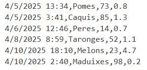
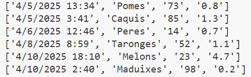
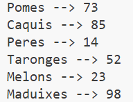
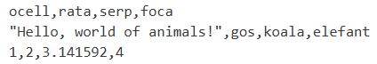
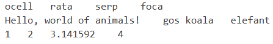
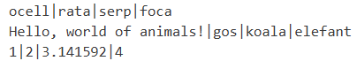

# 11. Gestió de dades en arxius
## 11.1 Lectura de dades d'un CSV

Un arxiu CSV (*Comma Separated Values*) conté dades organitzades per files en les quals la informació se separa normalment mitjançant comes (encara que es poden utilitzar altres caràcters de separació). S'solen utilitzar molt en informàtica per a guardar i processar gran quantitat de dades, ja que són fitxers que ocupen molt poc (arxius de text pla) i que són compatibles amb totes les plataformes (Windows, MacOS, Linux …).

L'exemple següent mostra un arxiu que emmagatzema informació sobre una comanda de fruites. Cada fila conté, separat per comes `,`:

- la data i hora de la comanda
- la fruita
- un enter que indica la quantitat de peces sol·licitades
- un nombre real que és el preu per unitat d'aquesta fruita



Si volem llegir i processar les dades d'un arxiu CSV necessitem realitzar els següents passos:

1.  Importar el mòdul `csv` que ens permetrà usar funcions específiques per al processament d'arxius CSV
2.  Obrir l'arxiu CSV que volem processar mitjançant la funció incorporada `open()` i guardar l'objecte que aquesta crea en una variable
3.  Utilitzar la funció `csv.reader()` sobre la variable creada per a obtindre un `objeto` de tipus `reader` que podrem iterar per a anar llegint fila a fila tot l'arxiu CSV

``` python
import csv
arxiu = open('fruites.csv')
arxiu_reader = csv.reader(arxiu)
```

Una vegada creat l'objecte iterable, el podem recórrer amb un bucle `for-in` que ens tornarà, en cada iteració del bucle, **una llista amb les dades de cada fila**.

``` python
for fila in arxiu_reader:
    print(str(fila))
```



La llista `fila`, en cada iteració, contindrà la informació d'una de les fruites de la comanda. Podem accedir als diferents valors de la llista mitjançant indexació per a extraure les dades que ens interessen.

``` python
for fila in arxiu_reader:
    fruita = fila[1]
    unitats = int(fila[2])    
    print(fruita + ' --> ' + str(unitats))
```



En funció del tipus de dades, haurem de fer el canvi de tipus corresponent per a poder tractar les dades correctament (`int()`, `str()`, `float()` …).

És important saber que **només es pot iterar l'objecte reader una vegada**. Per a tornar a llegir l'arxiu CSV, s'ha de tornar a cridar a `open()` i `csv.reader()` per a crear un altre objecte `reader`.

Una precaució que s'ha de tindre quan es treballa amb arxius, és tancar qualsevol referència a aquests una vegada acabem de processar-los (en llegir-los i especialment en escriure'ls). Per a això simplement cridarem al mètode `close()` de l'objecte sobre el qual es va obrir l'arxiu.

``` python
arxiu.close()
```

## 11.2 Escriptura de dades en un CSV

Si volem guardar dades utilitzades pel nostre programa *Python* per a un posterior processament o per a compartir-les, podem emmagatzemar-les en un fitxer CSV.

Els passos que haurem de seguir són:

1.  Importar el mòdul `csv` que ens permetrà usar funcions específiques per al processament d'arxius CSV
2.  Obrir **en mode escriptura** `'w'` l'arxiu CSV en el qual volem guardar les dades mitjançant la funció `open(archivo, ‘w’, newline=’’)` i guardar l'objecte que aquesta crea en una variable
3.  Utilitzar la funció `csv.writer()` sobre la variable creada per a obtindre un `objeto` de tipus `writer` que podrem usar per a anar guardant llistes (línia a línia).

``` python
import csv
arxiu = open('animals.csv', 'w', newline='')
arxiu_writer = csv.writer(arxiu)
```

**En Windows**, s'ha de passar una cadena en blanc com a argument de `newline=’’` en la funció `open()`. Si s'oblida això, les files de l'arxiu CSV es mostraran a doble espai.

Una vegada creat l'objecte `writer`, utilitzarem la seua funció `writerow()` per a emmagatzemar una llista en l'última fila de l'arxiu.

``` python
arxiu_writer.writerow(['ocell', 'rata', 'serp', 'foca'])
arxiu_writer.writerow(['Hello, world of animals!', 'gos', 'koala', 'elefant'])
arxiu_writer.writerow([1, 2, 3.141592, 4])
arxiu.close()
```



D'aquesta manera, els valors de la llista es guardaran separats per comes `,`. Recordeu que **és molt important tancar l'ús de l'arxiu** una vegada acabeu d'usar-lo `close()`. En alguns llenguatges de programació és just en aquest moment en el qual l'arxiu s'actualitza amb els canvis realitzats. Per la qual cosa és bona pràctica acostumar-se a tancar-lo sempre, amb independència del llenguatge usat.

Si en lloc de tindre els valors del CSV separats per comes `,` els voleu guardar amb un altre delimitador, podeu indicar-ho amb la propietat `delimiter` de la crida a `csv.writer()`.

``` python
arxiu_tab = open('animals_tab.csv', 'w', newline='')
arxiu_writer = csv.writer(arxiu_tab, delimiter='\t')
arxiu_writer.writerow(['ocell', 'rata', 'serp', 'foca'])
arxiu_writer.writerow(['Hello, world of animals!', 'gos', 'koala', 'elefant'])
arxiu_writer.writerow([1, 2, 3.141592, 4])
arxiu_tab.close()
```



``` python
arxiu_linia = open('animals_linia.csv', 'w', newline='')
arxiu_writer = csv.writer(arxiu_linia, delimiter='|')
arxiu_writer.writerow(['ocell', 'rata', 'serp', 'foca'])
arxiu_writer.writerow(['Hello, world of animals!', 'gos', 'koala', 'elefant'])
arxiu_writer.writerow([1, 2, 3.141592, 4])
arxiu_linia.close()
```



