# 12 Manipulació d'imatges

**Pillow (`PIL`)** és un paquet de Python de tercers (*third-party*) per a interactuar amb arxius d'imatge. Aquest paquet compta amb diverses funcions que faciliten retallar, redimensionar i editar el contingut d'una imatge. Per a poder fer-ho, importarem solament el mòdul `Image` de la llibreria.

``` python
from PIL import Image
imatge_gat = Image.open('zophie.png')
imatge_gat.show()
```

Mitjançant la funció `open()` d'`Image` crearem un `objeto` de tipus imatge a partir d'un arxiu emmagatzemat en l'ordinador. Els diferents mètodes i atributs d'aquest `objeto` ens permetran modificar la imatge. Per exemple, mostrarem la imatge carregada mitjançant la funció `show()`.

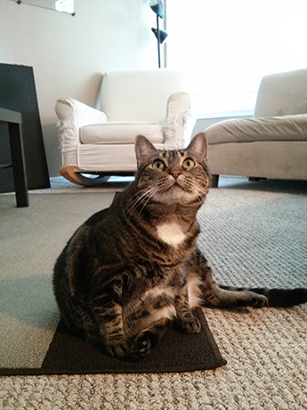

## 12.1 Característiques de les imatges

Podem accedir als atributs de nom, format i grandària de la imatge de la següent manera.

``` python
print('Nom: ' + imatge_gat.filename)
print('Format: ' + imatge_gat.format)
ample, alt = imatge_gat.size
print('Ample =', ample, ' / Alt =', alt)
#Guardem en un altre format (jpg)
imatge_gat.save('zophie.jpg')
```

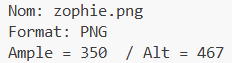

Com veiem, es pot guardar la imatge en un format diferent mitjançant `save()`.

En *Python*, els píxels d'una imatge s'adrecen mitjançant les coordenades `x` i `y`, que especifiquen, respectivament, la seua posició horitzontal i vertical. L'origen és el píxel en la cantonada superior esquerra de la imatge i s'especifica amb la notació `(0, 0)`.

<div style="display: flex; justify-content: center; align-items: center; gap: 10px;">
    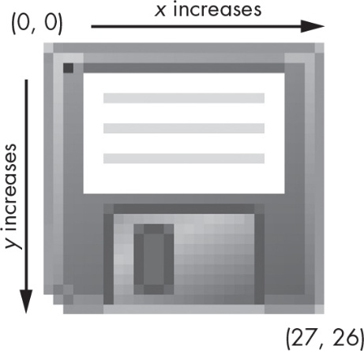    
    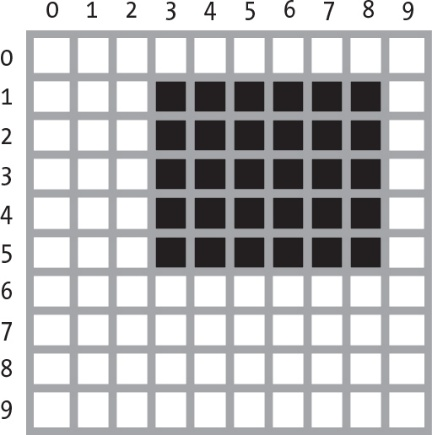
</div>
<br>

El primer `0` representa la coordenada `x`, que comença en `0` a l'origen i augmenta d'esquerra a dreta. El segon `0` representa la coordenada `y`, que comença en `0` a l'origen i augmenta cap avall, la qual cosa és contrària a com s'expliquen normalment a la classe de matemàtiques.

Moltes de les funcions de `Pillow` prenen com a argument una `tupla` de caixa (recorda que una `tupla` és “com una llista”, però immutable). Això significa que `Pillow` espera una `tupla` de quatre coordenades enteres que representen una regió rectangular en una imatge. Els quatre enters són, en ordre, els següents:

- `Left`: La coordenada `x` de la vora més a l'esquerra de la caixa
- `Top`: La coordenada `y` de la vora superior de la caixa
- `Right`: La coordenada `x` d'un píxel a la dreta de la vora més a la dreta de la caixa. Aquest enter ha de ser major que l'enter esquerre
- `Bottom`: La coordenada `y` d'un píxel per davall de la vora inferior de la caixa. Aquest enter ha de ser major que l'enter superior

Cal tindre en compte que la caixa inclou les coordenades esquerra i superior, i arriba fins a, però no inclou, les coordenades dreta i inferior. Per exemple, la `tupla` de caixa `(3, 1, 9, 6)` representa tots els píxels de la caixa negra de la figura anterior.

## 12.2 Retallar, copiar i apegar

Una vegada coneixem la manera de referenciar els píxels d'una imatge en *Python*, podem retallar una imatge mitjançant la funció `crop()`, passant-li la caixa a tallar amb una `tupla` de la següent manera.

``` python
#Creem una nova a partir d'un tall de l'original
imatge_cara = imatge_gat.crop((150, 150, 240, 250))
imatge_cara.save('tallada.png')
imatge_cara.show()
```

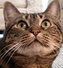

La imatge retallada podem, per exemple, apegar-la en diferents llocs de la imatge original. Ho farem sobre una còpia de l'original, creada mitjançant la funció `copy()`, per a així mantindre l'original sense canvis.

``` python
#Pega la cara tallada sobre una còpia de la imatge original
copia_gat = imatge_gat.copy()
copia_gat.paste(imatge_cara, (0, 0))
copia_gat.paste(imatge_cara, (250, 250))
copia_gat.save('pegada.png')
copia_gat.show()
```
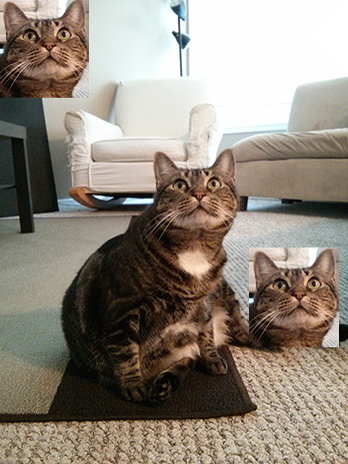

La funció `paste()` permet apegar una imatge sobre una altra, definint el píxel inicial a partir del qual s'apegarà mitjançant una `tupla` de 2 punts `(x, y)`.

Jugant amb la funció `paste()` i 2 bucles `for` aniuats, podem aconseguir un mosaic de cares de gats sobre una còpia de la imatge original.

``` python
# Crea un mosaic de cares damunt la imatge original
ample_cara, alt_cara = imatge_cara.size
mosaic_gat = imatge_gat.copy()
#for left in range(0, ample, ample_cara):
for left in range(0, 3*ample_cara, ample_cara):    
    for top in range(0, alt, alt_cara):
        print(left, top)
        mosaic_gat.paste(imatge_cara, (left, top))
mosaic_gat.show()
mosaic_gat.save('mosaic.png')
```

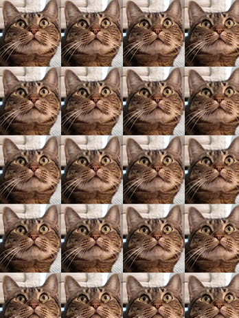

En aquest exemple utilitzem l'ample/alt de la imatge original `(ample, alt)` i el de la imatge de la cara `(ample_cara, alt_cara)` per a definir els valors `left/top` a partir dels quals s'apegarà cadascuna de les cares. El primer `for` recorrerà les files del mosaic, mentre que el `for` aniuat recorrerà les columnes:

- `range(0, ample, ample_cara)`: comença en el píxel horitzontal `0`, arriba a l'últim píxel de l'ample de la imatge original, incrementant en un nombre de píxels igual a l'ample de la imatge de la cara.

- `range(0, alt, alt_cara)`: comença en el píxel vertical `0`, arriba a l'últim píxel de l'alt de la imatge original, incrementant en un nombre de píxels igual a l'alt de la imatge de la cara.

A mesura que es van realitzant iteracions completes del bucle aniuat, la imatge final anirà canviant de la següent manera.

| 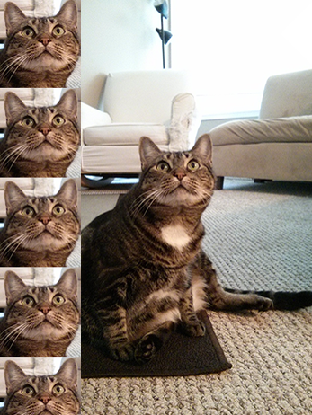 | 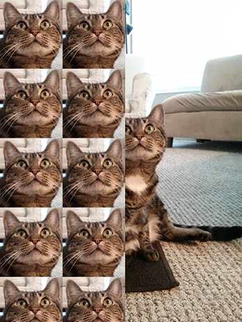 | 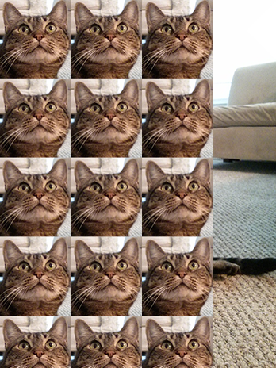 |
|----------------------------------------------------------------------------|----------------------------------------------------------------------------|----------------------------------------------------------------------------|
| **left = 0**                                                               | **left = ample_cara**                                                      | **left = 2\*ample_cara**                                                   |

## 12.3 Redimensionar i rotar

Les funcions `resize()` i `rotate()` ens permeten canviar la grandària d'una imatge i rotar-la respectivament.

``` python
# Canvia el tamany
imatge_reduida = imatge_gat.resize((int(ample / 2), int(alt / 2)))
imatge_reduida.show()
imatge_reduida.save('reduida.png')
```

El mètode `resize()` torna un **nou objecte `Image`** amb l'ample i alt especificats (no modifica l'Image original). Accepta una `tupla` de dos enters que representa les noves dimensions. Com que només accepta nombres enters, és necessari convertir ambdues dimensions mitjançant `int()`.

Per a assegurar la proporcionalitat de la imatge resultant, és convenient que les noves dimensions siguen múltiples de l'ample/alt original (d'ací l'ús d'`ample/2` i `alt/2` en aquest exemple).

Si el que volem fer és rotar una imatge, el mètode `rotate()` torna un **nou objecte `Image`** i deixa l'original sense canvis. El mètode accepta un enter o `float` que representa el nombre de graus que es rotarà la imatge en sentit antihorari.

``` python
# Rotar imatges
imatge_gat.rotate(90).save('rotada90.png')
imatge_gat.rotate(180).save('rotada180.png')
imatge_gat.rotate(6).save('rotada6.png')
imatge_gat.rotate(6, expand=True).save('rotada6_expandida.png')
```

Com veiem, es poden encadenar crides de mètode cridant a `save()` directament en l'objecte `Image` tornat des de `rotate()`, sense necessitat de guardar-lo en una variable intermèdia. Les imatges obtingudes són les següents.

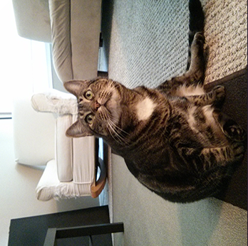

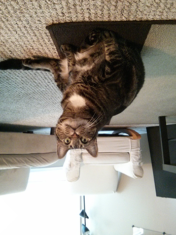

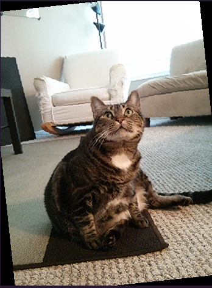

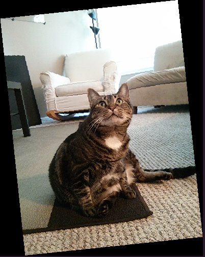

El mètode `rotate()` té l'argument opcional `expand`, que es pot establir a `True` per a ampliar les dimensions de la imatge i que s'ajuste a tota la nova imatge rotada.

Recordeu que, una vegada finalitzem el tractament de les imatges, és convenient tancar tots els objectes `Image`.

``` python
#Tanca totes les imatges
mosaic_gat.close()
imatge_reduida.close()
copia_gat.close()
imatge_cara.close()
imatge_gat.close()
```

---
## EXERCICI
Crea, a partir de les 2 imatges proporcionades, una nova que mostre exactament el muntatge final.

**Imatges inicials:**
<div style="display: flex; justify-content: center; align-items: center; gap: 10px;">
    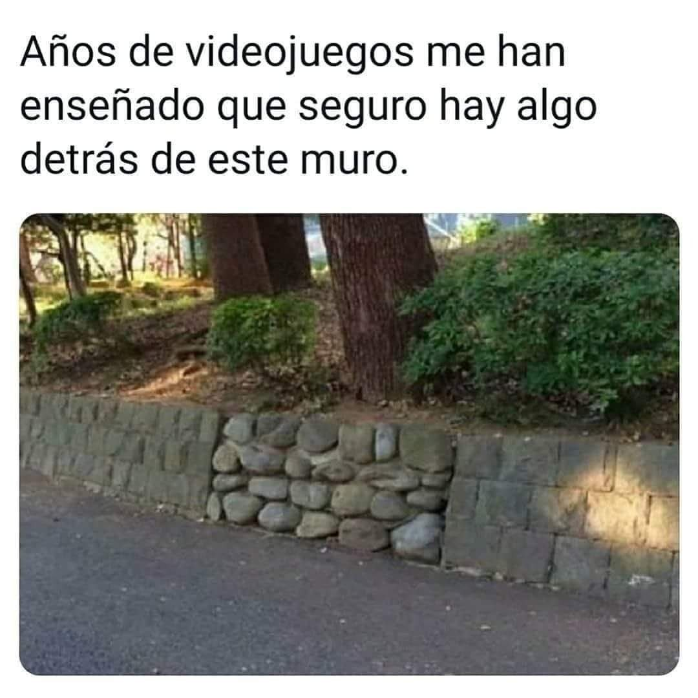    
    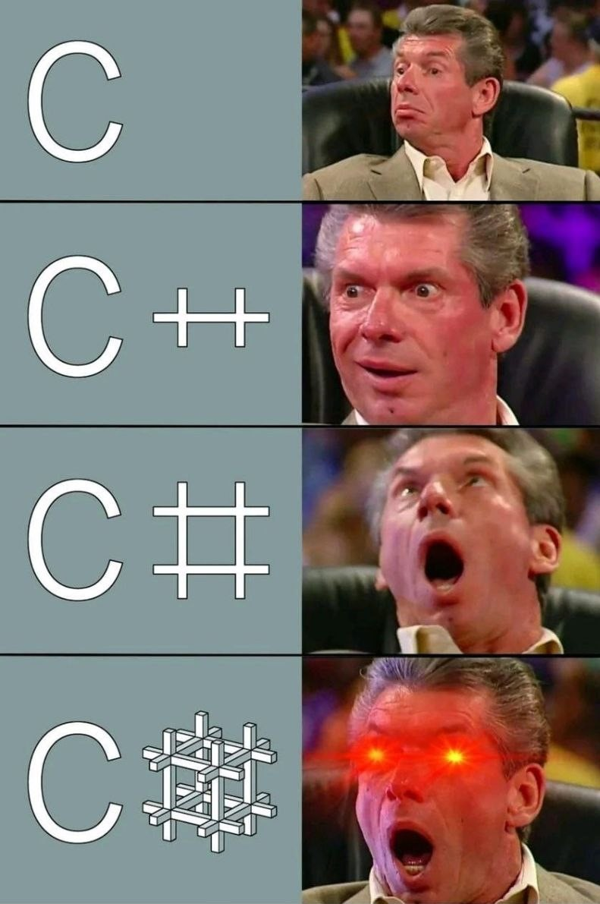
</div>

**Resultat:**
<div style="display: flex; justify-content: center; align-items: center; gap: 10px;">    
    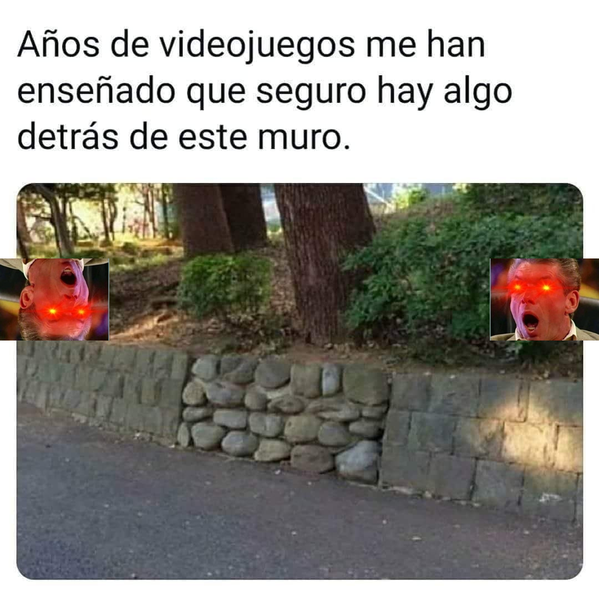
</div>