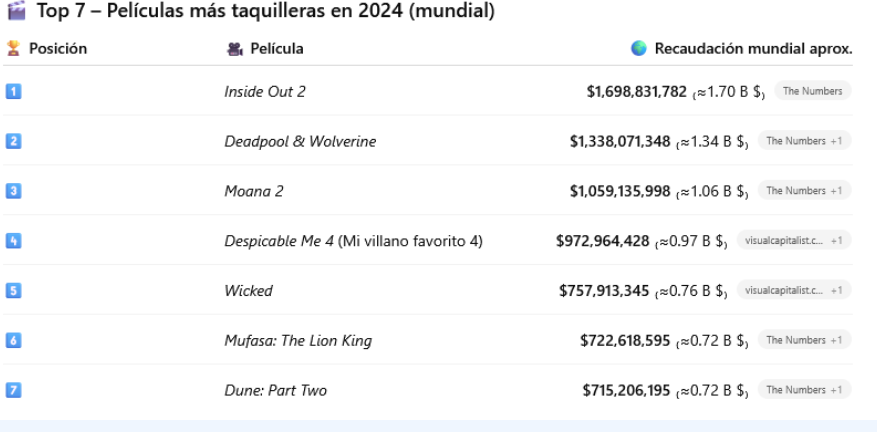
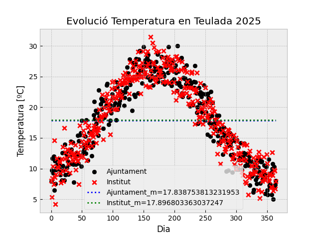

# 13 Creació de gràfiques

La biblioteca *Matplotlib* permet crear una àmplia varietat de gràfics (gràfics de línies, de barres, de dispersió, circulars bàsics, 3D …). Podeu trobar la documentació completa en [https://matplotlib.org](https://matplotlib.org). Depenent del Sistema Operatiu i la configuració de *Python*, haureu de seguir uns passos per a la [instal·lació](https://matplotlib.org/stable/install/index.html) de *Matplotlib*.

## 13.1 Línies i Dispersió

Un gràfic de línies és ideal per a mostrar els canvis en una mesura al llarg del temps. En *Matplotlib*, els termes `plot`, `graph` i `chart` s'usen indistintament, i el terme `figure` es refereix a la finestra que conté un o més gràfics.

Importem `matplotlib.pyplot` amb el nom `plt` per a facilitar la introducció de les seues funcions.

A continuació, per a representar els **punts de dades en una figura 2D**, hem de cridar a la funció `plt.plot()`. Primer associarem al gràfic els valors per als eixos horitzontal/vertical guardats en `x` i `y1`. Després de cridar a `plt.plot()` amb aquests valors, l'invoquem una segona vegada amb `x` ​​i `y2` per a afegir una segona línia al gràfic.

``` python
import matplotlib.pyplot as plt
x = [0, 1, 2, 3, 4, 5]
y1 = [10, 13, 15, 18, 16, 20]
y2 = [9, 11, 18, 16, 17, 19]
plt.plot(x, y1)
plt.plot(x, y2)
# Per guardar un fitxer d'imatge del gràfic, heu de cridar 
# plt.savefig() abans de cridar a plt.show()
plt.savefig('linies.png')  
plt.show() 
```

*Matplotlib* seleccionarà automàticament els colors de les línies i una grandària adequada per al gràfic. Podem guardar el gràfic predeterminat com una imatge PNG cridant a `plt.savefig()`.


*Matplotlib* compta amb la funció `plt.show()` de vista prèvia que mostra el gràfic en una finestra. Cal remarcar que, si volem guardar el gràfic, hem de fer-ho abans de cridar a la funció `plt.show()`. La crida a la funció bloquejarà l'execució del codi i no tornarà fins que l'usuari tanque la finestra.

Per a crear un **gràfic de dispersió** d'aquestes mateixes dades, passeu els valors de l'eix `x` i de l'eix `y` a la funció `plt.scatter()`.

``` python
# Gràfica Scatter
plt.scatter(x, y1)
plt.scatter(x, y2)
plt.savefig('scatter.png')
plt.show()
```


## 13.2 Barres i gràfics circulars

Els **gràfics de barres** són útils per a comparar el mateix tipus de dades en diferents categories. A diferència d'un gràfic de línies, l'ordre de les categories no és important, encara que solen estar ordenades alfabèticament.

``` python
# Barres
categories = ['Gats', 'Gossos', 'Ratolins', 'Pardals']
valors = [100, 150, 30, 200]
plt.bar(categories, valors)
plt.savefig('barres.png')
plt.show()
```

Passem les categories a enumerar en l'eix `x` com la primera llista a `plt.bar()` i els valors per a cada categoria com la segona llista.


Per a crear un gràfic circular, utilitzarem la funció `plt.pie()`. En lloc de categories i valors, un gràfic circular té sectors i etiquetes. La funció `plt.pie()` accepta una llista de grandàries de porció i una llista d'etiquetes per a cada porció.

``` python
# Gràfic Circular
porcions = [100, 150, 30, 200]  # El tamany de cada porció
etiquetes = ['Gats', 'Gossos', 'Ratolins', 'Pardals'] 
plt.pie(porcions, labels=etiquetes)
plt.savefig('tarta.png')
plt.show()
```

El primer argument posicional de `plt.pie()` fa referència a les porcions `x` (`porcions` en aquest exemple), però el segon no fa referència a les etiquetes, sinó a l'atribut `explode`, per la qual cosa per a assignar els valors d'`etiquetes` a l'atribut `labels` del `plt.pie()` hem d'especificar-ho en la crida a la funció. 
Podeu consultar els detalls dels diferents paràmetres de `plt.pie()` en la seua [documentació oficial](https://matplotlib.org/stable/api/_as_gen/matplotlib.pyplot.pie.html).


Entre la gran diversitat d'atributs que podem modificar per a obtindre el gràfic desitjat, l'atribut `autopct` ens permet mostrar el valor de cada porció com un % respecte del total.

``` python
plt.pie(porcions, labels=etiquetes, autopct='%.1f%%')
plt.savefig('tartaX100.png')
plt.show()
```


L'atribut és una cadena d'especificació de format: la cadena `'%.1f%%'` especifica que el nombre ha de mostrar un dígit després del punt decimal i després del decimal es mostra el símbol de % (la cadena `'%.1f'` mostraria el mateix valor, però sense el símbol de % final).

---
## EXERCICIS
### 1. Pel.lícules
Crea el gràfic circular mostrat a partir de les dades proporcionades per ChatGPT​.
Consulta la documentació i exemples de [matplotlib.pyplot.pie](https://matplotlib.org/stable/api/_as_gen/matplotlib.pyplot.pie.html#matplotlib.pyplot.pie) per a esbrinar com fer l'ombra i la separació entre porcions​.




### 2. Consum elèctric
Crea el gràfic mostrat a partir de les següents dades:​

``` python
x = [0, 1, 2, 3, 4, 5]
y1 = [10, 13, 15, 18, 16, 20]
y2 = [9, 11, 18, 16, 17, 19]
```

Consulta la documentació de [matplotlib.pyplot.plot](https://matplotlib.org/stable/api/_as_gen/matplotlib.pyplot.plot.html#matplotlib.pyplot.plot) i el *CheatSheet* d'AULES per a aconseguir els canvis​.


### 3. Temperatures
Crea el gràfic mostrat a partir de les dades guardades en [temperatures_teulada_2025.csv](arxius/temperatures_teulada_2025.csv)​.
Les línies puntejades i la llegenda mostren el valor mitjà de cada una de les temperatures​.

