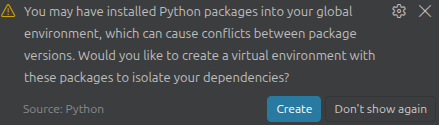
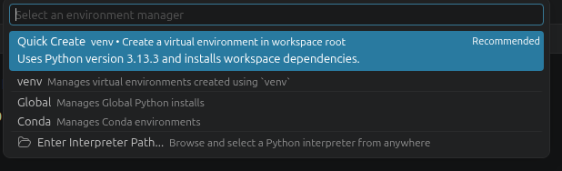
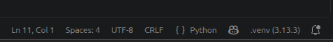
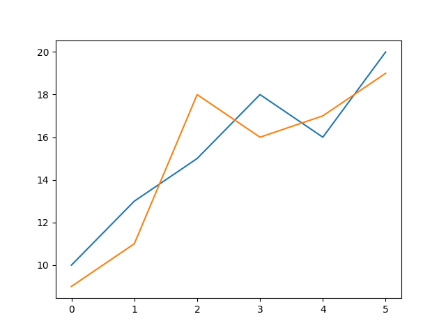
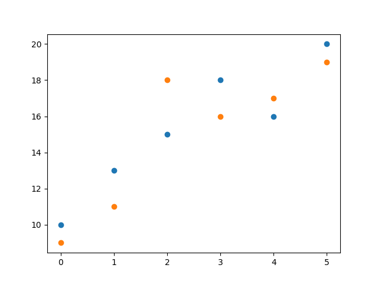
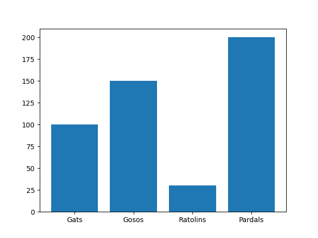
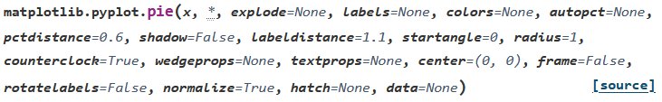
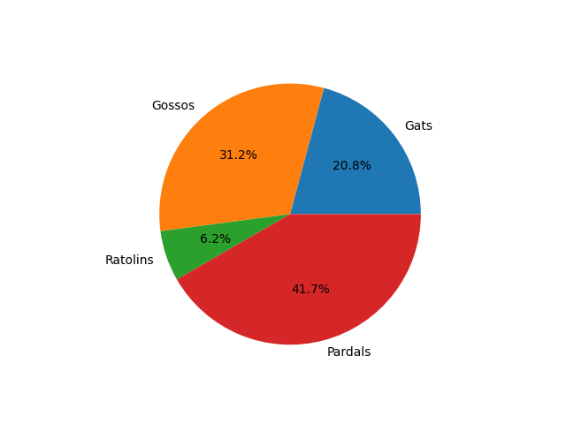
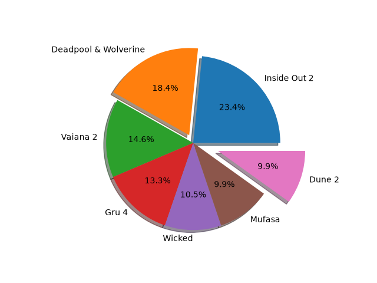
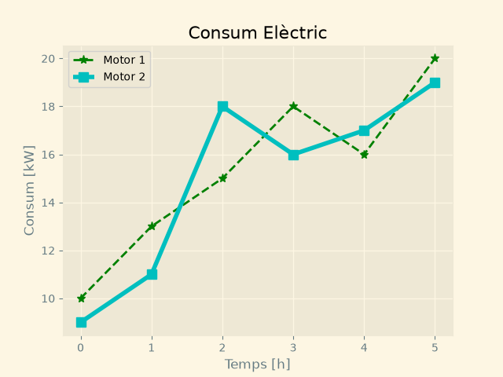

# 13 Creació de gràfiques

La biblioteca *Matplotlib* permet crear una àmplia varietat de gràfics (gràfics de línies, de barres, de dispersió, circulars bàsics, 3D …). Podeu trobar la documentació completa en [https://matplotlib.org](https://matplotlib.org). 

## 13.1 Creació d'un *virtual environment*
Per a poder treballar amb *Matplotlib*, el primer que caldrà fer és importar els components de la llibreria que necessitem. Per exemple, per a utilitzar `pyplot()` faríem:
``` python
import matplotlib.pyplot as plt
```
Com que *Matplotlib* no és una llibreria nativa de *Python*, a l'executar el nostre codi el primer que obtindrem serà un error com aquest.
``` python
Traceback (most recent call last):
  File "/home/profe/Documents/grafiquesMatploLib/iniiciar.py", line 1, in <module>
    import matplotlib.pyplot as plt
ModuleNotFoundError: No module named 'matplotlib'
```
Que ve a dir que el mòdul `matplotlib` no es troba en instal.lat.
Depenent del Sistema Operatiu i la configuració de *Python*, haureu de seguir uns passos per a la [instal·lació](https://matplotlib.org/stable/install/index.html) de *Matplotlib*.


### Utilitzant VSC
Per al nostre SO i instal.lació global de *Python*, farem el següent en la terminal de *Visual Studio Code* (VSC):
``` python
pip install matplotlib
```

I segurament obtindreu el següent avís en la terminal:
``` python
error: externally-managed-environment

× This environment is externally managed
╰─> To install Python packages system-wide, try apt install
    python3-xyz, where xyz is the package you are trying to
    install.
    
    If you wish to install a non-Debian packaged Python application,
    it may be easiest to use pipx install xyz, which will manage a
    virtual environment for you. Make sure you have pipx installed.
    
    See /usr/share/doc/python3.13/README.venv for more information.

note: If you believe this is a mistake, please contact your Python installation or OS distribution provider. 
You can override this, at the risk of breaking your Python installation or OS, by passing --break-system-packages.
hint: See PEP 668 for the detailed specification.
```

A més a més, també és possible que VSC ens oferisca la possibilitat de crear un *Virtual Environment*.


Aquestos avisos venen a dir que, com que la nostra instal.lació de *Python* és global per a tots els usuaris i projectes de l'equip, instal.lar o modificar paquets de forma global pot fer que altres projectes deixen de funcionar.

Una solució per a evitar aquests tipus de conflictes és treballar amb **entorns virtuals** de *Python* (els *virtual environments*).

Un entorn virtual és un **entorn de desenvolupament totalment autònom**, amb el seu propi intèrpret de *Python*, les seues pròpies llibreries i les dependències necessàries. Això crea una configuració "mini" de *Python* separada, completament aïllada de la instal·lació de *Python* del sistema i de qualsevol altre entorn virtual que puguem tindre.

Aprofitarem que VSC ens oferix la possibilitat de crear un *virtual environment* per al nostre projecte i apretarem sobre el botó **Create**. En la barra superior de VSC apareixerà un missatge semblant al següent, i caldrà que fem click en ell:



VSC crearà el *virtual environment* i realitzarà ja la instal.lació de `matplotlib`. Podem comprovar si estem treballant amb l'entorn virtual en la barra inferior dreta de VSC, on apareixerà: 



`.venv(3.13.3)` fa referència a que estem treballant en un entorn virtual amb la versió 3.13.3 de *Python*.

Si executem ara un codi que simplement faça una importació des de `matplotlib`, 

``` python
import matplotlib.pyplot as plt
```
no obtindrem l'error d'importació del mòdul i a més podrem vorer que el *prompt* de la terminal indica ara que estem treballant dins l'entorn virtual.

``` bash
(.venv) profe@osboxes:~/Documents/grafiquesMatploLib$ 
```

### Des del terminal de Linux
Si no treballem amb VSC, podem igualment crear i utilitzar entorns virtuals des de la terminal del nostre equip.

Primer crearem la carpeta del nostre projecte i a continuació crearem l'entorn virtual.
``` bash
mkdir grafiques
cd grafiques
python3 -m venv venv-grafiques
```

Dins la carpeta del nostre projecte s'haurà creat l'entorn virtual `venv-grafiques`.
``` bash
profe@osboxes:~/Documents/grafiques$ ll
total 12
drwxr-xr-x 3 profe profes 4096 Nov 18 13:28 ./
drwxr-xr-x 8 profe profes 4096 Nov 18 13:28 ../
drwxr-xr-x 5 profe profes 4096 Nov 18 13:28 venv-grafiques/
profe@osboxes:~/Documents/grafiques$ 
```

Una vegada creat el *venv*, caldrà activar-lo per a poder utilitzar-lo.

``` bash
profe@osboxes:~/Documents/grafiques$ source venv-grafiques/bin/activate
(venv-grafiques) profe@osboxes:~/Documents/grafiques$ 
```

Vorem com el prompt del terminal canvia, indicant que el *venv* està activat.

Podem ja començar a implementar el codi dins la carpeta del projecte i a importar les llibreries necessàries sense modificar la instal.lació global de *Python* de l'equip.


## 13.1 Línies i Dispersió

Un gràfic de línies és ideal per a mostrar els canvis en una mesura al llarg del temps. En *Matplotlib*, els termes `plot`, `graph` i `chart` s'usen indistintament, i el terme `figure` es refereix a la finestra que conté un o més gràfics.

Importem `matplotlib.pyplot` amb el nom `plt` per a facilitar la introducció de les seues funcions.

A continuació, per a representar els **punts de dades en una figura 2D**, hem de cridar a la funció `plt.plot()`. Primer associarem al gràfic els valors per als eixos horitzontal/vertical guardats en `x` i `y1`. Després de cridar a `plt.plot()` amb aquests valors, l'invoquem una segona vegada amb `x` ​​i `y2` per a afegir una segona línia al gràfic.

``` python
import matplotlib.pyplot as plt
x = [0, 1, 2, 3, 4, 5]
y1 = [10, 13, 15, 18, 16, 20]
y2 = [9, 11, 18, 16, 17, 19]
plt.plot(x, y1)
plt.plot(x, y2)
# Per guardar un fitxer d'imatge del gràfic, heu de cridar 
# plt.savefig() abans de cridar a plt.show()
plt.savefig('linies.png')  
plt.show() 
```

*Matplotlib* seleccionarà automàticament els colors de les línies i una grandària adequada per al gràfic. Podem guardar el gràfic predeterminat com una imatge PNG cridant a `plt.savefig()`.



*Matplotlib* compta amb la funció `plt.show()` de vista prèvia que mostra el gràfic en una finestra. Cal remarcar que, si volem guardar el gràfic, hem de fer-ho abans de cridar a la funció `plt.show()`. La crida a la funció bloquejarà l'execució del codi i no tornarà fins que l'usuari tanque la finestra.

Per a crear un **gràfic de dispersió** d'aquestes mateixes dades, passeu els valors de l'eix `x` i de l'eix `y` a la funció `plt.scatter()`.

``` python
# Gràfica Scatter
plt.scatter(x, y1)
plt.scatter(x, y2)
plt.savefig('scatter.png')
plt.show()
```



## 13.2 Barres i gràfics circulars

Els **gràfics de barres** són útils per a comparar el mateix tipus de dades en diferents categories. A diferència d'un gràfic de línies, l'ordre de les categories no és important, encara que solen estar ordenades alfabèticament.

``` python
# Barres
categories = ['Gats', 'Gossos', 'Ratolins', 'Pardals']
valors = [100, 150, 30, 200]
plt.bar(categories, valors)
plt.savefig('barres.png')
plt.show()
```

Passem les categories a enumerar en l'eix `x` com la primera llista a `plt.bar()` i els valors per a cada categoria com la segona llista.



Per a crear un gràfic circular, utilitzarem la funció `plt.pie()`. En lloc de categories i valors, un gràfic circular té sectors i etiquetes. La funció `plt.pie()` accepta una llista de grandàries de porció i una llista d'etiquetes per a cada porció.

``` python
# Gràfic Circular
porcions = [100, 150, 30, 200]  # El tamany de cada porció
etiquetes = ['Gats', 'Gossos', 'Ratolins', 'Pardals'] 
plt.pie(porcions, labels=etiquetes)
plt.savefig('tarta.png')
plt.show()
```

El primer argument posicional de `plt.pie()` fa referència a les porcions `x` (`porcions` en aquest exemple), però el segon no fa referència a les etiquetes, sinó a l'atribut `explode`, per la qual cosa per a assignar els valors d'`etiquetes` a l'atribut `labels` del `plt.pie()` hem d'especificar-ho en la crida a la funció. 
Podeu consultar els detalls dels diferents paràmetres de `plt.pie()` en la seua [documentació oficial](https://matplotlib.org/stable/api/_as_gen/matplotlib.pyplot.pie.html).




Entre la gran diversitat d'atributs que podem modificar per a obtindre el gràfic desitjat, l'atribut `autopct` ens permet mostrar el valor de cada porció com un % respecte del total.

``` python
plt.pie(porcions, labels=etiquetes, autopct='%.1f%%')
plt.savefig('tartaX100.png')
plt.show()
```



L'atribut és una cadena d'especificació de format: la cadena `'%.1f%%'` especifica que el nombre ha de mostrar un dígit després del punt decimal i després del decimal es mostra el símbol de % (la cadena `'%.1f'` mostraria el mateix valor, però sense el símbol de % final).

---
## EXERCICIS
### 1. Pel.lícules
Crea el gràfic circular mostrat a partir de les dades proporcionades per ChatGPT​.
Consulta la documentació i exemples de [matplotlib.pyplot.pie](https://matplotlib.org/stable/api/_as_gen/matplotlib.pyplot.pie.html#matplotlib.pyplot.pie) per a esbrinar com fer l'ombra i la separació entre porcions​.




### 2. Consum elèctric
Crea el gràfic mostrat a partir de les següents dades:​

``` python
x = [0, 1, 2, 3, 4, 5]
y1 = [10, 13, 15, 18, 16, 20]
y2 = [9, 11, 18, 16, 17, 19]
```

Consulta la documentació de [matplotlib.pyplot.plot](https://matplotlib.org/stable/api/_as_gen/matplotlib.pyplot.plot.html#matplotlib.pyplot.plot) i el *CheatSheet* d'AULES per a aconseguir els canvis​.



### 3. Temperatures
Crea el gràfic mostrat a partir de les dades guardades en [temperatures_teulada_2025.csv](arxius/temperatures_teulada_2025.csv)​.
Les línies puntejades i la llegenda mostren el valor mitjà de cada una de les temperatures​.

