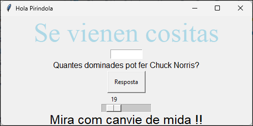
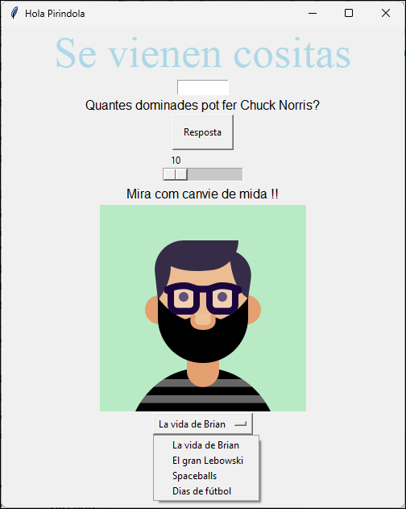
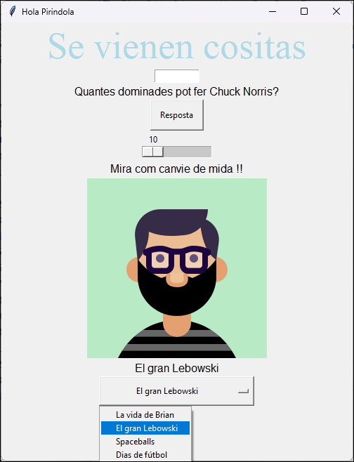

# 14 Introducció a les GUI

En aquest apartat aprendrem a crear **interfícies gràfiques d'usuari (GUI)** molt senzilles amb la llibreria `guizero`. El que farem és crear una interfície *Frankenstein* amb molts ginys, com la mostrada a continuació, per a familiaritzar-nos amb l'ús de `guizero`. Una vegada presentats els ginys, ja podreu fer les vostres pròpies GUIs.

**Exemple:** 


## 14.1 Primers passos

- Instal·la `tkinter` amb el gestor de paquets de la teva distribució. Per a Ubuntu/Debian:
```bash
sudo apt install python3-tk
```
- Activa un entorn virtual de *Python*. Revisa l'apartat [Creació d'un virtual environment](../13-grafiques/#131-creacio-dun-virtual-environment) si no recordes com es fa.

- Una vegada treballant en l'entorn virtual, instal·la la llibreria `guizero` escrivint al terminal de VSC:
```bash
pip install guizero
```
- Crea un nou arxiu, afegix este codi i executa'l. Et permetrà comprovar que tot està ben configurat.

```python
from guizero import App
app = App(title="Hola Pirindola")
app.display()
```

- Hauries de vorer una finestra de GUI com esta (titulada «Hola Pirindola» i buida). L'aspecte de la finestra serà diferent segons el SO.


## 14.2 Afegir ginys

Pots afegir text, quadres de text, botons i altres elements a una GUI. Estos elements s'anomenen **ginys** (*widgets*). Cada vegada que afegisques un giny, segueix estes dos regles:

### Regla 1

Afegix el giny a la llista d'`imports` de l'inici del programa. Cada tipus de giny només s'ha d'afegir una vegada a la llista, i després el pots utilitzar tantes vegades com vulgues en la GUI.

El següent codi importa dos ginys: `App` i `Text`.

```python
from guizero import App, Text
```

### Regla 2

Afegix tot el codi dels ginys entre la línia de codi que crea l'`App` i la línia de codi que la mostra `app.display()`.

```python
from guizero import App
app = App(title="Hola Pirindola")
#
# Tot el codi dels ginys ací
#
app.display()
```

## 14.3 Ginys bàsics

### Text

El giny `Text` mostra text en pantalla.

Afegix `Text` a la llista de ginys a l'inici del programa i crea un giny `Text`.

```python
from guizero import App, Text

app = App(title="Hola Pirindola")
benvinguda = Text(app, text="Se vienen cositas")
app.display()
```

Executa el codi. Hauries de veure el text en la GUI («Se vienen cositas»).


Pots canviar la mida, el tipus de lletra i el color del text així:

```python
from guizero import App, Text

app = App(title="Hola Pirindola")
benvinguda = Text(
   app,
   text="Se vienen cositas",
   size=40,
   font="Times New Roman",
   color="lightblue"
)
app.display()
```

Separar les propietats dels objectes `Text()` en diferents línies ajuda a llegir i entrendre el codi.


### TextBox

El giny `TextBox` permet a l'usuari escriure dades.

Afegix `TextBox` a la llista de ginys a l'inici del programa i crea un giny `TextBox` al final del codi.

```python
from guizero import App, Text, TextBox

app = App(title="Hola Pirindola")
benvinguda = Text(
   app,
   text="Se vienen cositas",
   size=40,
   font="Times New Roman",
   color="lightblue"
)
nom = TextBox(app)
app.display()
```

Executa el codi. Hauries de vorer un quadre de text xicotet baix del text principal.


### PushButton

El giny `PushButton` crea un botó que es pot apretar. Quan s'apreta el botó, es crida una funció indicada en la propietat `command`.

Este exemple mostrarà un acudit, amb un botó per a apretar que mostrarà la resposta.

Afegix `PushButton` a la llista de ginys a l'inici del programa i escriu una funció anomenada `mostra_missatge()` a continuació:

```python
from guizero import App, Text, TextBox, PushButton
def mostra_missatge():
    missatge.value = "Totes"
```

Configurarem que aquesta funció siga "cridada" a l'apretar el botó i ens servirà per a canviar el contingut d'un giny de `Text` referenciat per la variable `missatge`.

Afegix un giny `Text` amb el començament de l'acudit i guarda la seua referència a la variable `missatge`.

```python
missatge = Text(app, text="Quantes dominades pot fer Chuck Norris?")
```

Crea un giny `PushButton` i programa'l per a que cride a la funció `mostra_missatge` quan s'aprete el botó. Entre els diferents paràmetres que tenen els ginys de `PushButton`, tenim:

- `command`: que indica la funció a cridar quan s'apreta el botó
- `text`: és el text que apareix al botó

Per tant, el nostre botó podria quedar codificat de la següent forma:

```python
actualitza_text = PushButton(
       app,
       command = mostra_missatge,
       text = "Resposta"
)
```
A l'apretar el botó s'executa el mètode `mostra_missatge`, que canvia el valor (`.value`) referenciat per la variable `missatge` a **"Totes"**.

A l'executar el codi hauries de veure la pregunta ... 


... i quan apretes el botó, es mostrarà la resposta.


### Slider

Un control lliscant `Slider` permet als usuaris triar fàcilment un valor d'un interval. Funciona de manera similar al control de volum.

Este exemple et permetrà canviar la mida de la lletra amb un control lliscant.

Afegix `Slider` a la llista de ginys a l'inici del programa (`import`) i crea a continuació un giny `Slider`. 

Cada vegada que es mou el control lliscant, `Slider` crida a la funció que se li passe a través del paràmetre `command`. El que farem és programar que cride a la funció `canviar_mida_text` que codificarem després.

```python
mida_text = Slider(
   app,
   command = canviar_mida_text,
   start = 10,
   end = 80
)
```
Els paràmetres `start` i `end` determinen els valors mínim i màxim del control lliscant (les mides de lletra en aquest exemple).

Crearem ara un giny de tipus `Text`a qui li canviarem la mida de la lletra mitjançant el `Slider`. Afegix un `Text` a l'App i guarda la seua referència a la variable `text_de_mostra`.

```python
text_de_mostra = Text(app, text="Mira com canvie de mida !!")
```
Queda per escriure la funció `canviar_mida_text`, que rebrà com a paràmetre d'entrada el valor actual del slider `valor_slider` i l'utilitzarà per a aplicar-lo a la mida (`.size`) del giny `Text` referenciat per `text_de_mostra`.

```python
def canviar_mida_text(valor_slider):
   text_de_mostra.size = valor_slider
```

A l'executar el codi hauries de vorer el text d'exemple ... 


...i quan mous el control lliscant, el text es farà més gran o més xicotet.



### Picture

Pots afegir una imatge a una GUI amb el giny `Picture`. Busca una imatge i guarda-la en la mateixa carpeta que el teu fitxer de *Python*.

Inclou `Picture` a l'`import` del programa i afegix un giny de la següent forma.
```python
imatge = Picture(app, image="avatar.png")
```
El paràmetre `image` inclourà el *path* a l'arxiu d'imatge que vulgues incloure.


### Combo

El giny `Combo` et permet seleccionar una opció d'un menú desplegable.

Afegirem `Combo` a la llista de ginys a l'inici del programa i inclourem un giny de la següent forma.
```python
selector = Combo(app, 
                options = ["La vida de Brian",
                         "El gran Lebowski",
                         "Spaceballs",
                         "Dias de fútbol"],
)
```
El selector ens permet triar entre una sèrie d'opcions que es codifiquen dins una llista que es passa a través del paràmetre `options`.



Per a vorer l'efecte de seleccionar una opció, crearem un giny de tipus `Text`, amb un text inicial, i que modificarem amb el valor seleccionat al `Combo`.

```python
text_peli = Text(app, text="Tria la millor comèdia")
```
Modificarem el `Combo` per a incloure l'acció que caldrà fer quan es trie una opció del giny. El paràmetre `comand` definirà la funció que es llançarà.

```python
selector = Combo(app, 
                options = ["La vida de Brian",
                         "El gran Lebowski",
                         "Spaceballs",
                         "Dias de fútbol"],
                width = 30,
                height = 2,
                command = actualitza_peli
)
```
Cada vegada que l'usuari canvie l'opció del selector, es cridarà a `actualitza_peli`. La crida inclourà el valor de l'opció triada en el selector i que es podrà utilitzar dins la funció. També s'ha aprofitat per a modificar la mida del `Combo`, mitjançant els seus paràmetres `width` i `height`.

Queda només programar la funció `actualitza_peli` per a que actualitze el text de giny `text_peli`.

```python
def actualitza_peli(seleccionada):
    text_peli.value = seleccionada
```
A l'executar el programa podrem modificar el giny de text al canviar la selecció del `Combo`.




### CheckBox

El giny `CheckBox` et permet seleccionar o desseleccionar una opció.
```python
cookies = CheckBox(app, text="Acceptar cookies del dimoni")
```


Com la majoria dels ginys vistos fins ara, aquest també es pot parametritzar mitjançant els paràmetres `width`, `height`, `command` ... Els IDEs en general solen mostrar ajudes dels diferents paràmetres i tipus d'aquests mentre piques el codi.

**Exemple de VSC**


### ButtonGroup

El giny `ButtonGroup` et permet crear un grup de botons ràdio per a triar una opció d'un conjunt. Cal afegir `ButtonGroup` a la llista de ginys a l'import del programa i a continuació definir el grup de la següent forma.

```python
assignatures = ButtonGroup(
      app,
      options = [ ["Física", "F"], ["Mates", "M"],["Biologia", "B"] ],
      selected = "M",
)
```


Cada botó queda definit per una llista de 2 valors `[1r, 2n]`: el 1r és el text que apareix al botó i el 2n és la referència que s'utilitza per a gestionar el botó (ha de ser única). El conjunt de botons quedarà definit com una matriu, formada per una llista de llistes de botons.

```python
[ ["Física", "F"], 
  ["Mates", "M"],
  ["Biologia", "B"] 
]
```

El paràmetre `selected` definix quin és el botó seleccionat per defecte, mitjançant la seua referencia (`M` en este exemple). 


## 14.4 Obtindre un valor

Com ja hem fet anteriorment, podem obtindre el valor de qualsevol giny accedint al seu atribut `.value`.

En aquest exemple agafarem el text escrit en un `TextBox` per a actualitzar el valor d'un giny de tipus `Text` a l'apretar un `PushButton`.

Afegix els ginys, posant de moment `???` com a text al giny.

```python
entrada = TextBox(app)
eixida = Text(app, text="???")
boto = PushButton(app, text="Actualitza el text", command=nou_text)
```


`nou_text` és la funció que es cridarà a l'apretar el botó. La funció agafarà el valor escrit en el quadre de text i l'escriurà en el text d'eixida.

```python
def nou_text():
   eixida.value = entrada.value
```
A l'apretar el botó, el text del `TextBox` es mostrarà al `Text`.


## EXERCICI

- Crea la teua pròpia GUI amb alguns dels ginys que has après.
- Consulta la [documentació de guizero](https://lawsie.github.io/guizero/widgetoverview/) per a descobrir com personalitzar els ginys.
- Utilitza un giny diferent que hages trobat en la [documentació de guizero](https://lawsie.github.io/guizero/widgetoverview/).

---

