# 14 Introducció a les GUI

En aquest apartat aprendrem a crear **interfícies gràfiques d'usuari (GUI)** molt senzilles amb la llibreria `guizero`. El que farem és crear una interfície *Frankenstein* amb molts ginys, com la mostrada a continuació, per a familiaritzar-nos amb l'ús de `guizero`. Una vegada presentats els ginys, ja podreu fer les vostres pròpies GUIs.

**Exemple:** 

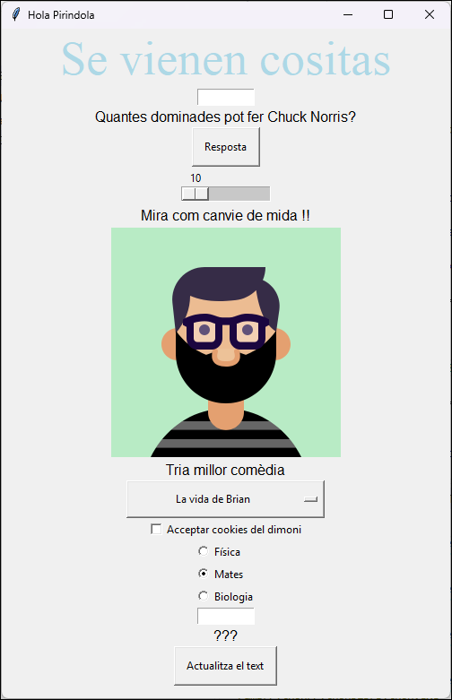

## 14.1 Primers passos

- Instal·la `tkinter` amb el gestor de paquets de la teva distribució. Per a Ubuntu/Debian:
```bash
sudo apt install python3-tk
```
- Activa un entorn virtual de *Python*. Revisa l'apartat [Creació d'un virtual environment](../13-grafiques/#131-creacio-dun-virtual-environment) si no recordes com es fa.

- Una vegada treballant en l'entorn virtual, instal·la la llibreria `guizero` escrivint al terminal de VSC:
```bash
pip install guizero
```
- Crea un nou arxiu, afegix este codi i executa'l. Et permetrà comprovar que tot està ben configurat.

```python
from guizero import App
app = App(title="Hola Pirindola")
app.display()
```

- Hauries de vorer una finestra de GUI com esta (titulada «Hola Pirindola» i buida). L'aspecte de la finestra serà diferent segons el SO.

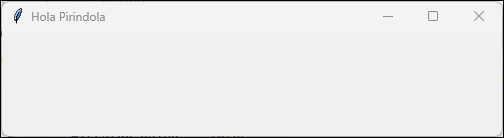


## 14.2 Afegir ginys

Pots afegir text, quadres de text, botons i altres elements a una GUI. Estos elements s'anomenen **ginys** (*widgets*). Cada vegada que afegisques un giny, segueix estes dos regles:

### Regla 1

Afegix el giny a la llista d'`imports` de l'inici del programa. Cada tipus de giny només s'ha d'afegir una vegada a la llista, i després el pots utilitzar tantes vegades com vulgues en la GUI.

El següent codi importa dos ginys: `App` i `Text`.

```python
from guizero import App, Text
```

### Regla 2

Afegix tot el codi dels ginys entre la línia de codi que crea l'`App` i la línia de codi que la mostra `app.display()`.

```python
from guizero import App
app = App(title="Hola Pirindola")
#
# Tot el codi dels ginys ací
#
app.display()
```

## 14.3 Ginys bàsics

### Text

El giny `Text` mostra text en pantalla.

Afegix `Text` a la llista de ginys a l'inici del programa i crea un giny `Text`.

```python
from guizero import App, Text

app = App(title="Hola Pirindola")
benvinguda = Text(app, text="Se vienen cositas")
app.display()
```

Executa el codi. Hauries de veure el text en la GUI («Se vienen cositas»).

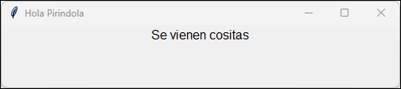

Pots canviar la mida, el tipus de lletra i el color del text així:

```python
from guizero import App, Text

app = App(title="Hola Pirindola")
benvinguda = Text(
   app,
   text="Se vienen cositas",
   size=40,
   font="Times New Roman",
   color="lightblue"
)
app.display()
```

Separar les propietats dels objectes `Text()` en diferents línies ajuda a llegir i entendre el codi.

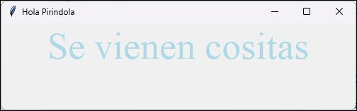

### TextBox

El giny `TextBox` permet a l'usuari escriure dades.

Afegix `TextBox` a la llista de ginys a l'inici del programa i crea un giny `TextBox` al final del codi.

```python
from guizero import App, Text, TextBox

app = App(title="Hola Pirindola")
benvinguda = Text(
   app,
   text="Se vienen cositas",
   size=40,
   font="Times New Roman",
   color="lightblue"
)
nom = TextBox(app)
app.display()
```

Executa el codi. Hauries de vorer un quadre de text xicotet baix del text principal.

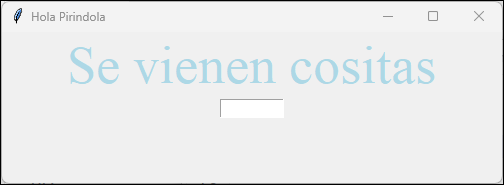

### PushButton

El giny `PushButton` crea un botó que es pot apretar. Quan s'apreta el botó, es crida una funció indicada en la propietat `command`.

Este exemple mostrarà un acudit, amb un botó per a apretar que mostrarà la resposta.

Afegix `PushButton` a la llista de ginys a l'inici del programa i escriu una funció anomenada `mostra_missatge()` a continuació:

```python
from guizero import App, Text, TextBox, PushButton
def mostra_missatge():
    missatge.value = "Totes"
```

Configurarem que aquesta funció siga "cridada" a l'apretar el botó i ens servirà per a canviar el contingut d'un giny de `Text` referenciat per la variable `missatge`.

Afegix un giny `Text` amb el començament de l'acudit i guarda la seua referència a la variable `missatge`.

```python
missatge = Text(app, text="Quantes dominades pot fer Chuck Norris?")
```

Crea un giny `PushButton` i programa'l perquè cride a la funció `mostra_missatge` quan s'aprete el botó. Entre els diferents paràmetres que tenen els ginys de `PushButton`, tenim:

- `command`: que indica la funció a cridar quan s'apreta el botó
- `text`: és el text que apareix al botó

Per tant, el nostre botó podria quedar codificat de la següent forma:

```python
actualitza_text = PushButton(
       app,
       command = mostra_missatge,
       text = "Resposta"
)
```
A l'apretar el botó s'executa el mètode `mostra_missatge`, que canvia el valor (`.value`) referenciat per la variable `missatge` a **"Totes"**.

A l'executar el codi hauries de veure la pregunta ... 

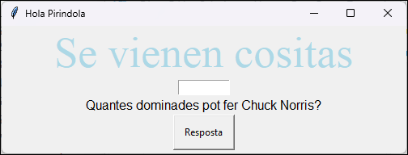

... i quan apretes el botó, es mostrarà la resposta.

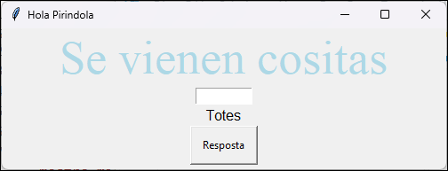


### Slider

Un control lliscant `Slider` permet als usuaris triar fàcilment un valor d'un interval. Funciona de manera similar al control de volum.

Este exemple et permetrà canviar la mida de la lletra amb un control lliscant.

Afegix `Slider` a la llista de ginys a l'inici del programa (`import`) i crea a continuació un giny `Slider`. 

Cada vegada que es mou el control lliscant, `Slider` crida a la funció que se li passe a través del paràmetre `command`. El que farem és programar que cride a la funció `canviar_mida_text` que codificarem després.

```python
mida_text = Slider(
   app,
   command = canviar_mida_text,
   start = 10,
   end = 80
)
```
Els paràmetres `start` i `end` determinen els valors mínim i màxim del control lliscant (les mides de lletra en aquest exemple).

Crearem ara un giny de tipus `Text`a qui li canviarem la mida de la lletra mitjançant el `Slider`. Afegix un `Text` a l'App i guarda la seua referència a la variable `text_de_mostra`.

```python
text_de_mostra = Text(app, text="Mira com canvie de mida !!")
```
Queda per escriure la funció `canviar_mida_text`, que rebrà com a paràmetre d'entrada el valor actual del *slider* `valor_slider` i l'utilitzarà per a aplicar-lo a la mida (`.size`) del giny `Text` referenciat per `text_de_mostra`.

```python
def canviar_mida_text(valor_slider):
   text_de_mostra.size = valor_slider
```

A l'executar el codi hauries de vorer el text d'exemple ... 

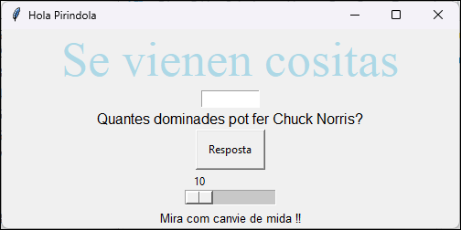

...i quan mous el control lliscant, el text es farà més gran o més xicotet.


### Picture

Pots afegir una imatge a una GUI amb el giny `Picture`. Busca una imatge i guarda-la en la mateixa carpeta que el teu fitxer de *Python*.

Inclou `Picture` a l'`import` del programa i afegix un giny de la següent forma.
```python
imatge = Picture(app, image="avatar.png")
```
El paràmetre `image` inclourà el *path* a l'arxiu d'imatge que vulgues incloure.

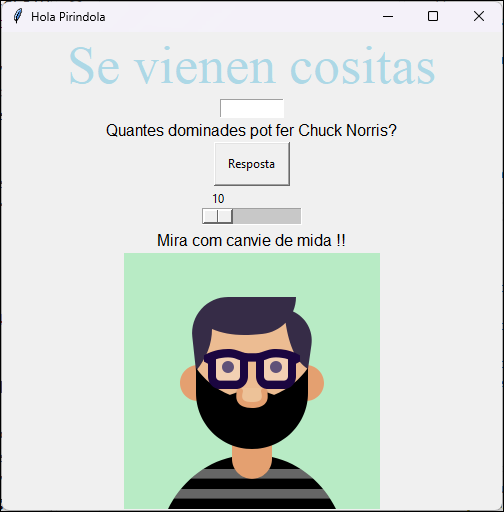


### Combo

El giny `Combo` et permet seleccionar una opció d'un menú desplegable.

Afegirem `Combo` a la llista de ginys a l'inici del programa i inclourem un giny de la següent forma.
```python
selector = Combo(app, 
                options = ["La vida de Brian",
                         "El gran Lebowski",
                         "Spaceballs",
                         "Dias de fútbol"],
)
```
El selector ens permet triar entre una sèrie d'opcions que es codifiquen dins una llista que es passa a través del paràmetre `options`.


Per a vorer l'efecte de seleccionar una opció, crearem un giny de tipus `Text`, amb un text inicial, i que modificarem amb el valor seleccionat al `Combo`.

```python
text_peli = Text(app, text="Tria la millor comèdia")
```
Modificarem el `Combo` per a incloure l'acció que caldrà fer quan es trie una opció del giny. El paràmetre `comand` definirà la funció que es llançarà.

```python
selector = Combo(app, 
                options = ["La vida de Brian",
                         "El gran Lebowski",
                         "Spaceballs",
                         "Dias de fútbol"],
                width = 30,
                height = 2,
                command = actualitza_peli
)
```
Cada vegada que l'usuari canvie l'opció del selector, es cridarà a `actualitza_peli`. La crida inclourà el valor de l'opció triada en el selector i que es podrà utilitzar dins la funció. També s'ha aprofitat per a modificar la mida del `Combo`, mitjançant els seus paràmetres `width` i `height`.

Queda només programar la funció `actualitza_peli` perquè actualitze el text de giny `text_peli`.

```python
def actualitza_peli(seleccionada):
    text_peli.value = seleccionada
```
A l'executar el programa podrem modificar el giny de text al canviar la selecció del `Combo`.

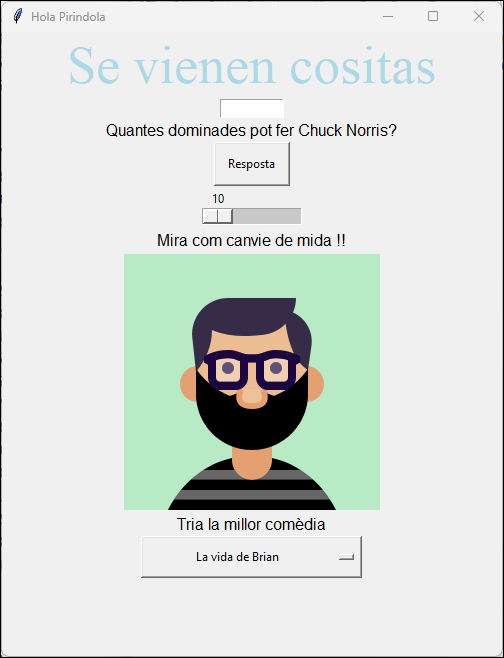


### CheckBox

El giny `CheckBox` et permet seleccionar o desseleccionar una opció.
```python
cookies = CheckBox(app, text="Acceptar cookies del dimoni")
```

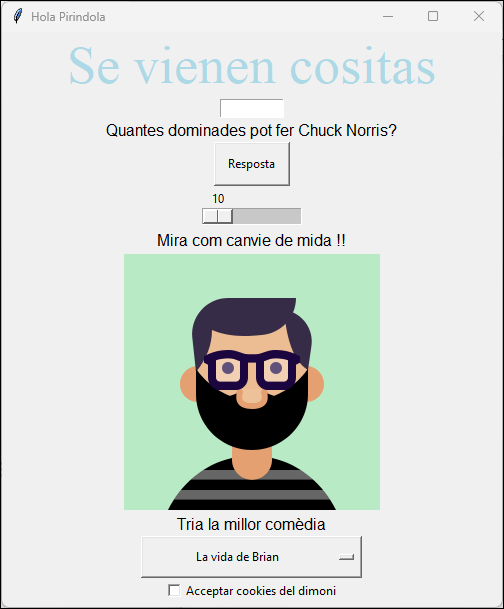

Com la majoria dels ginys vistos fins ara, aquest també es pot parametritzar mitjançant els paràmetres `width`, `height`, `command` ... Els IDEs en general solen mostrar ajudes dels diferents paràmetres i tipus d'aquests mentre piques el codi.

**Exemple de VSC**

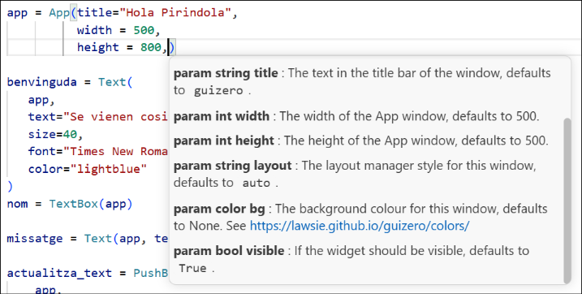

### ButtonGroup

El giny `ButtonGroup` et permet crear un grup de botons ràdio per a triar una opció d'un conjunt. Cal afegir `ButtonGroup` a la llista de ginys a l'import del programa i a continuació definir el grup de la següent forma.

```python
assignatures = ButtonGroup(
      app,
      options = [ ["Física", "F"], ["Mates", "M"],["Biologia", "B"] ],
      selected = "M",
)
```

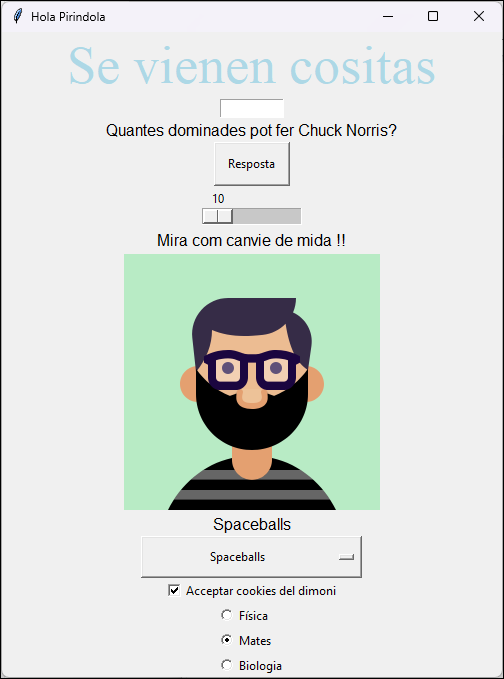

Cada botó queda definit per una llista de 2 valors `[1r, 2n]`: el 1r és el text que apareix al botó i el 2n és la referència que s'utilitza per a gestionar el botó (ha de ser única). El conjunt de botons quedarà definit com una matriu, formada per una llista de llistes de botons.

```python
[ ["Física", "F"], 
  ["Mates", "M"],
  ["Biologia", "B"] 
]
```

El paràmetre `selected` definix quin és el botó seleccionat per defecte, mitjançant la seua referència (`M` en este exemple). 

### Box

Les caixes `Box` són contenidors que ens permeten distribuir i ordenar altres ginys en el seu interior. Per defecte són elements buits i sense vora, que abraçaran el tamany dels ginys que incloga el `Box`.

```python
Text(app, text="La següent imatge ha estat modificada")
imatge_box = Box(app, width="fill")
Picture(imatge_box, image="educacio.png")

Text(app, text="Guardar els canvis?")
botons_box = Box(app, height="fill")
PushButton(botons_box, text="Acceptar")
PushButton(botons_box, text="Cancelar")
```
La 1a caixa només inclou la imatge. Per a col.locar-la dins de la caixa, ho indiquem en el 1r paràmetre del constructor de la imatge `Picture(imatge_box, image="educacio.png")`.

La caixa ocuparà tot l'ample de la finestra `width="fill"` i serà tan alta com la imatge.

La 2a caixa conté 2 botons. Al constructor de cada botó li passem la referència a la caixa `PushButton(botons_box, text="Acceptar")` perquè es col.loquen dins el `Box`.

La caixa dels botons té la mateixa amplària que els botons que conté i ocuparà tot l'alt de la finestra `height="fill"`. 

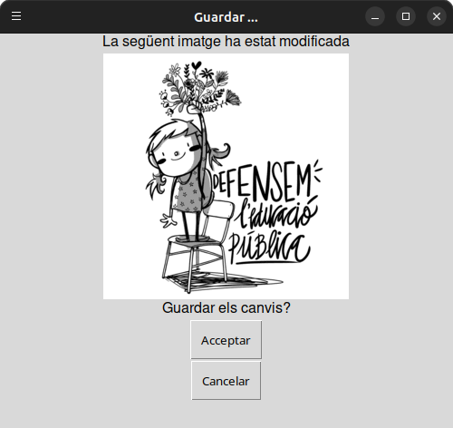

Durant les fases de disseny de les GUIs, es sol donar vora a les caixes per a localitzar-les i identificar clarament els ginys que contenen, l'alineament i la distribució d'aquests.

Per a fer-ho podem afegir el paràmetre `border = True` al constructor de `Box` perquè es mostre una vora mínima, o `border = x` perquè es mostre una vora del gruix `x` que vulguem.

```python
Text(app, text="La següent imatge ha estat modificada")
imatge_box = Box(app, width="fill", border=True)
Picture(imatge_box, image="educacio.png")

Text(app, text="Guardar els canvis?")
botons_box = Box(app, height="fill", border=5)
PushButton(botons_box, text="Acceptar")
PushButton(botons_box, text="Cancelar")
```

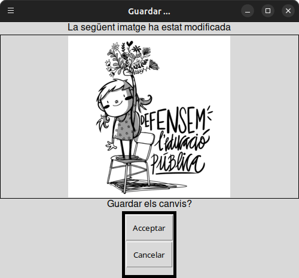


## 14.4 Obtindre un valor

Com ja hem fet anteriorment, podem obtindre el valor de qualsevol giny accedint al seu atribut `.value`.

En aquest exemple agafarem el text escrit en un `TextBox` per a actualitzar el valor d'un giny de tipus `Text` a l'apretar un `PushButton`.

Afegix els ginys, posant de moment `???` com a text al giny.

```python
entrada = TextBox(app)
eixida = Text(app, text="???")
boto = PushButton(app, text="Actualitza el text", command=nou_text)
```
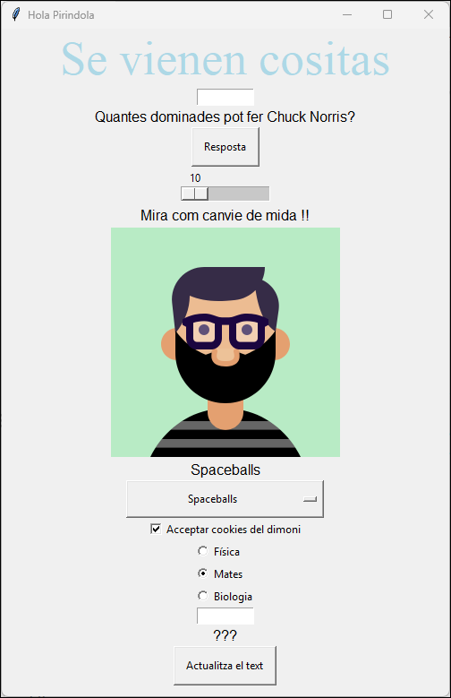

`nou_text` és la funció que es cridarà a l'apretar el botó. La funció agafarà el valor escrit en el quadre de text i l'escriurà en el text d'eixida.

```python
def nou_text():
   eixida.value = entrada.value
```
A l'apretar el botó, el text del `TextBox` es mostrarà al `Text`.

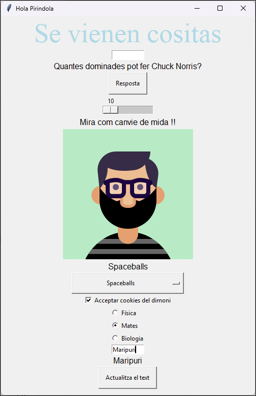


> FEU ARA [L'EXERCICI 1](../14-guis/#1-formulari-de-matricula)


## 14.5  Layouts

El disseny (*layout*) d'una interfície gràfica és la manera com s'organitzen els ginys dins de la finestra.

Els ginys es poden organitzar en «contenidors» (p. e. `App`, `Window`, `Box`) amb qualsevol d'aquests dos posicionaments:

- `auto`: els ginys es col·loquen automàticament
- `grid`: tu especifiques en quina posició d'una graella ha d'anar cada giny

El posicionament s'establix amb el paràmetre `layout` del contenidor, per exemple:

```python
app = App(layout="auto")
formulari_box = Box(app, layout="grid", border=True)
```

Si no s'especifica el paràmetre `layout`, s'utilitza `auto` per defecte.

### Posicionament `auto`

Tots els ginys s'organitzen segons l'ordre en què es creen i s'alineen al centre. Per exemple, el codi següent crea un botó entre dos ginys `Text`, un damunt de l'altre.

```python
Text(app, text = "damunt del botó")
PushButton(app, text = "STOP")
Text(app, text = "baix del botó")
```


#### Alineació

Els ginys es poden alinear a dalt (`top`), a baix (`bottom`), a l'esquerra (`left`) o a la dreta (`right`) mitjançant la propietat `align` en crear-los.

Alinear un giny fa que quede «apegat» a eixe costat del contenidor, per exemple:

```python
PushButton(app, text = "dalt",  align="top")
PushButton(app, text = "esquerra",  align="left")
PushButton(app, text = "dreta",  align="right")
PushButton(app, text = "baix",  align="bottom")
```

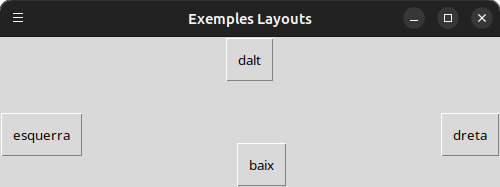

Si alinees diversos ginys al mateix costat del contenidor, s'apilaran:

```python
PushButton(app, text = "Dreta 1",  align="right")
PushButton(app, text = "Dreta 2",  align="right")
PushButton(app, text = "Baix 1",  align="bottom")
PushButton(app, text = "Baix 2",  align="bottom")
```


Els ginys s'apilen segons l'ordre de creació, de manera que el giny que es crea primer queda més prop de la vora en la direcció indicada.

#### Omplir (fill)

També es pot fer que els ginys «òmpliguen» tot l'espai disponible establint els paràmetres `width` i `height` al valor `fill`.

```python
TextBox(app, text="Escriu alguna cosa", width="fill")
ListBox(app, items=["Cosa", "Coses", "Cosetes"], height="fill", align="left")
```

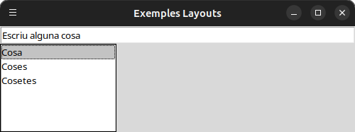

El `TextBox` ocupa tota l'amplària del contenidor gràcies al `width="fill"`, mentre que el `ListBox` ocupa tot l'alt del costat esquerre gràcies a `height="fill", align="left"`

**Nota:** Utilitzar `fill` pot no tindre sempre l'efecte que esperes, ja que és el sistema operatiu qui repartix l'espai de la pantalla.

### Posicionament `grid`

El disseny `grid` et permet situar els ginys en una graella virtual.

Quan crees un giny, hauràs de passar-li un paràmetre addicional anomenat `grid`, que és una llista amb les coordenades `[x,y]` on vols que aparega el giny:

- `x` fa referència a la columna
- `y` fa referència a la fila

No cal especificar l'amplària ni l'altura de la graella: s'ampliarà segons les coordenades que indiques per a cada giny. Això sí, les cel·les de la graella que no contenen cap objecte no tindran ni altura ni amplària.

Això és molt útil quan vols crear interfícies en què els ginys queden alineats. Per exemple, pots crear un teclat numèric de telèfon.

```python
app = App(title = "Telèfon", height=200, width=300, layout="grid")

button1 = PushButton(app, text="1", grid=[0,0])
button2 = PushButton(app, text="2", grid=[1,0])
button3 = PushButton(app, text="3", grid=[2,0])
button4 = PushButton(app, text="4", grid=[0,1])
button5 = PushButton(app, text="5", grid=[1,1])
button6 = PushButton(app, text="6", grid=[2,1])
button7 = PushButton(app, text="7", grid=[0,2])
button8 = PushButton(app, text="8", grid=[1,2])
button9 = PushButton(app, text="9", grid=[2,2])
button0 = PushButton(app, text="0", grid=[1,3])
```


També pots alinear els ginys dins de la graella, cosa que resulta útil quan crees un formulari.

```python
app = App(title = "Formulari", height=200, width=300, layout="grid")

Text(app, text="Nom", grid=[0,0], align="left")
TextBox(app, grid=[1,0])
Text(app, text="Cognom", grid=[0,1], align="left")
TextBox(app, grid=[1,1])
Text(app, text="email", grid=[0,2], align="left")
TextBox(app, grid=[1,2])
CheckBox(app, text="Accepte el tractament de dades", grid=[1,3])
PushButton(app, text="Enviar", grid=[1,4], align="right")
```

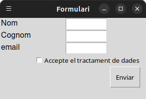

### Ús de contenidors

Amb el contenidor `Box` pots dividir la teua interfície en diferents seccions i, així, organitzar-la de la manera que vulgues.

```python
from guizero import App, Box, Text, TextBox, PushButton
app = App(title = "Exemple Box")

titol_box = Box(app, width="fill", align="top", border=True)
Text(titol_box, text="TÍTOL")

botons_box = Box(app, width="fill", align="bottom", border=True, layout="grid")
Text(botons_box, text="BOTONS", grid=[0,0])
PushButton(botons_box, text="Guardar", grid=[0,1])
PushButton(botons_box, text="Cancelar", grid=[1,1])

opcions_box = Box(app, height="fill", align="right", border=True)
Text(opcions_box, text="OPCIONS")

contingut_box = Box(app, align="top", width="fill", border=True)
Text(contingut_box, text="CONTINGUT")

formulari_box = Box(contingut_box, layout="grid", width="fill", align="left", border=True)
Text(formulari_box, grid=[0,0], text="FORMULARI", align="right")
Text(formulari_box, grid=[0,1], text="Nom", align="left")
Text(formulari_box, grid=[0,2], text="Cognom", align="left")
TextBox(formulari_box, grid=[1,1], text="Escriu ací el teu nom", width="fill")
TextBox(formulari_box, grid=[1,2], text="Escriu ací el teu cognom", width="fill")

app.display()
```

En este exemple podem vorer com es combinen *layouts* de tipus `auto` i `grid`. L'App principal utilitza un posicionament `auto`, mentre que alguns dels `Box` utilitzen `grid` com a posicionament: 
```python
botons_box = Box(app, width="fill", align="bottom", border=True, layout="grid")
```

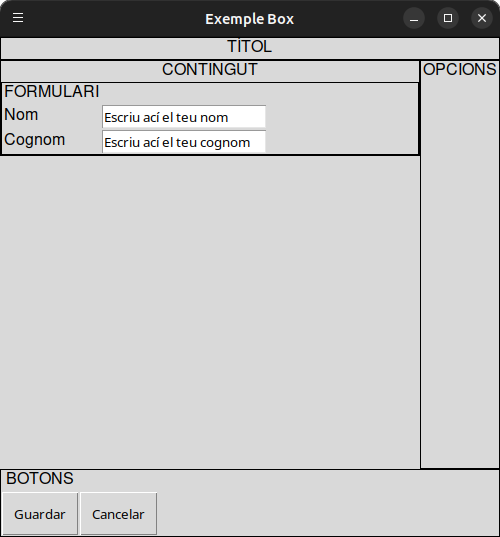

Com a bones pràctiques:

- assignarem cada contenidor a una variable, p.e. `titol_box = Box(app, width="fill", align="top", border=True)`
- utilitzarem la variable posteriorment com a referència per a col.locar els ginys que vulguem dins d'ella `Text(titol_box, text="TÍTOL")`
- ajuda incloure en el nom de la variable a quin tipus de contenidor fa referència `opcions_box`, `contingut_box` ...
- inicialment, durant la fase de disseny del *layout*, li posarem vora `border=True` als contenidors. Una vegada finalitzada la GUI, llevarem les vores.


**Nota:** Pots posar un `Box` dins d'un altre `Box`, la qual cosa et permet superposar caixes i situar els ginys on vulgues.

**Consell:** Quan crees una interfície, et pot resultar més fàcil dissenyar-la primer en paper i anotar on aniran situades les caixes.


## EXERCICIS

### 1. Formulari de matrícula

Construir un formulari de matrícula de Batxillerat que reacciona a les accions de l'usuari: canvia la llista d'assignatures segons el curs i valida l'acceptació de la protecció de dades abans de registrar.

<div style="display: flex; justify-content: center; align-items: center; gap: 10px;">
    
</div>


#### Especificacions de la interfície

Caldrà que imiteu el resultat anterior, amb llibertat per a:

- triar la imatge que vulgueu
- la tipologia de lletra (ha de ser diferent de la de per defecte) 
- la llista de les assignatures que preferiu

Respecteu els textos, les mides i els colors. El tamany de la GUI ha de quadrar amb el contingut.

Per a realitzar aquest exercici, és molt probable que hàgeu de consultar la documentació oficial dels [ginys de guizero](https://lawsie.github.io/guizero/widgetoverview/#overview).


#### Dades inicials
L'alumnat podrà triar entre assignatures de 1r o de 2n de batxillerat. Quan canvie l'opció, la llista del desplegable que es troba a continuació haurà de canviar.

<div style="display: flex; justify-content: center; align-items: center; gap: 10px;">
    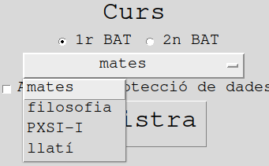    
    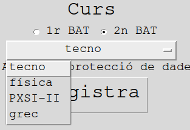
</div>

**Pistes:**

- S'executa cada vegada que l'usuari canvia el curs
- Buida el desplegable amb `clear()`
- Si el curs és 1r, afegix al desplegable les assignatures de 1r
- En cas contrari, les assignatures de 2n

#### Registre de l'assignatura
Quan l'usuari aprete el botó de registre:

- Es mostrarà el missatge `HAS D'ACCEPTAR LA PROTECCIÓ DE DADES`, si el *checkbox* no està marcat
- Si està marcat, es mostrarà el text `[alumne] registrat en [assignatura]` 
- El fons del text serà roig si no es marca el *checkbox* i verd si està marcat
- El nom de l'assignatura apareixerà en majúscules (però no en el `Combo`)

<div style="display: flex; justify-content: center; align-items: center; gap: 10px;">
    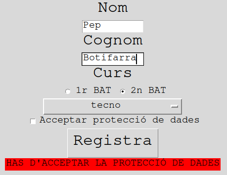    
    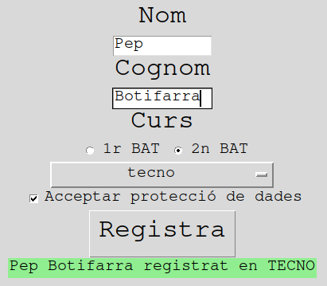
</div>

#### Consells
1. Fixeu la tipografia i la mida de text general per a `app`, i després ja augmenteu la mida dels ginys que ho necessiten
2. En la creació dels ginys, assigneu-los a una variable per a posteriorment poder:
    - referenciar-los en altres ginys
    - accedir als seus valors mitjançant `.value`
    - modificar-los accedint a les propietats i mètodes particulars de cada giny
3. El nom d'aquestes variables haurien d'incloure el tipus de giny al qual fan referència perquè siguen fàcils d'identificar en el codi i no les confongueu amb altres variables que siguen llistes o noms de funcions. Per exemple:
    - `dades_cb`: fa referència a un **c**heck**b**ox
    - `registre_bt`: fa referència a un **b**u**t**ton
4. Definiu les 2 llistes d'assignatures abans de l'`App` i treballeu directament amb aquestes
5. Escriviu una funció i associeu-la al `ButtonGroup` amb `command`. Programeu que al canviar de curs canvien les assignatures
6. De la mateixa forma, escriviu una funció i associeu-la al botó per a gestionar el color i contingut del missatge final


### 2. Formulari millorat
Creareu ara un formulari amb un *layout* millorat i amb algunes ampliacions. L'exercici es basa en una modificació de l'exercici anterior.

<div style="display: flex; justify-content: center; align-items: center; gap: 10px;">
    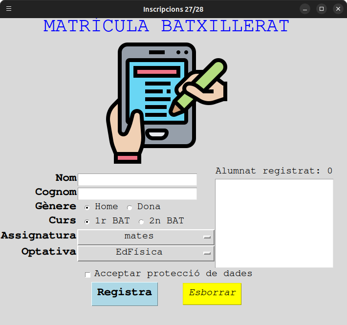        
</div>

#### Més funcionalitats

Afegiu aquestes funcionalitats extra:

1. **Validació de camps buits**: Si el nom o el cognom estan buits, mostreu un missatge d'error en roig i no registreu l'alumne
2. **Neteja després del registre**: Buideu els quadres de text i desmarqueu el *checkbox* quan el registre siga correcte
3. **Segona assignatura**: Afegiu un segon `Combo` perquè l'alumne puga triar una assignatura optativa (les mateixes pels 2 cursos) i mostreu les dos al missatge final
4. **Gènere**: Incloeu un giny per a seleccionar el gènere de l'alumne/a i aixina modificar el missatge de registre: `"registrat"` o `"registrada"` 
5. **Llista de registres**: Inclou un giny `ListBox` a la dreta que vaja mostrant en tot moment els registres fets amb el format `nom_cognom | assignatura | optativa`
6. **Comptador de registres**: Afegiu un `Text` que mostre el nombre d'alumnes registrats des que s'ha obert el programa. Col.loqueu-ho damunt del `ListBox`
7. **Esborrar**: Un nou botó esborrarà tots els registres fets, deixant la llista buida i el comptador a `0`


<div style="display: flex; justify-content: center; align-items: center; gap: 10px;">
    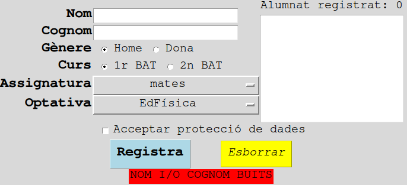        
</div>
<br>
<div style="display: flex; justify-content: center; align-items: center; gap: 10px;">    
    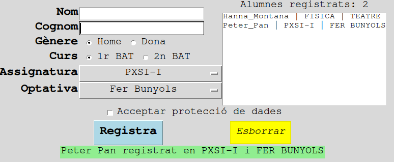
</div>

#### Posicionament dels ginys
Aquesta versió de la GUI caldrà que tinga un *layout* més ordenat, posicionant els diferents ginys com es mostra en la proposta de solució.

Implementa primer totes les funcionalitats anteriors i, una vegada funcionen, comença a preocupar-te pel posicionament dels components.

1. En la part superior estarà el títol i la imatge
2. Al centre esquerra els ginys del formulari
3. Al centre dreta la llista dels registres i el comptador
4. Baix els botons, *checkbox* i el missatge d'error/registre

**Consells de posicionament**

- Definir `app` com a posicionament de graella `layout = "grid"`
- Col.locar les 4 agrupacions de ginys mostrades anteriorment cadascuna dins un `Box`
- Posicionar cada `Box` en un cel.la de la graella d'`app`

**Refinant el posicionament**
Si has seguit els consells i has utilitzat `grid` per a posicionar la majoria dels elements, possiblement no t'hauran quedat centrats com desitges. 

Perquè queden millor posicionats, totes les cel.les de les graelles han de tindre contingut, però com que hi ha columnes de determinades files que no tenen cap giny, la solució és ampliar l'ocupació de les cel.les amb components sobre les cel.les buides.

Aquest mètode es coneix com *Spanning columns/rows* i caldrà que consultes la documentació oficial de guizero sobre [layouts](https://lawsie.github.io/guizero/layout/) per a saber com es fa i aplicar-ho a aquesta GUI.

