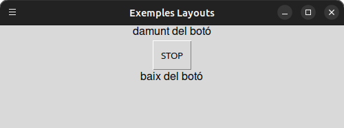
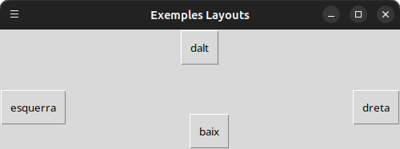
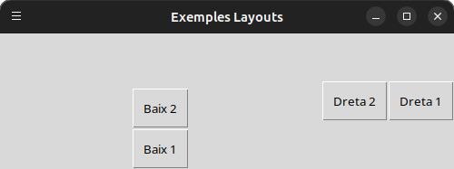
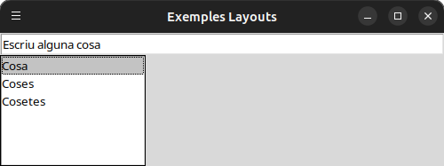
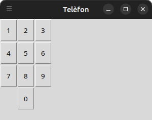

# 15 Layouts

El disseny (*layout*) de la teua interfície gràfica és la manera com s'organitzen els ginys dins de la finestra.

## 15.1 Posicionament

Els ginys es poden organitzar en «contenidors» (p. e. `App`, `Window`, `Box`) amb qualsevol d'aquests dos posicionaments:

- `auto`: els ginys es col·loquen automàticament
- `grid`: tu especifiques en quina posició d'una graella ha d'anar cada giny

El posicionament s'estableix amb el paràmetre `layout` del contenidor, per exemple:

```python
app = App(layout="auto")
app = App(layout="grid")
```

Si no s'especifica el paràmetre `layout`, s'utilitza `auto` per defecte.

### Posicionament `auto`

Tots els ginys s'organitzen segons l'ordre en què es creen i s'alineen al centre. Per exemple, el codi següent crea un botó entre dos ginys `Text`, un damunt de l'altre.

```python
Text(app, text = "damunt del botó")
PushButton(app, text = "STOP")
Text(app, text = "baix del botó")
```



### Alineació

Els ginys es poden alinear a dalt (`top`), a baix (`bottom`), a l'esquerra (`left`) o a la dreta (`right`) mitjançant la propietat `align` en crear-los.

Alinear un giny fa que quede «apegat» a eixe costat del contenidor, per exemple:

```python
PushButton(app, text = "dalt",  align="top")
PushButton(app, text = "esquerra",  align="left")
PushButton(app, text = "dreta",  align="right")
PushButton(app, text = "baix",  align="bottom")
```



Si alinees diversos ginys al mateix costat del contenidor, s'apilaran:

```python
PushButton(app, text = "Dreta 1",  align="right")
PushButton(app, text = "Dreta 2",  align="right")
PushButton(app, text = "Baix 1",  align="bottom")
PushButton(app, text = "Baix 2",  align="bottom")
```



Els ginys s'apilen segons l'ordre de creació, de manera que el giny que es crea primer queda més prop de la vora en la direcció indicada.

### Omplir (fill)

També es pot fer que els ginys «ompliguen» tot l'espai disponible establint els paràmetres `width` i `height` al valor `fill`.

```python
TextBox(app, text="Escriu alguna cosa", width="fill")
ListBox(app, items=["Cosa", "Coses", "Cosetes"], height="fill", align="left")
```



El `TextBox` ocupa tota l'amplària del contenidor gràcies al `width="fill"`, mentre que el `ListBox` ocupa tot el costat esquerre degut a `height="fill", align="left"`

**Nota:** Utilitzar `fill` pot no tindre sempre l'efecte que esperes, ja que és el sistema operatiu qui reparteix l'espai de la pantalla.

## Disseny en graella (grid)

El disseny `grid` et permet situar els ginys en una graella virtual.

Quan crees un giny, hauràs de passar-li un paràmetre addicional anomenat `grid`, que és una llista amb les coordenades `[x,y]` on vols que aparega el giny.

No cal especificar l'amplària ni l'altura de la graella: s'ampliarà segons les coordenades que indiques per a cada giny. Això sí, les cel·les de la graella que no contenen cap objecte no tindran ni altura ni amplària.

Això és molt útil quan vols crear interfícies en què els ginys queden alineats. Per exemple, pots crear un teclat numèric de telèfon.

```python
app = App(title = "Telèfon", height=200, width=300, layout="grid")

button1 = PushButton(app, text="1", grid=[0,0])
button2 = PushButton(app, text="2", grid=[1,0])
button3  = PushButton(app, text="3", grid=[2,0])
button4  = PushButton(app, text="4", grid=[0,1])
button5  = PushButton(app, text="5", grid=[1,1])
button6  = PushButton(app, text="6", grid=[2,1])
button7  = PushButton(app, text="7", grid=[0,2])
button8  = PushButton(app, text="8", grid=[1,2])
button9  = PushButton(app, text="9", grid=[2,2])
button0  = PushButton(app, text="0", grid=[1,3])
```





També pots alinear els ginys dins de la graella, cosa que resulta útil quan crees un formulari:


```python
from guizero import App, Text, TextBox

app = App(layout="grid")

name_label = Text(app, text="Name", grid=[0,0], align="left")
name = TextBox(app, grid=[1,0])
surname_label = Text(app, text="Surname", grid=[0,1], align="left")
surname = TextBox(app, grid=[1,1])
dob_label = Text(app, text="Date of Birth", grid=[0,2], align="left")
dob = TextBox(app, grid=[1,2])

app.display()
```

### Ocupar diverses columnes o files

Es pot fer que els ginys ocupen diverses columnes o files indicant l'extensió dins del paràmetre `grid`. Aquests valors són opcionals, però, si s'especifiquen, cal incloure'ls tots amb el format `[x,y,xspan,yspan]`.

L'exemple següent mostra un giny `Text` situat a 0,1 que ocupa dues columnes (x) i una fila (y):

```python
text = Text(app, text="Hello world", grid=[0,1,2,1])
```

Aquest mètode de disseny es pot utilitzar per a incloure ginys de diferents mides disposats els uns al costat dels altres.

```python
from guizero import App, Picture

app = App(layout="grid")

picture1 = Picture(app, image="std1.gif", grid=[0,0])
picture2 = Picture(app, image="std2.gif", grid=[1,0])
picture3 = Picture(app, image="tall1.gif", grid=[2,0,1,2])
picture4 = Picture(app, image="wide1.gif", grid=[0,1,2,1])

app.display()
```


## Caixes

Amb el giny `Box` pots dividir la teua interfície en diferents seccions i, així, organitzar-la de la manera que vulgues.


([Codi de l'exemple anterior](https://github.com/lawsie/guizero/tree/master/examples/layout_boxes.py))

Si volgueres crear un títol a la cantonada superior esquerra de la interfície, podries utilitzar un `Box` que òmpliga la part superior de l'`App` i col·locar-hi dins un giny `Text` alineat a l'esquerra (`left`).

```python
from guizero import App, Box, Text
app = App()

title_box = Box(app, width="fill", align="top")
title = Text(title_box, text="title", align="left")

app.display()
```


Pot ser-te més fàcil dissenyar la interfície si les caixes tenen vora, cosa que es pot aconseguir establint el paràmetre `border` de `Box` a `True`.

```python
title_box = Box(app, width="fill", align="top", border=True)
```


Es pot fer servir un mètode semblant per a posar els botons «OK» i «Cancel» a la part inferior dreta de la interfície. Recorda que els ginys s'apilen a la dreta segons l'ordre de creació, per això el botó de cancel·lar es crea primer.

```python
from guizero import App, Box, PushButton
app = App()

buttons_box = Box(app, width="fill", align="bottom")
cancel = PushButton(buttons_box, text="Cancel", align="right")
ok = PushButton(buttons_box, text="OK", align="right")

app.display()
```


**Nota:** Pots posar un `Box` dins d'un altre `Box`, la qual cosa et permet superposar caixes i situar els ginys on vulgues.

**Consell:** Quan crees una interfície, et pot resultar més fàcil dissenyar-la primer en paper i anotar on aniran situades les caixes.


Malauradament, encara que pots posar una caixa dins d'una altra caixa, guizero no permet enviar-se-la per correu a un mateix ni fer-la miques amb un martell ;)

---

*Font: [guizero - Layouts](https://lawsie.github.io/guizero/layout/). Documentació original construïda amb [MkDocs](https://www.mkdocs.org/).*
