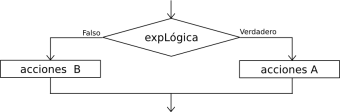
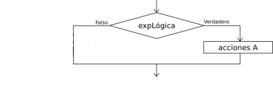
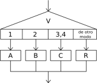

# 2: Interactividad y Control de Flujo

## 2.1. La Función *print()*

La función print() es la herramienta principal en *Python* para comunicar resultados y mostrar información en la pantalla del usuario (conocida como la salida estándar). Nos permite ver el resultado de nuestras expresiones, el valor de nuestras variables o simplemente mostrar mensajes de texto.

Su uso más básico consiste en pasarle el valor que queremos mostrar:

```python
print("Hola mundo") # Muestra el texto Hola mundo
fahrenheit = 91
celsius = (fahrenheit - 32) * 5/9
print(celsius) # Muestra el valor de la variable celsius
```

También es posible imprimir múltiples elementos en una sola llamada a print(), separándolos por comas. Por defecto, *Python* los mostrará en la misma línea, separados por un espacio.

```python
episodio = 3
print("Episodio", episodio, "del libro")
# Salida: Episodio 3 del libro
```

La función print() incluye parámetros opcionales que nos permiten modificar su comportamiento por defecto:

- **sep=str**: Este parámetro permite cambiar el separador que se usa entre los elementos. En lugar del espacio por defecto, podemos usar cualquier otra cadena de texto.
- **end=str**: Por defecto, cada llamada a print() termina con un salto de línea. El parámetro end permite especificar un carácter o cadena de texto diferente para el final, lo que posibilita que la siguiente llamada a print() continúe en la misma línea.

Mostrar información es útil, pero para crear programas verdaderamente dinámicos, también necesitamos que puedan recibir información del usuario.

## 2.2. La Función *input()*

La función input() es fundamental para crear programas interactivos. Detiene la ejecución del programa, muestra un mensaje al usuario (si se le proporciona uno) y espera a que este escriba algo con el teclado y presione *Enter*.

La sintaxis básica para leer la entrada del usuario y almacenarla en una variable es:

variable = input(texto)

Aquí, texto es el mensaje opcional que se le mostrará al usuario para indicarle qué dato debe ingresar.

Un punto crítico a recordar es que la función input() **siempre devuelve los datos ingresados por el usuario como una cadena de texto (*str*)**, sin importar si el usuario escribió números. Intentar realizar operaciones matemáticas directamente con la salida de input() resultará en un TypeError.

Para poder trabajar correctamente con la entrada del usuario, es necesario realizar una **"conversión de tipos"**. *Python* proporciona funciones para convertir un valor de un tipo a otro:

- int(): Convierte un valor a un número entero
- float(): Convierte un valor a un número de punto flotante

- bool(): Convierte un valor a un booleano

Podemos combinar input() con estas funciones para leer y convertir los datos en un solo paso:

```python
lec = int(input("¿Cuántas lecciones has visto? "))
total = 15
faltan = total - lec # Ahora esto funciona, porque 'lec' es un int
print("Te faltan", faltan, "lecciones. ¡Ánimo!")
# Resultado por pantalla:
¿Cuántas lecciones has visto? 3
Te faltan 12 lecciones. ¡Ánimo!
```

Ahora que nuestro programa puede recibir una calificación, un nombre o una temperatura del usuario, ¿cómo podemos hacer que reaccione de forma inteligente a esa información? La respuesta está en las estructuras condicionales.

## 2.3. Estructuras Condicionales

Las estructuras condicionales son la base de la toma de decisiones en programación. Permiten que un programa evalúe una condición (una expresión que resulta ser True o False) y ejecute diferentes bloques de código dependiendo del resultado. Esto le da al programa la capacidad de reaccionar de manera diferente a distintas entradas o situaciones.

### if-else



Esta es la estructura condicional más completa. Evalúa una condición (expresión lógica): si es True, ejecuta el bloque de código que sigue al if; si es False, ejecuta un bloque de código alternativo dentro de la cláusula else.

**La sintaxis requiere que los bloques de código estén indentados** (generalmente con 4 espacios o tabulado) para indicar que pertenecen a la estructura.

```python
# Sintaxis
```

if \<condición\>:

```python
    # Bloque de código si la condición es True
else:
    # Bloque de código si la condición es False
# Ejemplo
llueve = True
if llueve == True:
    print("Llevaré paraguas")
else:
    print("No llevaré paraguas")
# Resultado: Muestra "Llevaré paraguas"
```

### if sin else



El bloque else es completamente opcional. Un if puede existir por sí solo. En este caso, el bloque de código indentado se ejecutará únicamente si la condición es True. Si la condición es False, el programa simplemente saltará ese bloque y continuará con la siguiente instrucción fuera del if.

```python
charco = True
if charco == True:
    print("A saltar!")
print("Fin de la caminata") # Esta línea se ejecuta siempre al estar fuera del if
```

Cabe destacar que no puede existir una cláusula else sin una instrucción if que la preceda.

### elif

Cuando necesitamos evaluar más de dos posibles caminos, podemos encadenar múltiples condiciones usando elif (contracción de "*else if*"). El programa evalúa las condiciones en orden: **la primera que resulte True ejecutará su bloque de código, y el resto de la estructura elif/else será ignorada**. El bloque else final es opcional y actúa como un caso por defecto si ninguna de las condiciones anteriores fue True.

```python
# Sintaxis General
if <condicion1>:
    # ...
elif <condicion2>:
    # ...
elif <condicion3>:
    # ...
else:
    # ...
# Ejemplo
temperatura = 15
llueve = True
if temperatura >= 18:
    print("No llevaré paraguas ni abrigo")
elif llueve == True:
    print("Llevaré paraguas y abrigo")
else:
    print("Solo llevaré abrigo")
# Resultado: Mostrará "Llevaré paraguas y abrigo"
```

### match-case

Es una estructura que permite comparar un valor contra distintos patrones y ejecutar el bloque de código correspondiente al primer patrón que coincida.



Es similar al switch de otros lenguajes, pero más flexible.

```python
match <variable>:
    case <patron1>:
        # código si coincide patron1
    case <patron2>:
        # código si coincide patron2
    case _:
        # caso por defecto
```

*Python* evalúa los case en orden y ejecuta el primero que coincide. El case \_ funciona como el else de un if (por defecto, si no se cumple ninguno de los anteriores).

La estructura match-case sirve para evitar muchos if / elif / else y hacer el código más legible.

```python
valor = int(input("Dame un entero: "))
match valor:
    case 1:
        print ( "Uno" )
    case 2:
        print ( "Dos" )
    case 3:
        print ( "Tres" )
    case _:
        print ( "Otro valor" )
```

En un match-case se pueden poner más de un valor, separando con “\|”.

```python
valor = int(input("Dame un entero: "))
match valor:
    case 1 | 2:
        print ( "Uno o Dos" )
    case 3:
        print ( "Tres" )
    case _:
        print ( "Otro valor mayor que 3" )
```

Tomar decisiones es poderoso, pero ¿qué pasa cuando necesitamos que nuestro programa realice una acción una y otra vez?

