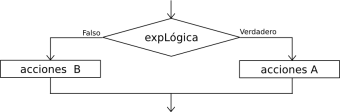
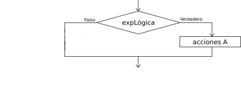
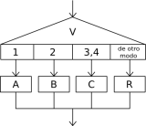

# 2: Interactivitat i Control de Flux

## 2.1. La Funció `print()`

La funció `print()` és l'eina principal en *Python* per a comunicar resultats i mostrar informació en la pantalla de l'usuari (coneguda com l'eixida estàndard). Ens permet veure el resultat de les nostres expressions, el valor de les nostres variables o simplement mostrar missatges de text.

El seu ús més bàsic consisteix a passar-li el valor que volem mostrar:

```python
print("Hola mundo") # Mostra el text Hola mundo
fahrenheit = 91
celsius = (fahrenheit - 32) * 5/9
print(celsius) # Mostra el valor de la variable celsius
```

També és possible imprimir múltiples elements en una sola crida a `print()`, separant-los per comes. Per defecte, *Python* els mostrarà en la mateixa línia, separats per un espai.

```python
episodio = 3
print("Episodio", episodio, "del libro")
# Eixida: Episodio 3 del libro
```

La funció `print()` inclou paràmetres opcionals que ens permeten modificar el seu comportament per defecte:

- `sep=str`: Aquest paràmetre permet canviar el separador que s'usa entre els elements. En lloc de l'espai per defecte, podem usar qualsevol altra cadena de text.
- `end=str`: Per defecte, cada crida a `print()` acaba amb un salt de línia. El paràmetre end permet especificar un caràcter o cadena de text diferent per al final, la qual cosa possibilita que la següent crida a `print()` continue en la mateixa línia.

Mostrar informació és útil, però per a crear programes verdaderament dinàmics, també necessitem que puguen rebre informació de l'usuari.

## 2.2. La Funció `input()`

La funció `input()` és fonamental per a crear programes interactius. Deté l'execució del programa, mostra un missatge a l'usuari (si se li'n proporciona un) i espera que aquest escriga alguna cosa amb el teclat i prema `Enter`.

La sintaxi bàsica per a llegir l'entrada de l'usuari i emmagatzemar-la en una variable és:

```python
variable = input(texto)
```

Ací, text és el missatge opcional que es mostrarà a l'usuari per a indicar-li quina dada ha d'introduir.

Un punt crític a recordar és que la funció `input()` **sempre torna les dades introduïdes per l'usuari com una cadena de text (`str`)**, sense importar si l'usuari va escriure nombres. Intentar realitzar operacions matemàtiques directament amb l'eixida d'`input()` resultarà en un `TypeError`.

Per a poder treballar correctament amb l'entrada de l'usuari, és necessari realitzar una **"conversió de tipus"**. *Python* proporciona funcions per a convertir un valor d'un tipus a un altre:

- `int()`: Converteix un valor a un nombre enter
- `float()`: Converteix un valor a un nombre de punt flotant

- `bool()`: Converteix un valor a un booleà

Podem combinar `input()` amb aquestes funcions per a llegir i convertir les dades en un sol pas:

```python
lec = int(input("¿Cuántas lecciones has visto? "))
total = 15
faltan = total - lec # Ara això funciona, perquè 'lec' és un int
print("Te faltan", faltan, "lecciones. ¡Ánimo!")
# Resultat per pantalla:
# ¿Cuántas lecciones has visto? 3
# Te faltan 12 lecciones. ¡Ánimo!
```

Ara que el nostre programa pot rebre una qualificació, un nom o una temperatura de l'usuari, com podem fer que reaccione de manera intel·ligent a aquesta informació? La resposta està en les estructures condicionals.

## 2.3. Estructures Condicionals

Les estructures condicionals són la base de la presa de decisions en programació. Permeten que un programa avalue una condició (una expressió que resulta ser `True` o `False`) i execute diferents blocs de codi depenent del resultat. Això li dona al programa la capacitat de reaccionar de manera diferent a distintes entrades o situacions.

### if-else



Aquesta és l'estructura condicional més completa. Avalua una condició (expressió lògica): si és `True`, executa el bloc de codi que segueix a l'`if`; si és `False`, executa un bloc de codi alternatiu dins de la clàusula `else`.

**La sintaxi requereix que els blocs de codi estiguen indentats** (generalment amb 4 espais o tabulat) per a indicar que pertanyen a l'estructura.

```python
# Sintaxi
if <condición>:
    # Bloc de codi si la condició és True
else:
    # Bloc de codi si la condició és False
# Exemple
llueve = True
if llueve == True:
    print("Llevaré paraguas")
else:
    print("No llevaré paraguas")
# Resultat: Muestra "Llevaré paraguas"
```

### if sense else



El bloc `else` és completament opcional. Un `if` pot existir per si sol. En aquest cas, el bloc de codi indentat s'executarà únicament si la condició és `True`. Si la condició és `False`, el programa simplement saltarà aquest bloc i continuarà amb la següent instrucció fora de l'`if`.

```python
charco = True
if charco == True:
    print("A saltar!")
print("Fin de la caminata") # Aquesta línia s'executa sempre en estar fora de l'if
```

Cal destacar que no pot existir una clàusula `else` sense una instrucció `if` que la preceda.

### elif

Quan necessitem avaluar més de dos possibles camins, podem encadenar múltiples condicions usant `elif` (contracció de "`else if`"). El programa avalua les condicions en ordre: **la primera que resulte `True` executarà el seu bloc de codi, i la resta de l'estructura `elif/else` serà ignorada**. El bloc else final és opcional i actua com un cas per defecte si cap de les condicions anteriors va ser `True`.

```python
# Sintaxi General
if <condicion1>:
    # ...
elif <condicion2>:
    # ...
elif <condicion3>:
    # ...
else:
    # ...
# Exemple
temperatura = 15
llueve = True
if temperatura >= 18:
    print("No llevaré paraguas ni abrigo")
elif llueve == True:
    print("Llevaré paraguas y abrigo")
else:
    print("Solo llevaré abrigo")
# Resultat: Mostrará "Llevaré paraguas y abrigo"
```

### match-case

És una estructura que permet comparar un valor contra diferents patrons i executar el bloc de codi corresponent al primer patró que coincidisca.



És similar al `switch` d'altres llenguatges, però més flexible.

```python
match <variable>:
    case <patron1>:
        # codi si coincideix patron1
    case <patron2>:
        # codi si coincideix patron2
    case _:
        # cas per defecte
```

*Python* avalua els `case` en ordre i executa el primer que coincideix. El `case _` funciona com l'`else` d'un `if` (per defecte, si no es compleix cap dels anteriors).

L'estructura `match-case` serveix per a evitar molts `if` / `elif` / `else` i fer el codi més llegible.

```python
valor = int(input("Dame un entero: "))
match valor:
    case 1:
        print ( "Uno" )
    case 2:
        print ( "Dos" )
    case 3:
        print ( "Tres" )
    case _:
        print ( "Otro valor" )
```

En un `match-case` es poden posar més d'un valor, separant amb “\|”.

```python
valor = int(input("Dame un entero: "))
match valor:
    case 1 | 2:
        print ( "Uno o Dos" )
    case 3:
        print ( "Tres" )
    case _:
        print ( "Otro valor mayor que 3" )
```

Prendre decisions és poderós, però què passa quan necessitem que el nostre programa realitze una acció una vegada i una altra?

---
## EXERCICI
Escriu un programa que demane la temperatura actual i mostre els missatges “Fa calor”, “Fa fred” o “Temperat” segons les següents casuístiques​:

- \> 30º: Fa calor
- < 10º: Fa fred
- altre: Temperat

```text
Quina és la temperatura?: 7
Fa fred
Quina és la temperatura?: 33
Fa calor
Quina és la temperatura?: 25
Temperat
```
