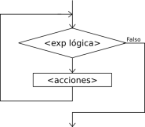

# 3: Repitiendo Tareas con Bucles

## 3.1. El Bucle *while*

El bucle while es una estructura de control que permite repetir un bloque de código de manera continua ***mientras* una condición específica se mantenga como True**.



El programa evalúa la condición al inicio de cada repetición (o iteración). Si es True, ejecuta el bloque de código; si es False, el bucle termina y el programa continúa con la siguiente instrucción.

La sintaxis del bucle while es la siguiente, donde el bloque de instrucciones debe estar indentado:

```python
while <condición>:
    # instrucciones a repetir
```

Para que un bucle while no se ejecute indefinidamente, **es crucial que alguna de las variables involucradas en la condición cambie su valor *dentro* del bucle**, de modo que en algún momento la condición se vuelva False.

```python
# Ejemplo de conversión de temperaturas de 32°F a 72°F
temp = 32
print("fº cº")
while temp < 73:
    print(temp, " ", int((temp-32)*5/9))
    temp = temp + 1 # Esta línea es crucial para evitar un bucle infinito
# Resultado
fº cº
32   0
33   0
34   1
35   1
36   2
…
70   21
71   21
72   22
```

Si la condición de un bucle while nunca se vuelve False, se produce un **bucle infinito**, lo que hará que el programa se "congele" y nunca termine.

Aunque while es flexible, existe una forma de bucle más adecuada para cuando conocemos de antemano el número exacto de repeticiones.

## 3.2. El Bucle *for* y *range()*

El bucle for es la estructura ideal cuando necesitamos iterar sobre una secuencia de elementos (como una lista) o cuando queremos repetir un bloque de código un número específico y predefinido de veces.


Para generar secuencias de números sobre las cuales iterar, el bucle for se combina comúnmente con la función range().

La función range() puede usarse de tres maneras para generar secuencias numéricas:

- range(fin): Genera una secuencia de números desde 0 hasta fin - 1.
- range(inicio, fin): Genera una secuencia desde inicio hasta fin - 1.

- range(inicio, fin, paso): Genera una secuencia desde inicio hasta fin - 1, avanzando de paso en paso.

La sintaxis del bucle for es:

```python
for <variable> in <secuencia>:
    # instrucciones
```

En cada iteración, la variable tomará el siguiente valor de la secuencia hasta que se hayan recorrido todos los elementos. Comparado con while, el bucle for con range() es más conciso y menos propenso a errores de ciclos infinitos para repeticiones contadas.

```python
# Mismo ejemplo de conversión de temperaturas con un bucle for
print("fº cº")
for temp in range(32, 73): # range(32, 73) genera números de 32 a 72
    print(temp, " ", int((temp-32)*5/9))
```

Ahora que dominamos el flujo de nuestros programas, es momento de aprender a manejar no solo datos individuales, sino colecciones enteras de ellos.

## 3.3. Alteración de la ejecución de los bucles

En *Python* se pueden hacer saltos en el flujo de ejecución de los bucles, pero de una manera limitada y controlada.

### break

Sale de un bucle (for o while) inmediatamente.

```python
for i in range(10):
    if i == 5:
        break
    print(i)
# Salida: 0, 1, 2, 3, 4
```

### continue

Salta a la siguiente iteración del bucle, sin ejecutar el resto del código de dentro

```python
for i in range(5):
    if i == 2:
        continue
    print(i)
# Salida: 0, 1, 3, 4
```


