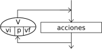

# 3: Repetint Tasques amb Bucles

## 3.1. El Bucle `while`

El bucle `while` és una estructura de control que permet repetir un bloc de codi de manera contínua ***mentre* una condició específica es mantinga com a `True`**.


El programa avalua la condició a l'inici de cada repetició (o iteració). Si és `True`, executa el bloc de codi; si és `False`, el bucle acaba i el programa continua amb la següent instrucció.

La sintaxi del bucle `while` és la següent, on el bloc d'instruccions ha d'estar indentat:

```python
while <condición>:
    # instruccions a repetir
```

Perquè un bucle `while` no s'execute indefinidament, **és crucial que alguna de les variables involucrades en la condició canvie el seu valor *dins* del bucle**, de manera que en algun moment la condició es torne `False`.

```python
# Exemple de conversió de temperatures de 32°F a 72°F
temp = 32
print("fº cº")
while temp < 73:
    print(temp, " ", int((temp-32)*5/9))
    temp = temp + 1 # Aquesta línia és crucial per a evitar un bucle infinit
# Resultat
fº cº
32   0
33   0
34   1
35   1
36   2
…
70   21
71   21
72   22
```

Si la condició d'un bucle `while` mai es torna `False`, es produeix un **bucle infinit**, la qual cosa farà que el programa es "congele" i mai acabe.

Encara que `while` és flexible, existeix una forma de bucle més adequada per a quan coneixem per endavant el nombre exacte de repeticions.

## 3.2. El Bucle *`for`* i *`range()`*

El bucle `for` és l'estructura ideal quan necessitem iterar sobre una seqüència d'elements (com una llista) o quan volem repetir un bloc de codi un nombre específic i predefinit de vegades.



Per a generar seqüències de nombres sobre les quals iterar, el bucle `for` es combina comunament amb la funció `range()`.

La funció `range()` pot usar-se de tres maneres per a generar seqüències numèriques:

- `range(fin)`: Genera una seqüència de nombres des de `0` fins a `fin-1`.
- `range(inicio, fin)`: Genera una seqüència des d'`inicio` fins a `fin-1`.
- `range(inicio, fin, paso)`: Genera una seqüència des d'`inicio` fins a `fin-1`, avançant de `paso` en `paso`.

La sintaxi del bucle `for` és:

```python
for <variable> in <secuencia>:
    # instruccions
```

En cada iteració, la variable prendrà el següent valor de la seqüència fins que s'hagen recorregut tots els elements. Comparat amb `while`, el bucle `for` amb `range()` és més concís i menys propens a errors de cicles infinits per a repeticions comptades.

```python
# Mateix exemple de conversió de temperatures amb un bucle for
print("fº cº")
for temp in range(32, 73): # range(32, 73) genera nombres de 32 a 72
    print(temp, " ", int((temp-32)*5/9))
```

Ara que dominem el flux dels nostres programes, és el moment d'aprendre a manejar no només dades individuals, sinó col·leccions senceres d'elles.

## 3.3. Alteració de l'execució dels bucles

En *Python* es poden fer salts en el flux d'execució dels bucles, però d'una manera limitada i controlada.

### `break`

Ix d'un bucle (`for` o `while`) immediatament.

```python
for i in range(10):
    if i == 5:
        break
    print(i)
# Eixida: 0, 1, 2, 3, 4
```

### `continue`

Salta a la següent iteració del bucle, sense executar la resta del codi de dins

```python
for i in range(5):
    if i == 2:
        continue
    print(i)
# Eixida: 0, 1, 3, 4
```

---
## EXERCICIS
Usa un bucle `for` i `range()` per a generar i imprimir la taula de multiplicar d'un número sol·licitat a l'usuari.​

Fes després el mateix utilitzant `while()`​.

```text
Quin és el nombre per a fer la taula de multiplicar?: 7
//// Tabla del 7 ////
7 x 0 = 0
7 x 1 = 7
7 x 2 = 14
7 x 3 = 21
7 x 4 = 28
7 x 5 = 35
7 x 6 = 42
7 x 7 = 49
7 x 8 = 56
7 x 9 = 63
7 x 10 = 70
```

[**--> Més activitats de bucles, llistes i funcions ací <--**](arxius/AltresActivitats.pdf)