# 8. Hagamos cosas chulas con Python

## 8.1 Lectura de datos de un CSV

Un archivo CSV (*Comma Separated Values*) contiene datos organizados por filas en las que la información se separa normalmente mediante comas (aunque se pueden utilizar otros caracteres de separación). Se suelen utilizar mucho en informática para guardar y procesar gran cantidad de datos, puesto que son ficheros que ocupan muy poco (archivos de texto plano) y que son compatibles con todas las plataformas (Windows, MacOS, Linux …).

El siguiente ejemplo muestra un archivo que almacena información sobre un pedido de frutas. Cada fila contiene, separado por comas `,`:

- la fecha y hora del pedido
- la fruta
- un entero que indica la cantidad de piezas solicitadas
- un número real que es el precio por unidad de esa fruta

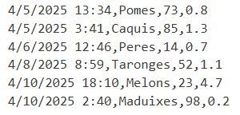

Si queremos leer y procesar los datos de un archivo CSV necesitamos realizar los siguientes pasos:

1.  Importar el módulo `csv` que nos permitirá usar funciones específicas para el procesado de archivos CSV
2.  Abrir el archivo CSV que queremos procesar mediante la función incorporada `open()` y guardar el objeto que ésta crea en una variable
3.  Utilizar la función `csv.reader()` sobre la variable creada para obtener un `objeto` de tipo `reader` que podremos iterar para ir leyendo fila a fila todo el archivo CSV

``` python
import csv
arxiu = open('fruites.csv')
arxiu_reader = csv.reader(arxiu)
```

Una vez creado el objeto iterable, lo podemos recorrer con un bucle `for-in` que nos devolverá, en cada iteración del bucle, **una lista con los datos de cada fila**.

``` python
for fila in arxiu_reader:
    print(str(fila))
```

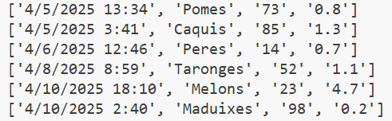

La lista `fila`, en cada iteración, contendrá la información de una de las frutas del pedido. Podemos acceder a los diferentes valores de la lista mediante indexación para extraer los datos que nos interesen.

``` python
for fila in arxiu_reader:
    fruita = fila[1]
    unitats = int(fila[2])    
    print(fruita + ' --> ' + str(unitats))
```

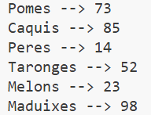

En función del tipo de datos, tendremos que hacer el cambio de tipo correspondiente para poder tratar los datos correctamente (`int()`, `str()`, `float()` …).

Es importante saber que **sólo se puede iterar el objeto reader una vez**. Para volver a leer el archivo CSV, se debe volver a llamar a `open()` y `csv.reader()` para crear otro objeto `reader`.

Una precaución que se debe tener al trabajar con archivos, es cerrar cualquier referencia a éstos una vez acabemos de procesarlos (al leerlos y especialmente al escribirlos). Para ellos simplemente llamaremos al método `close()` del objeto sobre el que se abrió el archivo.

``` python
arxiu.close()
```

## 8.2 Escritura de datos en un CSV

Si queremos guardar datos utilizados por nuestro programa *Python* para un posterior procesado o para compartirlos, podemos almacenarlos en un fichero CSV.

Los pasos que tendremos que seguir son:

1.  Importar el módulo `csv` que nos permitirá usar funciones específicas para el procesado de archivos CSV
2.  Abrir **en modo escritura** `'w'` el archivo CSV en el que queremos guardar los datos mediante la función `open(archivo, ‘w’, newline=’’)` y guardar el objeto que ésta crea en una variable
3.  Utilizar la función `csv.writer()` sobre la variable creada para obtener un `objeto` de tipo `writer` que podremos usar para ir guardando listas (línea a línea).

``` python
import csv
arxiu = open('animals.csv', 'w', newline='')
arxiu_writer = csv.writer(arxiu)
```

**En Windows**, se debe pasar una cadena en blanco como argumento de `newline=’’` en la función `open()`. Si se olvida esto, las filas del archivo CSV se mostrarán a doble espacio.

Una vez creado el objeto `writer`, utilizaremos su función `writerow()` para almacenar una lista en la última fila del archivo.

``` python
arxiu_writer.writerow(['ocell', 'rata', 'serp', 'foca'])
arxiu_writer.writerow(['Hello, world of animals!', 'gos', 'koala', 'elefant'])
arxiu_writer.writerow([1, 2, 3.141592, 4])
arxiu.close()
```

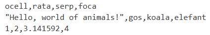

De este modo, los valores de la lista se guardarán separados por comas `,`. Recordad que **es muy importante cerrar el uso del archivo** una vez acabéis de usarlo `close()`. En algunos lenguajes de programación es justo en ese momento en el que el archivo se actualiza con los cambios realizados. Por lo que es buena práctica acostumbrarse a cerrarlo siempre, con independencia del lenguaje usado.

Si en lugar de tener los valores del CSV separados por comas `,` los queréis guardar con otro delimitador, podéis indicarlo con la propiedad `delimiter` de llamada a `csv.writer()`.

``` python
arxiu_tab = open('animals_tab.csv', 'w', newline='')
arxiu_writer = csv.writer(arxiu_tab, delimiter='\t')
arxiu_writer.writerow(['ocell', 'rata', 'serp', 'foca'])
arxiu_writer.writerow(['Hello, world of animals!', 'gos', 'koala', 'elefant'])
arxiu_writer.writerow([1, 2, 3.141592, 4])
arxiu_tab.close()
```

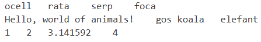

``` python
arxiu_linia = open('animals_linia.csv', 'w', newline='')
arxiu_writer = csv.writer(arxiu_linia, delimiter='|')
arxiu_writer.writerow(['ocell', 'rata', 'serp', 'foca'])
arxiu_writer.writerow(['Hello, world of animals!', 'gos', 'koala', 'elefant'])
arxiu_writer.writerow([1, 2, 3.141592, 4])
arxiu_linia.close()
```

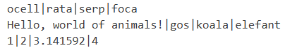

## 8.3 Manipulación de imágenes

**Pillow (`PIL`)** es un paquete de Python de terceros (*third-party*) para interactuar con archivos de imagen. Este paquete cuenta con varias funciones que facilitan recortar, redimensionar y editar el contenido de una imagen. Para poder hacerlo, importaremos solamente el módulo `Image` de la librería.

``` python
from PIL import Image
imatge_gat = Image.open('zophie.png')
imatge_gat.show()
```

Mediante la función `open()` de `Image` crearemos un `objeto` de tipo imagen a partir de un archivo almacenado en el ordenador. Los diferentes métodos y atributos de este `objeto` nos permitirán modificar la imagen. Por ejemplo, mostraremos la imagen cargada mediate la función `show()`.

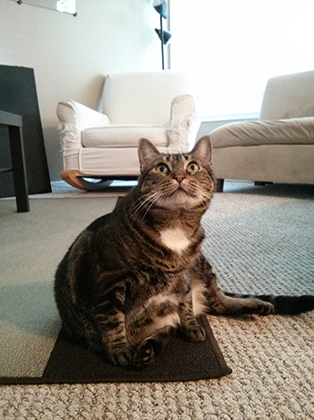

### Características de las imágenes

Podemos acceder a los atributos de nombre, formato y tamaño de la imagen de la siguiente forma.

``` python
print('Nom: ' + imatge_gat.filename)
print('Format: ' + imatge_gat.format)
ample, alt = imatge_gat.size
print('Ample =', ample, ' / Alt =', alt)
#Guardem en un altre format (jpg)
imatge_gat.save('zophie.jpg')
```

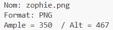

Como vemos, se puede guardar la imagen en un formato diferente mediante `save()`.

En *Python*, los píxeles de una imagen se direccionan mediante las coordenadas `x` e `y`, que especifican, respectivamente, su posición horizontal y vertical. El origen es el píxel en la esquina superior izquierda de la imagen y se especifica con la notación `(0, 0)`.

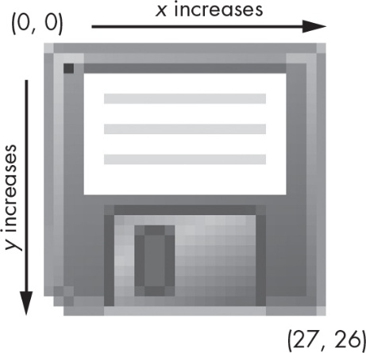

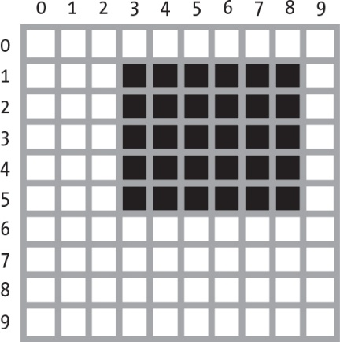

El primer `0` representa la coordenada `x`, que comienza en `0` en el origen y aumenta de izquierda a derecha. El segundo `0` representa la coordenada `y`, que comienza en `0` en el origen y aumenta hacia abajo, lo cual es contrario a cómo se explican normalmente en la clase de matemáticas.

Muchas de las funciones de `Pillow` toman como argumento una `tupla` de caja (recuerda que una `tupla` es “como una lista”, pero inmutable). Esto significa que `Pillow` espera una `tupla` de cuatro coordenadas enteras que representan una región rectangular en una imagen. Los cuatro enteros son, en orden, los siguientes:

- `Left`: La coordenada `x` del borde más a la izquierda de la caja
- `Top`: La coordenada `y` del borde superior de la caja
- `Right`: La coordenada `x` de un píxel a la derecha del borde más a la derecha de la caja. Este entero debe ser mayor que el entero izquierdo
- `Bottom`: La coordenada `y` de un píxel por debajo del borde inferior de la caja. Este entero debe ser mayor que el entero superior

Hay que tener en cuenta que la caja incluye las coordenadas izquierda y superior, y llega hasta, pero no incluye, las coordenadas derecha e inferior. Por ejemplo, la `tupla` de caja `(3, 1, 9, 6)` representa todos los píxeles de la caja negra de la figura anterior.

### Recortar, copiar y pegar

Una vez conocemos la forma de referenciar los píxeles de una imagen en *Python*, podemos recortar una imagen mediante la función `crop()`, pasándole la caja a cortar con una `tupla` de la siguiente forma.

``` python
#Creem una nova a partir d'un tall de l'original
imatge_cara = imatge_gat.crop((150, 150, 240, 250))
imatge_cara.save('tallada.png')
imatge_cara.show()
```


La imagen recortada podemos, por ejemplo, pegarla en diferentes lugares de la imagen original. Lo haremos sobre una copia de la original, creada mediante la función `copy()`, para así mantener la original sin cambios.

``` python
#Pega la cara tallada sobre una còpia de la imatge original
copia_gat = imatge_gat.copy()
copia_gat.paste(imatge_cara, (0, 0))
copia_gat.paste(imatge_cara, (250, 250))
copia_gat.save('pegada.png')
copia_gat.show()
```
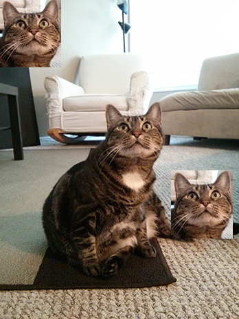

La función `paste()` permite pegar una imagen sobre otra, definiendo el píxel inicial a partir del cual se pegará mediante una `tupla` de 2 puntos `(x, y)`.

Jugando con la función `paste()` y 2 bucles `for` anidados, podemos conseguir un mosaico de caras de gatos sobre una copia de la imagen original.

``` python
# Crea un mosaic de cares damunt la imatge original
ample_cara, alt_cara = imatge_cara.size
mosaic_gat = imatge_gat.copy()
#for left in range(0, ample, ample_cara):
for left in range(0, 3*ample_cara, ample_cara):    
    for top in range(0, alt, alt_cara):
        print(left, top)
        mosaic_gat.paste(imatge_cara, (left, top))
mosaic_gat.show()
mosaic_gat.save('mosaic.png')
```

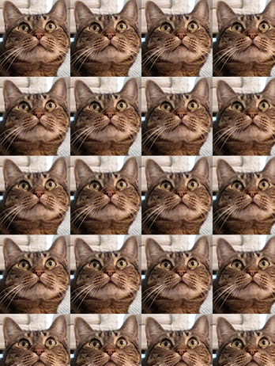

En este ejemplo utilizamos el ancho/alto de la imagen original `(ample, alt)` y el de la imagen de la cara `(ample_cara, alt_cara)` para definir los valores `left/top` a partir de los cuales se pegará cada una de las caras. El primer `for` recorrerá las filas del mosaico, mientras que el `for` anidado recorrerá las columnas:

- `range(0, ample, ample_cara)`: empieza en el píxel horizontal `0`, llega al último píxel del ancho de la imagen original, incrementando en un número de píxeles igual al ancho de la imagen de la cara.

- `range(0, alt, alt_cara)`: empieza en el píxel vertical `0`, llega al último píxel del alto de la imagen original, incrementando en un número de píxeles igual al alto de la imagen de la cara.

A medida que se van realizando iteraciones completas del bucle anidado, la imagen final irá cambiando de la siguiente forma.

| 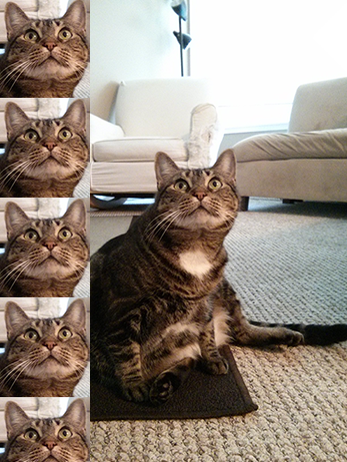 | 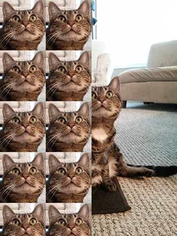 | 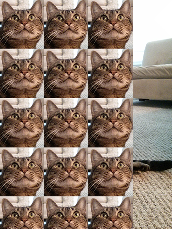 |
|----------------------------------------------------------------------------|----------------------------------------------------------------------------|----------------------------------------------------------------------------|
| **left = 0**                                                               | **left = ample_cara**                                                      | **left = 2\*ample_cara**                                                   |

### Redimensionar y rotar

Las funciones `resize()` y `rotate()` nos permiten cambiar el tamaño de una imagen y rotarla respectivamente.

``` python
# Canvia el tamany
imatge_reduida = imatge_gat.resize((int(ample / 2), int(alt / 2)))
imatge_reduida.show()
imatge_reduida.save('reduida.png')
```

El método `resize()` devuelve un **nuevo objeto `Image`** con el ancho y alto especificados (no modifica el Image original). Acepta una `tupla` de dos enteros que representa las nuevas dimensiones. Puesto que solo acepta números enteros, es necesario convertir ambas dimensiones mediante `int()`.

Para asegura la proporcionalidad de la imagen resultante, es conveniente que las nuevas dimensiones sean múltiplos del ancho/alto original (de ahí el uso de `ample/2` y `alt/2` en este ejemplo).

Si lo que queremos hacer es rotar una imagen, el método `rotate()` devuelve un **nuevo objeto `Image`** y deja el original sin cambios. El método acepta un entero o `float` que representa el número de grados que se rotará la imagen en sentido antihorario.

``` python
# Rotar imatges
imatge_gat.rotate(90).save('rotada90.png')
imatge_gat.rotate(180).save('rotada180.png')
imatge_gat.rotate(6).save('rotada6.png')
imatge_gat.rotate(6, expand=True).save('rotada6_expandida.png')
```

Como vemos, se pueden encadenar llamadas de método llamando a `save()` directamente en el objeto `Image` devuelto desde `rotate()`, sin necesidad de guardarlo en una variable intermedia. Las imágenes obtenidas son las siguientes.

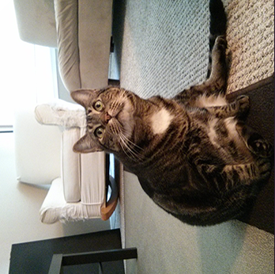

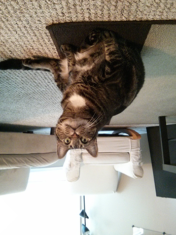

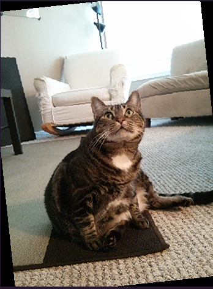

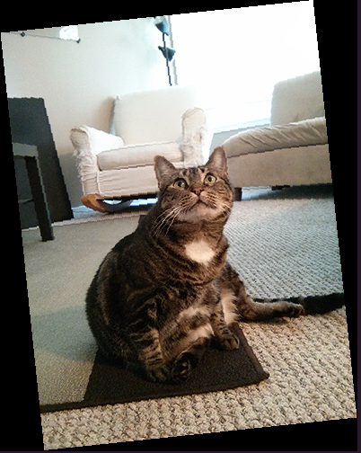

El método `rotate()` tiene el argumento opcional `expand`, que se puede establecer a `True` para ampliar las dimensiones de la imagen y que se ajuste a toda la nueva imagen rotada.

Recordad que, una vez finalicemos el tratamiento de las imágenes, es conveniente cerrar todos los objetos `Image`.

``` python
#Tanca totes les imatges
mosaic_gat.close()
imatge_reduida.close()
copia_gat.close()
imatge_cara.close()
imatge_gat.close()
```

## 8.4 Creación de gráficos

La biblioteca *Matplotlib* permite crear una amplia variedad de gráficos (gráficos de líneas, de barras, de dispersión, circulares básicos, 3D …). Podéis encontrar la documentación completa en [https://matplotlib.org](https://matplotlib.org). Dependiendo del Sistema Operativo y la configuración de *Python*, tendréis que seguir unos pasos para la [instalación](https://matplotlib.org/stable/install/index.html) de *Matplotlib*.

### Líneas y Dispersión

Un gráfico de líneas es ideal para mostrar los cambios en una medida a lo largo del tiempo. En *Matplotlib*, los términos `plot`, `graph` y `chart` se usan indistintamente, y el término `figure` se refiere a la ventana que contiene uno o más gráficos.

Importamos `matplotlib.pyplot` con el nombre `plt` para facilitar la introducción de sus funciones.

A continuación, para representar los **puntos de datos en una figura 2D**, debemos llamar a la función `plt.plot()`. Primero asociaremos al gráfico los valores para los ejes horizontal/vertical guardados en `x` e `y1`. Tras llamar a `plt.plot()` con estos valores, lo invocamos una segunda vez con `x` ​​e `y2` para añadir una segunda línea al gráfico.

``` python
import matplotlib.pyplot as plt
x = [0, 1, 2, 3, 4, 5]
y1 = [10, 13, 15, 18, 16, 20]
y2 = [9, 11, 18, 16, 17, 19]
plt.plot(x, y1)
plt.plot(x, y2)
# Per guardar un fitxer d'imatge del gràfic, heu de cridar 
# plt.savefig() abans de cridar a plt.show()
plt.savefig('linies.png')  
plt.show() 
```

*Matplotlib* seleccionará automáticamente los colores de las líneas y un tamaño adecuado para el gráfico. Podemos guardar el gráfico predeterminado como una imagen PNG llamando a `plt.savefig()`.

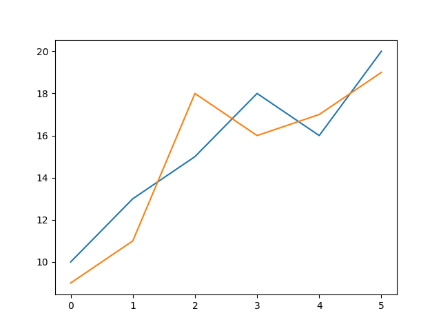

*Matplotlib* cuenta con la función `plt.show()` de vista previa que muestra el gráfico en una ventana. Remarcar que, si queremos guardar el gráfico, debemos hacerlo antes de llamar a la función `plt.show()`. La llamada a la función bloqueará la ejecución del código y no regresará hasta que el usuario cierre la ventana.

Para crear un **gráfico de dispersión** de estos mismos datos, pase los valores del eje `x` y del eje `y` a la función `plt.scatter()`.

``` python
# Gràfica Scatter
plt.scatter(x, y1)
plt.scatter(x, y2)
plt.savefig('scatter.png')
plt.show()
```

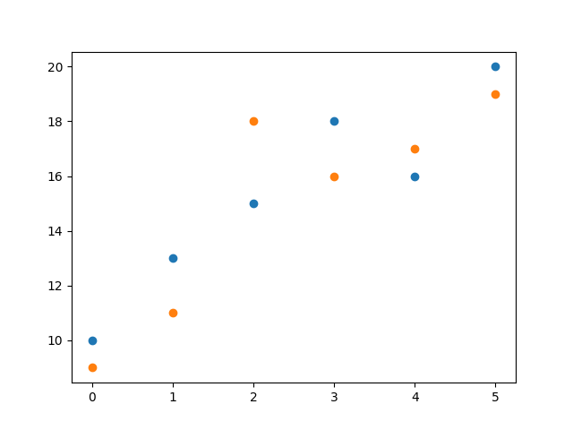

### Barras y gráficos circulares

Los **gráficos de barras** son útiles para comparar el mismo tipo de datos en diferentes categorías. A diferencia de un gráfico de líneas, el orden de las categorías no es importante, aunque suelen estar ordenadas alfabéticamente.

``` python
# Barres
categories = ['Gats', 'Gossos', 'Ratolins', 'Pardals']
valors = [100, 150, 30, 200]
plt.bar(categories, valors)
plt.savefig('barres.png')
plt.show()
```

Pasamos las categorías a enumerar en el eje `x` como la primera lista a `plt.bar()` y los valores para cada categoría como la segunda lista.

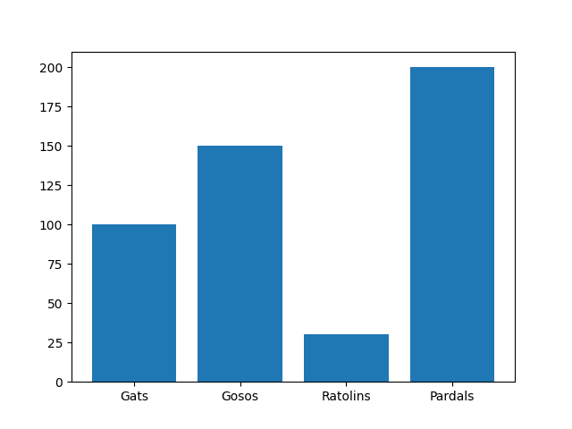

Para crear un gráfico circular, utilizaremos la función `plt.pie()`. En lugar de categorías y valores, un gráfico circular tiene sectores y etiquetas. La función `plt.pie()` acepta una lista de tamaños de porción y una lista de etiquetas para cada porción.

``` python
# Gràfic Circular
porcions = [100, 150, 30, 200]  # El tamany de cada porció
etiquetes = ['Gats', 'Gossos', 'Ratolins', 'Pardals'] 
plt.pie(porcions, labels=etiquetes)
plt.savefig('tarta.png')
plt.show()
```

El primer argumento posicional de `plt.pie()` hace referencia a las porciones `x` (`porcions` en este ejemplo), pero el segundo no hace referencia a las etiquetas, sino al atributo `explode`, por lo que para asignar los valores de `etiquetes` al atributo `labels` del `plt.pie()` debemos especificarlo en la llamada a la función. 
Podéis consultar los detalles de los diferentes parámetros de `plt.pie()` en su [documentación oficial](https://matplotlib.org/stable/api/_as_gen/matplotlib.pyplot.pie.html).

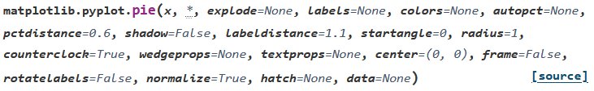


Entre la gran diversidad de atributos que podemos modificar para obtener el gráfico deseado, el atributo `autopct` nos permite mostrar el valor de cada porción como un % respecto del total.

``` python
plt.pie(porcions, labels=etiquetes, autopct='%.1f%%')
plt.savefig('tartaX100.png')
plt.show()
```

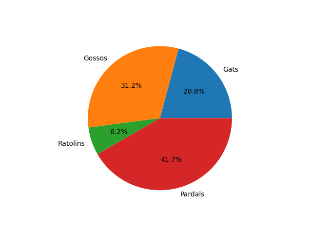

El atributo es una cadena de especificación de formato: la cadena `'%.1f%%'` especifica que el número debe mostrar un dígito después del punto decimal y después del decimal se muestra el símbolo de % (la cadena `'%.1f'` mostraría el mismo valor, pero sin el símbolo de % final).
