# 8. Fem coses xules amb Python

## 8.1 Lectura de dades d'un CSV

Un arxiu CSV (*Comma Separated Values*) conté dades organitzades per files en les quals la informació se separa normalment mitjançant comes (encara que es poden utilitzar altres caràcters de separació). S'solen utilitzar molt en informàtica per a guardar i processar gran quantitat de dades, ja que són fitxers que ocupen molt poc (arxius de text pla) i que són compatibles amb totes les plataformes (Windows, MacOS, Linux …).

L'exemple següent mostra un arxiu que emmagatzema informació sobre una comanda de fruites. Cada fila conté, separat per comes `,`:

- la data i hora de la comanda
- la fruita
- un enter que indica la quantitat de peces sol·licitades
- un nombre real que és el preu per unitat d'aquesta fruita

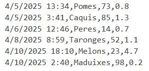

Si volem llegir i processar les dades d'un arxiu CSV necessitem realitzar els següents passos:

1.  Importar el mòdul `csv` que ens permetrà usar funcions específiques per al processament d'arxius CSV
2.  Obrir l'arxiu CSV que volem processar mitjançant la funció incorporada `open()` i guardar l'objecte que aquesta crea en una variable
3.  Utilitzar la funció `csv.reader()` sobre la variable creada per a obtindre un `objeto` de tipus `reader` que podrem iterar per a anar llegint fila a fila tot l'arxiu CSV

``` python
import csv
arxiu = open('fruites.csv')
arxiu_reader = csv.reader(arxiu)
```

Una vegada creat l'objecte iterable, el podem recórrer amb un bucle `for-in` que ens tornarà, en cada iteració del bucle, **una llista amb les dades de cada fila**.

``` python
for fila in arxiu_reader:
    print(str(fila))
```

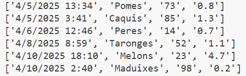

La llista `fila`, en cada iteració, contindrà la informació d'una de les fruites de la comanda. Podem accedir als diferents valors de la llista mitjançant indexació per a extraure les dades que ens interessen.

``` python
for fila in arxiu_reader:
    fruita = fila[1]
    unitats = int(fila[2])    
    print(fruita + ' --> ' + str(unitats))
```

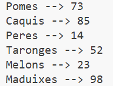

En funció del tipus de dades, haurem de fer el canvi de tipus corresponent per a poder tractar les dades correctament (`int()`, `str()`, `float()` …).

És important saber que **només es pot iterar l'objecte reader una vegada**. Per a tornar a llegir l'arxiu CSV, s'ha de tornar a cridar a `open()` i `csv.reader()` per a crear un altre objecte `reader`.

Una precaució que s'ha de tindre quan es treballa amb arxius, és tancar qualsevol referència a aquests una vegada acabem de processar-los (en llegir-los i especialment en escriure'ls). Per a això simplement cridarem al mètode `close()` de l'objecte sobre el qual es va obrir l'arxiu.

``` python
arxiu.close()
```

## 8.2 Escriptura de dades en un CSV

Si volem guardar dades utilitzades pel nostre programa *Python* per a un posterior processament o per a compartir-les, podem emmagatzemar-les en un fitxer CSV.

Els passos que haurem de seguir són:

1.  Importar el mòdul `csv` que ens permetrà usar funcions específiques per al processament d'arxius CSV
2.  Obrir **en mode escriptura** `'w'` l'arxiu CSV en el qual volem guardar les dades mitjançant la funció `open(archivo, ‘w’, newline=’’)` i guardar l'objecte que aquesta crea en una variable
3.  Utilitzar la funció `csv.writer()` sobre la variable creada per a obtindre un `objeto` de tipus `writer` que podrem usar per a anar guardant llistes (línia a línia).

``` python
import csv
arxiu = open('animals.csv', 'w', newline='')
arxiu_writer = csv.writer(arxiu)
```

**En Windows**, s'ha de passar una cadena en blanc com a argument de `newline=’’` en la funció `open()`. Si s'oblida això, les files de l'arxiu CSV es mostraran a doble espai.

Una vegada creat l'objecte `writer`, utilitzarem la seua funció `writerow()` per a emmagatzemar una llista en l'última fila de l'arxiu.

``` python
arxiu_writer.writerow(['ocell', 'rata', 'serp', 'foca'])
arxiu_writer.writerow(['Hello, world of animals!', 'gos', 'koala', 'elefant'])
arxiu_writer.writerow([1, 2, 3.141592, 4])
arxiu.close()
```

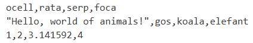

D'aquesta manera, els valors de la llista es guardaran separats per comes `,`. Recordeu que **és molt important tancar l'ús de l'arxiu** una vegada acabeu d'usar-lo `close()`. En alguns llenguatges de programació és just en aquest moment en el qual l'arxiu s'actualitza amb els canvis realitzats. Per la qual cosa és bona pràctica acostumar-se a tancar-lo sempre, amb independència del llenguatge usat.

Si en lloc de tindre els valors del CSV separats per comes `,` els voleu guardar amb un altre delimitador, podeu indicar-ho amb la propietat `delimiter` de la crida a `csv.writer()`.

``` python
arxiu_tab = open('animals_tab.csv', 'w', newline='')
arxiu_writer = csv.writer(arxiu_tab, delimiter='\t')
arxiu_writer.writerow(['ocell', 'rata', 'serp', 'foca'])
arxiu_writer.writerow(['Hello, world of animals!', 'gos', 'koala', 'elefant'])
arxiu_writer.writerow([1, 2, 3.141592, 4])
arxiu_tab.close()
```

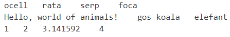

``` python
arxiu_linia = open('animals_linia.csv', 'w', newline='')
arxiu_writer = csv.writer(arxiu_linia, delimiter='|')
arxiu_writer.writerow(['ocell', 'rata', 'serp', 'foca'])
arxiu_writer.writerow(['Hello, world of animals!', 'gos', 'koala', 'elefant'])
arxiu_writer.writerow([1, 2, 3.141592, 4])
arxiu_linia.close()
```

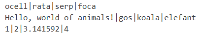

## 8.3 Manipulació d'imatges

**Pillow (`PIL`)** és un paquet de Python de tercers (*third-party*) per a interactuar amb arxius d'imatge. Aquest paquet compta amb diverses funcions que faciliten retallar, redimensionar i editar el contingut d'una imatge. Per a poder fer-ho, importarem solament el mòdul `Image` de la llibreria.

``` python
from PIL import Image
imatge_gat = Image.open('zophie.png')
imatge_gat.show()
```

Mitjançant la funció `open()` d'`Image` crearem un `objeto` de tipus imatge a partir d'un arxiu emmagatzemat en l'ordinador. Els diferents mètodes i atributs d'aquest `objeto` ens permetran modificar la imatge. Per exemple, mostrarem la imatge carregada mitjançant la funció `show()`.

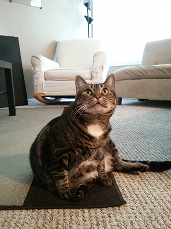

### Característiques de les imatges

Podem accedir als atributs de nom, format i grandària de la imatge de la següent manera.

``` python
print('Nom: ' + imatge_gat.filename)
print('Format: ' + imatge_gat.format)
ample, alt = imatge_gat.size
print('Ample =', ample, ' / Alt =', alt)
#Guardem en un altre format (jpg)
imatge_gat.save('zophie.jpg')
```

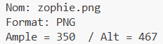

Com veiem, es pot guardar la imatge en un format diferent mitjançant `save()`.

En *Python*, els píxels d'una imatge s'adrecen mitjançant les coordenades `x` i `y`, que especifiquen, respectivament, la seua posició horitzontal i vertical. L'origen és el píxel en la cantonada superior esquerra de la imatge i s'especifica amb la notació `(0, 0)`.

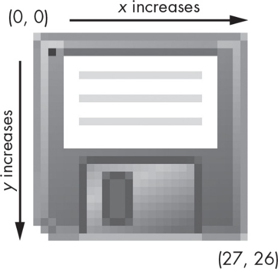

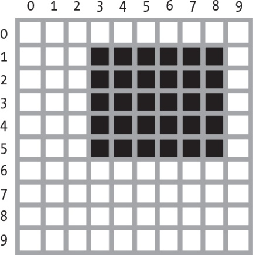

El primer `0` representa la coordenada `x`, que comença en `0` a l'origen i augmenta d'esquerra a dreta. El segon `0` representa la coordenada `y`, que comença en `0` a l'origen i augmenta cap avall, la qual cosa és contrària a com s'expliquen normalment a la classe de matemàtiques.

Moltes de les funcions de `Pillow` prenen com a argument una `tupla` de caixa (recorda que una `tupla` és “com una llista”, però immutable). Això significa que `Pillow` espera una `tupla` de quatre coordenades enteres que representen una regió rectangular en una imatge. Els quatre enters són, en ordre, els següents:

- `Left`: La coordenada `x` de la vora més a l'esquerra de la caixa
- `Top`: La coordenada `y` de la vora superior de la caixa
- `Right`: La coordenada `x` d'un píxel a la dreta de la vora més a la dreta de la caixa. Aquest enter ha de ser major que l'enter esquerre
- `Bottom`: La coordenada `y` d'un píxel per davall de la vora inferior de la caixa. Aquest enter ha de ser major que l'enter superior

Cal tindre en compte que la caixa inclou les coordenades esquerra i superior, i arriba fins a, però no inclou, les coordenades dreta i inferior. Per exemple, la `tupla` de caixa `(3, 1, 9, 6)` representa tots els píxels de la caixa negra de la figura anterior.

### Retallar, copiar i apegar

Una vegada coneixem la manera de referenciar els píxels d'una imatge en *Python*, podem retallar una imatge mitjançant la funció `crop()`, passant-li la caixa a tallar amb una `tupla` de la següent manera.

``` python
#Creem una nova a partir d'un tall de l'original
imatge_cara = imatge_gat.crop((150, 150, 240, 250))
imatge_cara.save('tallada.png')
imatge_cara.show()
```


La imatge retallada podem, per exemple, apegar-la en diferents llocs de la imatge original. Ho farem sobre una còpia de l'original, creada mitjançant la funció `copy()`, per a així mantindre l'original sense canvis.

``` python
#Pega la cara tallada sobre una còpia de la imatge original
copia_gat = imatge_gat.copy()
copia_gat.paste(imatge_cara, (0, 0))
copia_gat.paste(imatge_cara, (250, 250))
copia_gat.save('pegada.png')
copia_gat.show()
```
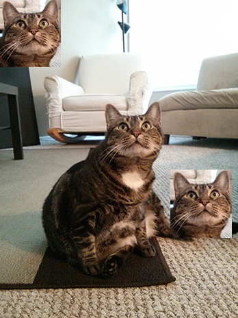

La funció `paste()` permet apegar una imatge sobre una altra, definint el píxel inicial a partir del qual s'apegarà mitjançant una `tupla` de 2 punts `(x, y)`.

Jugant amb la funció `paste()` i 2 bucles `for` aniuats, podem aconseguir un mosaic de cares de gats sobre una còpia de la imatge original.

``` python
# Crea un mosaic de cares damunt la imatge original
ample_cara, alt_cara = imatge_cara.size
mosaic_gat = imatge_gat.copy()
#for left in range(0, ample, ample_cara):
for left in range(0, 3*ample_cara, ample_cara):    
    for top in range(0, alt, alt_cara):
        print(left, top)
        mosaic_gat.paste(imatge_cara, (left, top))
mosaic_gat.show()
mosaic_gat.save('mosaic.png')
```

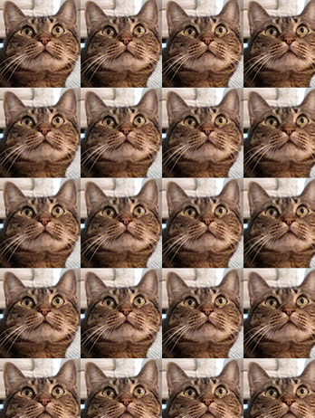

En aquest exemple utilitzem l'ample/alt de la imatge original `(ample, alt)` i el de la imatge de la cara `(ample_cara, alt_cara)` per a definir els valors `left/top` a partir dels quals s'apegarà cadascuna de les cares. El primer `for` recorrerà les files del mosaic, mentre que el `for` aniuat recorrerà les columnes:

- `range(0, ample, ample_cara)`: comença en el píxel horitzontal `0`, arriba a l'últim píxel de l'ample de la imatge original, incrementant en un nombre de píxels igual a l'ample de la imatge de la cara.

- `range(0, alt, alt_cara)`: comença en el píxel vertical `0`, arriba a l'últim píxel de l'alt de la imatge original, incrementant en un nombre de píxels igual a l'alt de la imatge de la cara.

A mesura que es van realitzant iteracions completes del bucle aniuat, la imatge final anirà canviant de la següent manera.

| 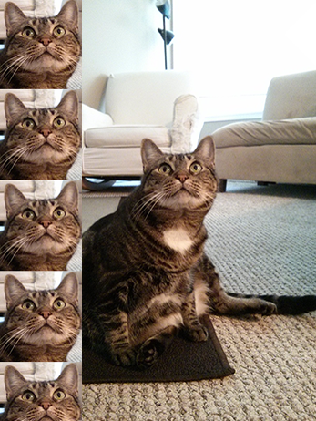 | 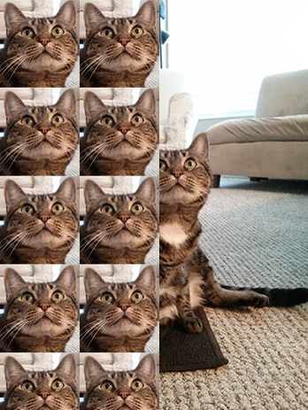 | 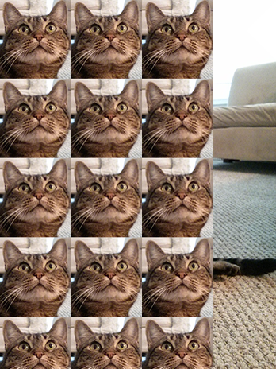 |
|----------------------------------------------------------------------------|----------------------------------------------------------------------------|----------------------------------------------------------------------------|
| **left = 0**                                                               | **left = ample_cara**                                                      | **left = 2\*ample_cara**                                                   |

### Redimensionar i rotar

Les funcions `resize()` i `rotate()` ens permeten canviar la grandària d'una imatge i rotar-la respectivament.

``` python
# Canvia el tamany
imatge_reduida = imatge_gat.resize((int(ample / 2), int(alt / 2)))
imatge_reduida.show()
imatge_reduida.save('reduida.png')
```

El mètode `resize()` torna un **nou objecte `Image`** amb l'ample i alt especificats (no modifica l'Image original). Accepta una `tupla` de dos enters que representa les noves dimensions. Com que només accepta nombres enters, és necessari convertir ambdues dimensions mitjançant `int()`.

Per a assegurar la proporcionalitat de la imatge resultant, és convenient que les noves dimensions siguen múltiples de l'ample/alt original (d'ací l'ús d'`ample/2` i `alt/2` en aquest exemple).

Si el que volem fer és rotar una imatge, el mètode `rotate()` torna un **nou objecte `Image`** i deixa l'original sense canvis. El mètode accepta un enter o `float` que representa el nombre de graus que es rotarà la imatge en sentit antihorari.

``` python
# Rotar imatges
imatge_gat.rotate(90).save('rotada90.png')
imatge_gat.rotate(180).save('rotada180.png')
imatge_gat.rotate(6).save('rotada6.png')
imatge_gat.rotate(6, expand=True).save('rotada6_expandida.png')
```

Com veiem, es poden encadenar crides de mètode cridant a `save()` directament en l'objecte `Image` tornat des de `rotate()`, sense necessitat de guardar-lo en una variable intermèdia. Les imatges obtingudes són les següents.

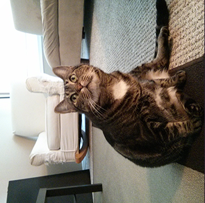

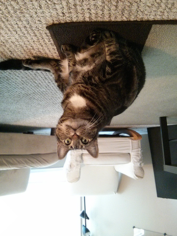

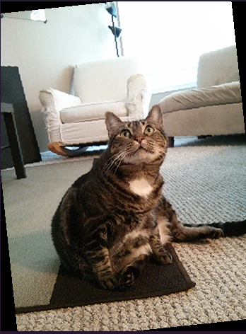

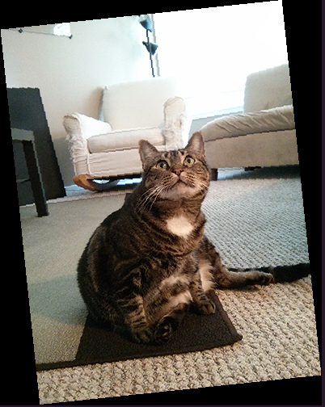

El mètode `rotate()` té l'argument opcional `expand`, que es pot establir a `True` per a ampliar les dimensions de la imatge i que s'ajuste a tota la nova imatge rotada.

Recordeu que, una vegada finalitzem el tractament de les imatges, és convenient tancar tots els objectes `Image`.

``` python
#Tanca totes les imatges
mosaic_gat.close()
imatge_reduida.close()
copia_gat.close()
imatge_cara.close()
imatge_gat.close()
```

## 8.4 Creació de gràfics

La biblioteca *Matplotlib* permet crear una àmplia varietat de gràfics (gràfics de línies, de barres, de dispersió, circulars bàsics, 3D …). Podeu trobar la documentació completa en [https://matplotlib.org](https://matplotlib.org). Depenent del Sistema Operatiu i la configuració de *Python*, haureu de seguir uns passos per a la [instal·lació](https://matplotlib.org/stable/install/index.html) de *Matplotlib*.

### Línies i Dispersió

Un gràfic de línies és ideal per a mostrar els canvis en una mesura al llarg del temps. En *Matplotlib*, els termes `plot`, `graph` i `chart` s'usen indistintament, i el terme `figure` es refereix a la finestra que conté un o més gràfics.

Importem `matplotlib.pyplot` amb el nom `plt` per a facilitar la introducció de les seues funcions.

A continuació, per a representar els **punts de dades en una figura 2D**, hem de cridar a la funció `plt.plot()`. Primer associarem al gràfic els valors per als eixos horitzontal/vertical guardats en `x` i `y1`. Després de cridar a `plt.plot()` amb aquests valors, l'invoquem una segona vegada amb `x` ​​i `y2` per a afegir una segona línia al gràfic.

``` python
import matplotlib.pyplot as plt
x = [0, 1, 2, 3, 4, 5]
y1 = [10, 13, 15, 18, 16, 20]
y2 = [9, 11, 18, 16, 17, 19]
plt.plot(x, y1)
plt.plot(x, y2)
# Per guardar un fitxer d'imatge del gràfic, heu de cridar 
# plt.savefig() abans de cridar a plt.show()
plt.savefig('linies.png')  
plt.show() 
```

*Matplotlib* seleccionarà automàticament els colors de les línies i una grandària adequada per al gràfic. Podem guardar el gràfic predeterminat com una imatge PNG cridant a `plt.savefig()`.

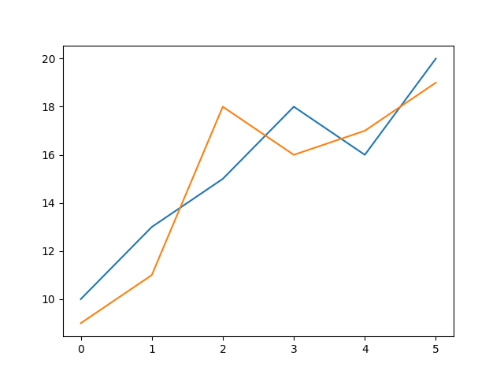

*Matplotlib* compta amb la funció `plt.show()` de vista prèvia que mostra el gràfic en una finestra. Cal remarcar que, si volem guardar el gràfic, hem de fer-ho abans de cridar a la funció `plt.show()`. La crida a la funció bloquejarà l'execució del codi i no tornarà fins que l'usuari tanque la finestra.

Per a crear un **gràfic de dispersió** d'aquestes mateixes dades, passeu els valors de l'eix `x` i de l'eix `y` a la funció `plt.scatter()`.

``` python
# Gràfica Scatter
plt.scatter(x, y1)
plt.scatter(x, y2)
plt.savefig('scatter.png')
plt.show()
```

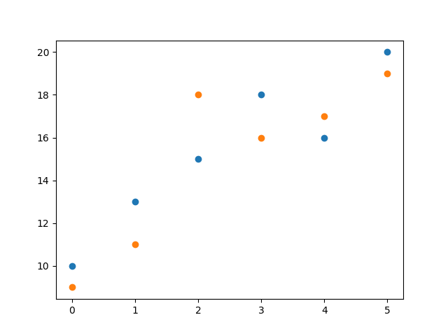

### Barres i gràfics circulars

Els **gràfics de barres** són útils per a comparar el mateix tipus de dades en diferents categories. A diferència d'un gràfic de línies, l'ordre de les categories no és important, encara que solen estar ordenades alfabèticament.

``` python
# Barres
categories = ['Gats', 'Gossos', 'Ratolins', 'Pardals']
valors = [100, 150, 30, 200]
plt.bar(categories, valors)
plt.savefig('barres.png')
plt.show()
```

Passem les categories a enumerar en l'eix `x` com la primera llista a `plt.bar()` i els valors per a cada categoria com la segona llista.

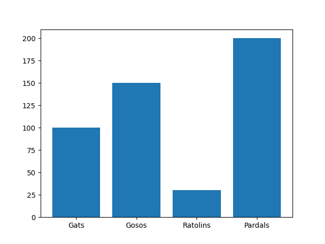

Per a crear un gràfic circular, utilitzarem la funció `plt.pie()`. En lloc de categories i valors, un gràfic circular té sectors i etiquetes. La funció `plt.pie()` accepta una llista de grandàries de porció i una llista d'etiquetes per a cada porció.

``` python
# Gràfic Circular
porcions = [100, 150, 30, 200]  # El tamany de cada porció
etiquetes = ['Gats', 'Gossos', 'Ratolins', 'Pardals'] 
plt.pie(porcions, labels=etiquetes)
plt.savefig('tarta.png')
plt.show()
```

El primer argument posicional de `plt.pie()` fa referència a les porcions `x` (`porcions` en aquest exemple), però el segon no fa referència a les etiquetes, sinó a l'atribut `explode`, per la qual cosa per a assignar els valors d'`etiquetes` a l'atribut `labels` del `plt.pie()` hem d'especificar-ho en la crida a la funció. 
Podeu consultar els detalls dels diferents paràmetres de `plt.pie()` en la seua [documentació oficial](https://matplotlib.org/stable/api/_as_gen/matplotlib.pyplot.pie.html).

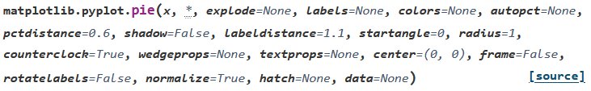


Entre la gran diversitat d'atributs que podem modificar per a obtindre el gràfic desitjat, l'atribut `autopct` ens permet mostrar el valor de cada porció com un % respecte del total.

``` python
plt.pie(porcions, labels=etiquetes, autopct='%.1f%%')
plt.savefig('tartaX100.png')
plt.show()
```

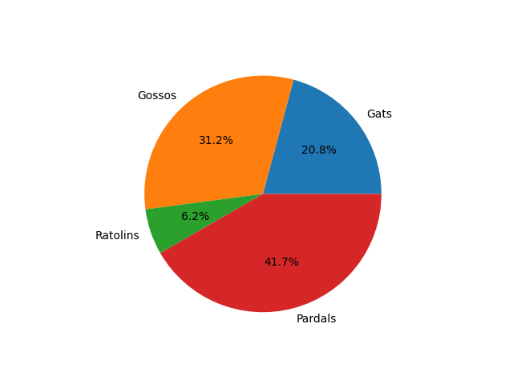

L'atribut és una cadena d'especificació de format: la cadena `'%.1f%%'` especifica que el nombre ha de mostrar un dígit després del punt decimal i després del decimal es mostra el símbol de % (la cadena `'%.1f'` mostraria el mateix valor, però sense el símbol de % final).
