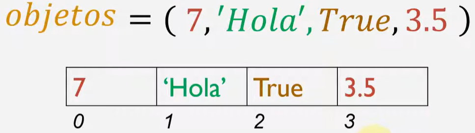

# 8. Tipus avançats
A més de les llistes que ja hem vist, *Python* ofereix altres tipus avançats de dades que vorem a contianució.

## 8.1 *Tuples*
Les *tuples* són unes col.lecions de dades com les llistes però, una vegada declarades, no es poden modificar → **immutables**

### Característiques
- Els seus elements van declarats entre parèntesis `( )`, a diferència que les llistes, on es declaren  entre `[ ]`
- Són **ordenades**
- Suporten indexació i *slicing* (igual que fem amb les llistes)
- No es poden afegir o eliminar elements (inmutables)
- Es poden **niar** → una *tupla* pot contenir altres *tuples*

<br>
<div style="display: flex; justify-content: center; align-items: center; gap: 10px;">
        
</div>
<br>

```python
mesosAny = ("Gen", "Feb", "Mar", "Abr", "Mai", "Jun", "Jul", "Ago", "Set", "Oct", "Nov", "Des")
print(mesosAny[1])           # accés al segon element
print(mesosAny[-1])          # accés a l'últim element
print(mesosAny[:3])          # slicing
print(mesosAny[:10:2])       # slicing
mesosAny[0] = 8        # ERROR, no podem modificar
```
```text
Feb
Des
('Gen', 'Feb', 'Mar')
('Gen', 'Mar', 'Mai', 'Jul', 'Set')
TypeError: 'tuple' object does not support item assignment
```

### Operacions bàsiques amb *tuples*
Les llistes i les *tuples* compartixen gran part d'aquestes operacions bàsiques: concatenació, repetició ...

```python
tupla1 = (-5, 23, 8, 11, -45, 23, 13, -7)          
tupla2 = (6,)         # tupla d'un sol element, cal posar la coma!
print(tupla2)
tupla3 = tupla1 + tupla2     # concatenar tuples
print(tupla3)   
print(tupla2 * 3)            # repetir la tupla 3 vegades
print("Mai" in mesosAny)     # retorna True
```
```text
(6,)
(-5, 23, 8, 11, -45, 23, 13, -7, 6)
(6, 6, 6)
True
```

Igualment, la majoria dels mètodes propis de les llistes també estan disponibles per a les *tuples*. Per exemple podem destacar:

- `len()`: retorna el tamany de la *tupla*
- `max()` `min()` `sum()`: només per a *tuples* amb elements compatibles
- `tupla.count(element)`: compta el nombre de vegades que un determinat `element` està en la *tupla*
- `tupla.index(element)`: retorna la posició de l'`element` dins la *tupla*, el primer que trobe
- `tupla.index(element, posicio)`: retorna la posició de l'`element` dins la *tupla*, a partir d'una determinada posició

```python
print(len(tupla3))    # nombre d'elements
print(max(tupla3))    # si els valors són compatibles
print(min(tupla3))    # si els valors són compatibles
print(sum(tupla3))    # si els valors són compatibles
tupla4 = (4, 2, 'u', 'ww', 2, -5)
print(sum(tupla4))    # ERROR, no podem sumar
print(tupla1.count(23))      # comptar ocurrències
print(tupla1.index(23))      # posició d'un valor
print(tupla1.index(23, 3))   # a partir de la posició 3
```
```text
9
23
-45
27
TypeError: unsupported operand type(s) for +: 'int' and 'str'
2
1
5
```

### Conversions, desempaquetat i recorregut

Podem **convertir** llistes a *tuples* utilitzant el mètode `tuple()` i fer-ho al contrari amb el mètode `list()`.
```python
llista = ["poma", "plàtan", "cirera"]
fruites = tuple(llista)     # convertir una llista en tupla
llista_ordenada = sorted(fruites)   # retorna una llista ordenada
nova_llista = list(fruites)  # convertir una tupla en llista
print(fruites)
print(llista_ordenada)
print(nova_llista)
```
```text
('poma', 'plàtan', 'cirera')
['cirera', 'plàtan', 'poma']
['poma', 'plàtan', 'cirera']
```

El **desempaquetat** és l'utilitat de *Pyhton* que permet extraure el contingut d'una *tupla* a diferents variables en una sola comanda. Si el nombre de variables a l'esquerra de l'assignació no es correspon amb el nombre d'elements de la *tupla*, obtindrem un error `ValueError: too many values to unpack`.

```python
a, b, c = fruites   # desempaquetat
print(b)  # --> plàtan
```

Per a ***recòrrer*** una *tupla* i gestionar el seu contingut, ho podem fer com amb qualsevol element iterable: p.e. amb bucles `for`.
```python
for t in fruites: print(t)     # recorregut de la tupla
for i in range(len(fruites)):
    print(str(i+1)+ ' - ' + fruites[i])     #  i varia de 0 a len(fruites)
```
```text
poma
plàtan
cirera
1 - poma
2 - plàtan
3 - cirera
```

### Mutabilitat dels elements

Havem explicat al principi que les *tuples* són inmutables, però **els elements que contenen sí que poden ser mutables**. És a dir, que podríem dir que les *tuples* són mutables i immutables a la vegada.

Per exemple, una llista dins d'una *tupla* sí que pot canviar:

```python
tupla = (-5, 23, 8, llista, -45, 23, 13, -7)
print(tupla)
tupla[3][1] = 'taronja'
print(tupla)
```
```text
(-5, 23, 8, ['poma', 'plàtan', 'cirera'], -45, 23, 13, -7)
(-5, 23, 8, ['poma', 'taronja', 'cirera'], -45, 23, 13, -7)
```

### Quan usar *tuples* en lloc de llistes?

1. Quan les dades no han de canviar. Exemple: coordenades, dies de la setmana
2. Quan es busca més eficiència. Les *tuples* consumeixen menys memòria i són més ràpides
3. Quan es necessiten dades *hashables*. Per exemple les *tuples* es poden usar com a claus en diccionaris (vorem més endavant el que és), les llistes no

---
## 8.2 Sets (conjunts)
Els *sets* són també una col.leció de dades com les llistes i les *tuples*, però amb unes particularitats que vorem a continuació.

### Característiques
- Els seus elements van declarats entre claus `{ }`
- **Elements únics:** en un *set* no pot haver-hi duplicats
- **No ordenats:** els elements no tenen un ordre específic dins el *set*
- **Mutables:** es poden afegir o eliminar elements
- **Els elements que conté han de ser immutables:** podem afegir o llevar elements, però no modificar un element concret (p.e. no pot incloure llistes, ja que aquestes són mutables)

```python
conjunt_buit = set()   
coses = {'a', 1, 2, 2, 3, 'vd', 'a', -5} # Elimina duplicats
print(coses)               
conjunt = set([1, 2, 3, 3])  # Convertir una llista en conjunt
print(conjunt)
```
```text
{1, 2, 'a', 3, -5, 'vd'}
{1, 2, 3}
```

Com que els elements no tenen una posició específica, quan s'imprimeix un *set* o s'itera sobre ell, l'ordre dels elements mostrat pot ser diferent del que es va utilitzar en crear-lo.

Dos execucions de `print(coses)` poden mostrar els elements en un ordre diferent:

```text
{'vd', 1, 2, 3, -5, 'a'}

{1, 2, 3, 'vd', -5, 'a'}
```

### Modificació de sets
Com que els *sets* no estan ordenats, no podem indexar els seus elements com ho fem amb les llistes per a modificar-los `llista[3] = 44`. Per a gestionar el conjunts disposem de mètodes propis, entre els que podem destacar:

- `conjunt.add(element)`: afegeix un `element` al *set* 
- `conjunt.update([e1,e2,e3...])`: afegir elements d'una llista "un a un" (cada element de la llista en una nova posició del *set*)
- `conjunt.remove(element)`: elimina l'`element` referenciat. Dona error si l'`element` no existeix dins el conjunt.
- `conjunt.discard(element)`: elimina l'`element` referenciat, però en aquest cas no dona error si no existeix

```python
conjunt.add(4)                 # afegix el nombre 4
conjunt.add((5, 'e', 6))       # afegix la tupla (5, 'e', 6)
print(conjunt)

conjunt.update([3,'w',7,8])    # afegix elements d'una llista 
# El 3 no s'afegix perque ja existeix en el conjunt
print(conjunt)

conjunt.remove(2)              # elimina el 2
conjunt.discard('w')           # elimina la 'w' 
conjunt.discard('paco')        # no dona error 
print(conjunt)
```

```text
{1, 2, 3, 4, (5, 'e', 6)}
{1, 2, 3, 4, (5, 'e', 6), 7, 8, 'w'}
{1, 3, 4, (5, 'e', 6), 7, 8}
```

### Com recórrer un set?

Exactament igual que es fa amb les llistes i les tuples.

```python
conjunt = {1, 2.5, "hola", (1, 2)}
for element in conjunt:
    print(element)
```
```text
1
2.5
(1, 2)
hola
```
Recorda que, al ser una col.lecció no ordenada, quan recorrem un *set* podem obtindre els resultats en un ordre diferent en cada execució. Fes la prova amb el codi anterior i voràs com cada vegada el `for` mostra els elements en un ordre diferent.

---
## 8.3 Python comprehension (Comprensió)

La comprensió de *Python* és una manera concisa i eficient de crear col.leccions a partir d'iterables, modificant i/o filtrant el seu contingut.

```python
resultat = [expressió for element in iterable if condició]
```
  - `expressió`: operació o transformació aplicada a cada element
  - `element`: variable que pren els valors de l'iterable en cada iteració 
  - `iterable`: objecte iterable (llista, *tupla*, rang, *set*, etc.)
  - `condició` (opcional): filtra els elements

### Exemples
Crear una llista de quadrats a partir d'un rang de nombres.
```python
quadrats = [x**2 for x in range(10)]
print(quadrats)     # Llista  
```

```text
[0, 1, 4, 9, 16, 25, 36, 49, 64, 81]
```
<br>

Filtrar els nombres parells d'un *set* i guardar-los en una llista.
```python
nombres = {0, 21, 44, 8, 7, 13, 50, 4, 16, 23, 12, 9}     # Set
parells = [x for x in nombres if x % 2 == 0]
print(parells)      # Llista 
```
```text
[0, 4, 8, 44, 12, 16, 50]
```
<br>

Convertir les paraules d'una *tupla* a majúscules i guardar-les en una llista. Fer després el mateix però guardant-les en un *set*, on s'eliminen duplicats i els elements queden desordenats.

```python
paraules = ("hola", "món", "hola", "python")    # Tupla
majuscules = [paraula.upper() for paraula in paraules]
print(majuscules)   # Llista  

majuscules = {paraula.upper() for paraula in paraules}
print(majuscules)   # Set   
```

```text
['HOLA', 'MÓN', 'HOLA', 'PYTHON']
{'MÓN', 'PYTHON', 'HOLA'}
```


---
## EXERCICIS
### 1. Exercici amb *tuples* i *sets*
Una biblioteca escolar vol gestionar els llibres i els socis. 

Cada llibre es guarda com una *tupla* `(títol, autor, any)`:
```python
llibre1 = ("Mirall trencat", "Mercè Rodoreda", 1974)
llibre2 = ("La plaça del Diamant", "Mercè Rodoreda", 1962)
llibre3 = ("Solitud", "Víctor Català", 1905)
```
1. Mostra el títol de `llibre1` accedint-hi per la posició
2. Mostra l’últim element de `llibre3` utilitzant un índex negatiu
3. Fes un desempaquetat de `llibre2` en tres variables `titol, autor, any` i imprimeix: "La plaça del Diamant va ser escrit per Mercè Rodoreda el 1962"
4. Crea una llista amb els tres llibres i ordena-la per llibre

Dos grups de socis han fet préstecs aquesta setmana:
```python
grup_a = {"Marta", "Pau", "Anna", "Joan", "Laia"}
grup_b = {"Pau", "Laia", "Jordi", "Núria", "Marc"}
```
5. Afegeix "Clara" al `grup_a` i elimina "Joan"
6. Comprova si "Marc" és al `grup_b`
7. Intenta eliminar "Àngel" del `grup_b` sense que et done error

**SOLUCIÓ** 
```python
# Part 1
print(llibre1[0])                  
print(llibre3[-1])                 
titol, autor, any = llibre2
print(f"{titol} va ser escrit per {autor} el {any}")
llibres = [llibre1, llibre2, llibre3]
print(sorted(llibres))

# Part 2
grup_a.add("Clara")
grup_a.remove("Joan")
print("Marc" in grup_b)            
grup_b.discard("Àngel")
```

### 2. Exercicis sobre Python comprehension
#### A. Primers passos
A partir de la següent llista:
```python
nombres = [1, 2, 3, 4, 5, 6, 7, 8, 9, 10]
```

1. Crea una llista amb el doble dels nombres senars
2. Crea una llista amb els nombres més grans que 5
3. Reescriu amb una list comprehension aquest bucle for:
```python
resultat = []
for n in nombres:
    resultat.append(n + 10) 
```

**SOLUCIÓ** 
```python
print([n * 2 for n in nombres if n % 2 != 0])
print([n for n in nombres if n > 5])
print([n + 10 for n in nombres])
```

#### B. Treballant amb text
A partir de la següent llista:
```python
noms = ["marta", "pau", "anna", "joan", "laia", "jordi"]
```
1. Crea una llista amb els noms en majúscules
2. Crea una llista amb la longitud de cada nom
3. Crea una llista amb els noms que tenen més de 4 lletres
4. Crea una llista amb la primera lletra de cada nom, en majúscula (["M", "P", ...])

**SOLUCIÓ** 
```python
print([nom.upper() for nom in noms])
print([len(nom) for nom in noms])
print([nom for nom in noms if len(nom) > 4])
print([nom[0].upper() for nom in noms])
```

#### C. Productes de la botiga
Una botiga en línia vol processar les seves dades. Cada producte és una tupla `(nom, preu, estoc)` dins la llista `productes`:
```python
productes = [
    ("Teclat", 25.0, 10),
    ("Ratolí", 12.5, 0),
    ("Monitor", 150.0, 4),
    ("Auriculars", 40.0, 0),
    ("Webcam", 30.0, 7),
]
```
1. Crea una llista amb només els noms dels productes
2. Crea una llista amb els noms dels productes disponibles (estoc > 0).
3. Crea una llista amb els preus amb un 21 % d’IVA afegit, arrodonits a 2 decimals (round()).
4. Crea una llista amb els noms dels productes que costen menys de 35 €.
5. Crea una llista de cadenes amb el format "Teclat: 25.0 €" per a cada producte

*PISTA:* Utilitza el desempaquetat de les *tuples* dins el `for` per a obtenir els 3 conceptes de cada producte per separat `for nom, preu, estoc in productes`.

**SOLUCIÓ** 
```python
print([nom for nom, preu, estoc in productes])
print([nom for nom, preu, estoc in productes if estoc > 0])
print([round(preu * 1.21, 2) for nom, preu, estoc in productes])
print([nom for nom, preu, estoc in productes if preu < 35])
print([f"{nom}: {preu} €" for nom, preu, estoc in productes])
```