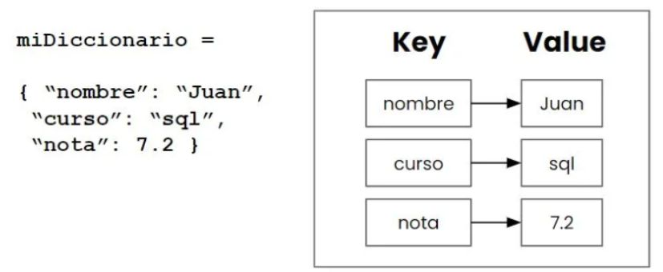

# 9. Diccionaris
Un diccionari és una col.lecció de dades que guarda la informació en parelles **clau → valor**. En lloc d’accedir al valor d'un element per la seva posició (com en una llista), hi accedixes per la seva **clau**.


<div style="display: flex; justify-content: center; align-items: center; gap: 10px;">
        
</div>


## 9.1 Característiques
- Els seus elements van declarats entre claus `{ }`, separant els elements amb comes `,`
- Cada element està format per una parella `clau : valor`
- Són **mutables**
- **No permeten claus duplicades**
  - Si s'afegix una clau repetida, el seu valor serà sobreescrit
- Les **claus** han de ser **immutables**
  - Poden ser `str`, `int`, `tuple`, però no `list` o `dict`.
- En el cap **valor** es pot guardar qualsevol tipus de dades (mutables o immutables)
- Els seus elements `clau : valor` mantenen l'ordre d'inserció

**Exemple**
```python
dic = {}  # Diccionari buit
persona = {"nom": "Carlos",
           "edat": 30,
           "ciutat": "Madrid"}
print(persona)
print(persona["nom"])  # Accedeix al valor d'una clau.
```

```text
{'nom': 'Carlos', 'edat': 30, 'ciutat': 'Madrid'}
Carlos
```

## 9.2 Modificació / accés
Podem afegir noves parelles clau/valor utilitzant la nomenclatura `diccionari[clau] = valor`.
Si una clau ja existeix, la modificarà.

El mètode `diccionari.update({ })` ens permet afegir/modificar vàries parelles clau/valor a la vegada.

```python
dic = {}  # Diccionari buit
dic["ies"] = "teulada"          # Afegir una nova clau
dic["provincia"] = "alacant"    
dic["provincia"] = "california" # Modificar el valor d'una clau existent

dic.update({"telefon": 965739045, "estudis": ['ESO', 'BAT', 'FP']})
print(dic)

nom = dic["ies"]  # Accedir a un valor (error si no existeix)
print(nom)
```

```text
{'ies': 'teulada', 'provincia': 'california', 'telefon': 965739045, 'estudis': ['ESO', 'BAT', 'FP']}
teulada
```

Podem eliminar elements d'un diccionari de vàries formes:
- `del diccionari[clau]`: Elimina una clau i el seu valor
- `diccionari.pop[clau]`: Retorna el valor de la clau i després elimina l'element
- `diccionari.clear()`: Buida el diccionari


```python
del dic["provincia"]
print(dic)
estudis = dic.pop("estudis")
print(dic)
print(estudis)
dic.clear()
print(dic)
```

```text
{'ies': 'teulada', 'telefon': 965739045, 'estudis': ['ESO', 'BAT', 'FP']}
{'ies': 'teulada', 'telefon': 965739045}
['ESO', 'BAT', 'FP']
{}
```

## 9.3 Mètodes particulars i iteracions
Donada la particular estructura dels diccionaris, aquests disposen d'una sèrie de mètodes propis que ens ajuden a gestionar les dades emmagatzemades en ells:

- `diccionari.keys()`: Retorna un `objecte` de tipus `dict_keys` (no una llista , string, *tupla* ...). Aquest `objecte` conté **totes les claus** del diccionari
- `diccionari.values()`: Retorna un `objecte` de tipus `dict_values`que conté **tots els valors** del diccionari
- `diccionari.items()`: Retorna un `objecte` de tipus `dict_items`que conté totes les parelles `(clau,valor)`

Si fem un `print()` d'aquestos objectes propis dels diccionaris vorem que no se'ns mostren com una llista, fet que ens ha de fer pensar que no podem tractar-los d'igual forma.

```python
persona = {"nom": "Carlos", 
           "edat": 30, 
           "ciutat": "Madrid"}
claus = persona.keys()     # objecte dict_keys
print(claus)
valors = persona.values()  # objecte dict_values
print(valors)
items = persona.items()    # objecte dict_items
print(items)
```
```text
dict_keys(['nom', 'edat', 'ciutat'])
dict_values(['Carlos', 30, 'Madrid'])
dict_items([('nom', 'Carlos'), ('edat', 30), ('ciutat', 'Madrid')])
```

Els `objectes` retornats pels mètodes `.keys()`, `.values()` i `.items()` podem utilitzar-los, per exemple, per a iterar sobre els diccionaris (recórrer-los).

```python
for clau in persona.keys():
    print(clau)
  
for valor in persona.values():
    print(valor)
  
for clau, valor in persona.items():
    print(clau, valor)
```
```text
nom
edat
ciutat
```

```text
Carlos
30
Madrid
```

```text
nom Carlos
edat 30
ciutat Madrid
```

Podem simplificar el `for` si el que volem és iterar sobre les claus (serà el més habitual). Si es pasa directament el diccionari al bucle `for`, aquest iterarà sobre les seues claus. 

```python
print('Les parelles clau/valor són:')
for clau in persona:
    print(clau, ' --> ', persona[clau])
```
```text
Les parelles clau/valor són:
nom  -->  Carlos
edat  -->  30
ciutat  -->  Madrid
```

Per tant, `for clau in persona.keys():` és equivalent a `for clau in persona:`.


## 9.4 Operacions agregades (`in`, `len`, `max`, `min`, `sum`)
Les operacions agregades de *Python* poden utilitzar-se sobre els diccionaris. Moltes d'aquestes operacions treballen per defecte sobre les **claus** (`max`, `min`, `sum`). Si el que es vol és treballar amb els **valors**, s'ha d'utilitzar `.values()`.

```python
edats = {"Anna": 20,
         "Pere": 25,
         "Joan": 18   }
print(max(edats))                # "Pere"
print(max(edats.values()))       # 25
print(min(edats.values()))       # 18
print(sum(edats.values()))       # 63
"Pere" in edats                  # True → busca entre les claus
25 in edats                      # False → NO busca entre els valors
25 in edats.values()             # True → busca entre els valors
```
---
## Exercici: La Rebel·lió 🌌

<div style="display: flex; justify-content: center; align-items: center; gap: 10px;">
        
</div>

L’Aliança Rebel ha perdut part dels seus arxius i necessita la teua ajuda per reconstruir-los. Treballaràs amb **diccionaris** per gestionar la informació dels personatges de la galàxia.

### Part 1: Creació de diccionaris

**1.1.** Crea dos diccionaris, anomenats `luke` i `vader`, amb les dades següents:

| **Clau**              | **Valor (luke)** | **Valor (vader)** |
|-----------------------|------------------|---------------|
| `nom`                   | "Luke Skywalker" | "Darth Vader" |
| `planeta`               | "Tatooine"       | "Tatooine"    |
| `bandol` (sense accent) | "Rebel·lió"      | "Imperi"      |
| `edat`                  | 19               | 45            |
| `arma`                  | "Sabre làser"    | "Sabre làser" |

**1.2.** Crea una **llista** anomenada `personatges` que continga els dos diccionaris anteriors.

### Part 2: Modificació de diccionaris

**2.1.** Han passat els anys i ara Luke té 35 anys. Actualitza el diccionari `luke`.

**2.2.** Afegeix una nova clau `rang` al diccionari `luke` amb el valor "Mestre Jedi".

**2.3.** Afegeix una nova clau `rang` al diccionari `vader` amb el valor "Lord Sith".

**2.4.** Vader s’ha redimit! Canvia el valor de `bandol` a "Rebel·lió".

**2.5.** Elimina la clau `arma` del diccionari `vader`.

### Part 3: Extracció de dades

**3.1.** Mostra per pantalla el nom i el planeta de Luke amb aquest format:

```text
Luke Skywalker ve de Tatooine
```

**3.2.** Mostra totes les **claus** del diccionari `luke`.
```text
dict_keys(['nom', 'planeta', 'bandol', 'edat', 'arma', 'rang'])
```

**3.3.** Mostra tots els **valors** del diccionari `luke`.

```text
dict_values(['Luke Skywalker', 'Tatooine', 'Rebel·lió', 35, 'Sabre làser', 'Mestre Jedi'])
```

**3.4.** Recorre el diccionari `luke` amb un bucle `for` i mostra cada parella clau-valor així:

```text
nom: Luke Skywalker
planeta: Tatooine
etc ...
```

**3.5.** Intenta obtenir la clau `nau` del diccionari `vader` utilitzant `.get()`, de manera que si no existeix mostre el missatge `"Sense nau assignada"` en lloc de donar error.

**3.6.** Recorre la llista `personatges` i mostra només el nom dels personatges que **siguen de la Rebel·lió**.

### Bonus ⭐

Crea un diccionari `naus` on la clau siga el nom del pilot i el valor siga el nom de la nau:

| **Clau**              | **Valor** |
|-----------------------|------------------|
| `Luke`                   | "X-Wing" |
| `Han`               | "Falcó Mil·lenari"       |
| `Vader`  | "TIE Advanced"      |


Després, demana a l’usuari un nom amb `input()` i mostra la seua nau. Si el pilot no existeix, mostra "Pilot desconegut".
