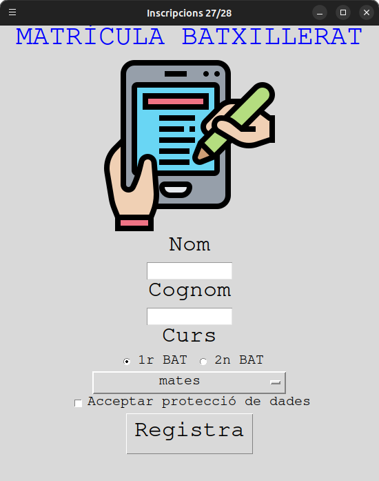
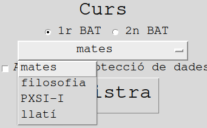
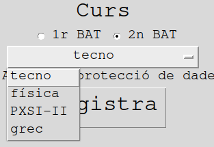
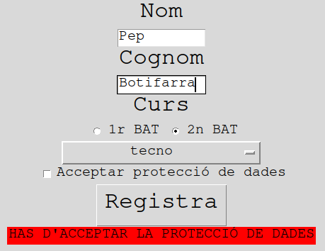
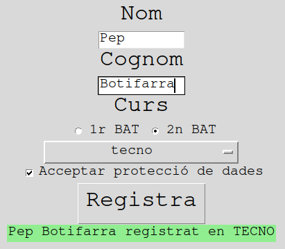

# Activitat guizero: Inscripcions de matrícula de Batxillerat

## Context i objectiu

Construir un formulari de matrícula de Batxillerat que reacciona a les accions de l'usuari: canvia la llista d'assignatures segons el curs i valida l'acceptació de la protecció de dades abans de registrar.

## Especificacions de la interfície

Caldrà que imiteu el resultat anterior, amb llibertat per a:

- triar la imatge que vulgueu
- la tipologia de lletra (ha de ser diferent de la de per defecte) 
- la llista de les assignatures que preferiu

Respecteu els textos, les mides i els colors. El tamany de la GUI ha de quadrar amb el contingut.

Per a realitzar aquest exercici, és molt probable que hàgeu de consultar la documentació oficial dels [ginys de guizero](https://lawsie.github.io/guizero/widgetoverview/#overview).

### Dades inicials
L'alumnat podrà triar entre assignatures de 1r o de 2n de batxillerat. Quan canvie l'opció, la llista del desplegable que es troba a continuació haurà de canviar.

        
    

**Pistes:**
- S'executa cada vegada que l'usuari canvia de curs
- Buida el desplegable amb `clear()`
- Si el curs és 1r, afegix al desplegable les assignatures de 1r
- En cas contrari, les assignatures de 2n

### Registre de l'assignatura
Quan l'usuari aprete el botó de registre:
- Es mostrarà el missatge `HAS D'ACCEPTAR LA PROTECCIÓ DE DADES`, si el *checkbox* no està marcat
- Si està marcat, es mostrarà el text `[alumne] registrat en [assignatura]` 

**Especificacions**
- El fons del text serà roig si no es marca la casella i verd si està marcada
- El nom de l'assignatura apareixerà en majúscules (però no en el `Combo`)

        
    

## Consells
1. Fixeu la tipografia i la mida de text general per a `app`, i després ja augmenteu la mida dels ginys que ho necessiten
2. En la creació dels ginys, assigneu-los a una variable per a posteriorment poder:
    - referenciar-los en altres ginys
    - accedir als seus valors mitjançant `.value`
    - modificar-los accedint a les propietats i mètodes particulars de cada giny
3. El nom d'aquestes variables haurien d'incloure en tipus de giny al qual fan referència perquè siguen fàcils d'identificar en el codi i les confongueu amb altres variables que siguen llistes o noms de funcions. Per exemple:
    - `dades_cb`: fa referència a un **c**heck**b**ox
    - `registre_bt`: fa referència a un **b**u**t**ton
4. Definiu les 2 llistes d'assignatures abans de l'`App` i treballeu directament amb aquestes
5. Escriviu una funció i associeu-la al `ButtonGroup` amb `command`. Comproveu que en canviar de curs canvien les assignatures
6. De la mateixa forma, escriviu una funció i associeu-la al botó per a gestionar el color i contingut del missatge final

## Ampliacions opcionals

Si heu acabat abans, afegiu una o més d'aquestes millores.

1. **Validació de camps buits.** Si el nom o el cognom estan buits, mostreu un missatge d'error en roig i no registreu l'alumne
2. **Neteja després del registre.** Buideu els quadres de text i desmarqueu la casella quan el registre siga correcte
3. **Segona assignatura.** Afegiu un segon `Combo` perquè l'alumne puga triar una assignatura optativa i mostreu les dos al missatge final.
4. **Comptador de registres.** Afegiu un `Text` que mostre el nombre d'alumnes registrats des que s'ha obert el programa.
5. **Gènere**: Incloeu un giny per a seleccionar el gènere de l'usuari i aixina modificar el missatge de registre: `registrat` o `registrada` 
6. **Disseny propi.** Canvieu colors, mides i la imatge per fer una versió pròpia, mantenint tota la funcionalitat.

