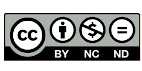

# 💻 Programació en Python 🐍️

Aquesta web està pensada per a ser una guia en els primers passos de la programació amb *Python*. El seu propòsit és proporcionar als estudiants una base sòlida i clara en els conceptes fonamentals del llenguatge. 

Al llarg dels seus apartats, s'abordaran des dels tipus de dades més bàsics i com manipular-los, fins a les estructures que permeten als nostres programes prendre decisions i repetir tasques. 

A continuació es mostrarà el maneig de col·leccions de dades (llistes, *tuples*, diccionaris...) i la creació i ús de funcions. S'explicarà l'estructuració de projectes en mòduls i es desenvoluparan xicotets exemples pràctics de tractament d'arxius CSV, imatges i gràfics.

[Començar →](0-intro.md)

---

        
    
    
    

---

