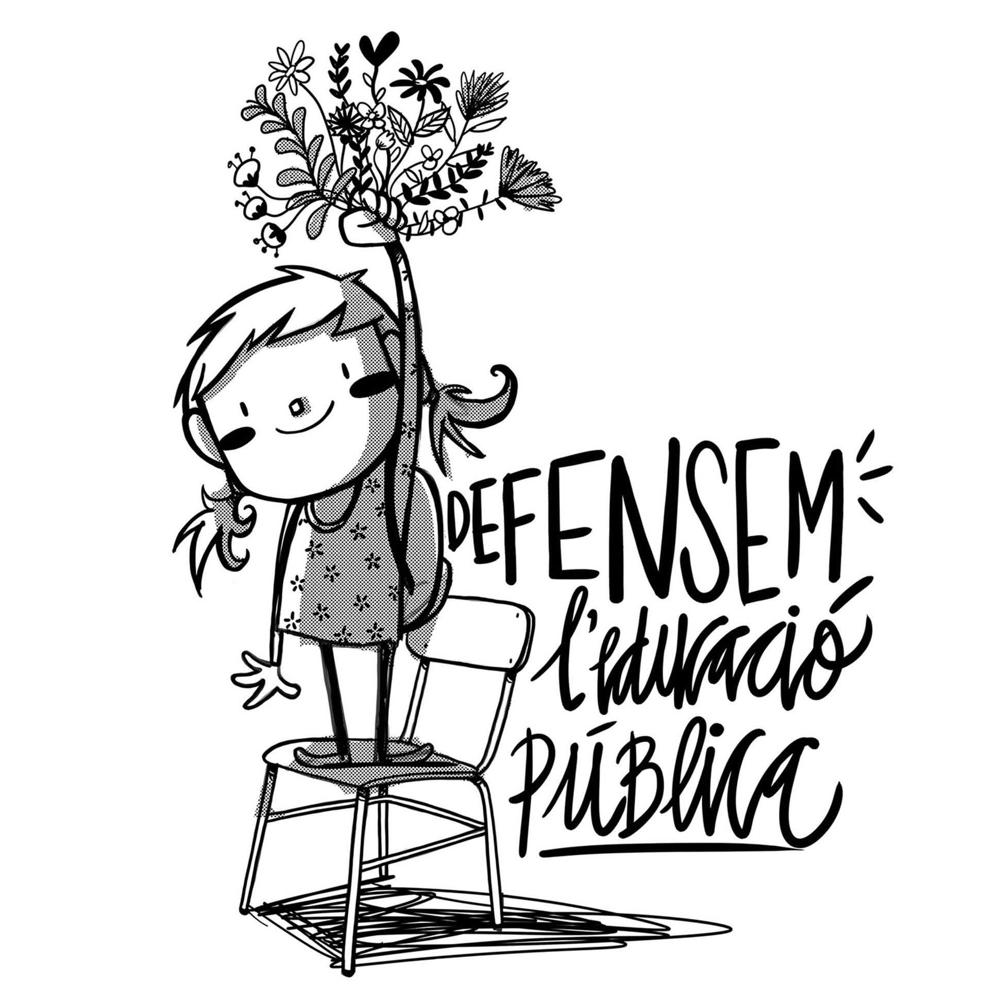

# 💻 Programación en Python 🐍️

Esta web está pensada para ser una guía en los primeros pasos de la programación con *Python*. Su propósito es proporcionar a los estudiantes una base sólida y clara en los conceptos fundamentales del lenguaje. 

A lo largo de sus apartados, se abordarán desde los tipos de datos más básicos y cómo manipularlos, hasta las estructuras que permiten a nuestros programas tomar decisiones y repetir tareas, culminando con el manejo de colecciones de datos (como las listas) y la creación y uso de funciones.

[Empezar →](0-introduccion.md)

---

        
    
    
    

---

